<sub>[⬅ All missions](../README.md) · [AM02 The Case of the Misrouted Cargo Droids ➡](../AM02-gateway-tool-routing/README.md)</sub>

<p align="center">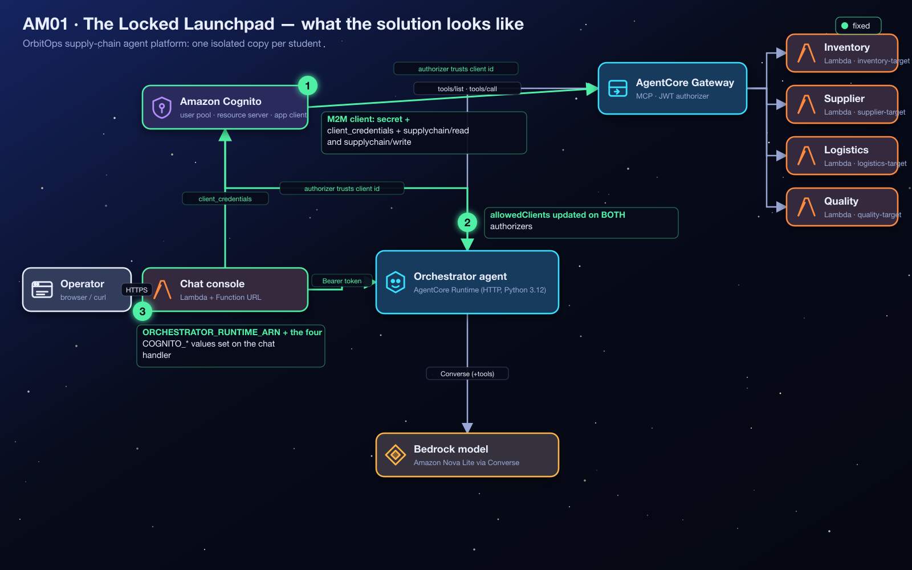</p>

# AM01 — Mission A: The Locked Launchpad — Solution Handout

> [!NOTE]
> **Answer key and debrief.** Open this after your Flight Test, or when your instructor calls time. It explains *what* to change and *why* the system behaves the way it does, so the lesson outlasts the lab. You do not need any AWS background: every term is explained before it is used. Console images in this guide are **real screenshots** from an instructor run on 2026-10-25, taken on a demo copy, so resource names read `demo-student00-…` where yours read `orbit-<your id>-…`. The console changes over time; if a label differs slightly, look for the same idea nearby.

**Contents:** [1 Mission recap](#1-mission-recap) · [2 Where you start](#2-where-you-start) · [3 Architecture explained](#3-architecture-explained) · [4 Concepts you need](#4-concepts-you-need-to-understand) · [5 Understanding the failure](#5-understanding-the-failure) · [6 Step-by-step solution](#6-step-by-step-solution) · [7 Verification](#7-verification) · [8 Troubleshooting](#8-troubleshooting) · [9 Key takeaways](#9-key-takeaways) · [10 Knowledge check](#10-knowledge-check) · [11 Exam angle](#11-exam-angle) · [12 Reflection answers](#12-reflection-questions-model-answers) · [13 Going further](#13-going-further-optional)

> [!TIP]
> **New to AWS?** Skim the vocabulary table below first. Every other term is explained where it first matters.

| Words you'll meet | In plain English |
|---|---|
| **AWS console** | The website where you view and change AWS resources by clicking. |
| **Terraform** | A tool that builds cloud resources from code files. Your instructor used it to create your environment; `terraform output` prints the values you were given. |
| **AWS Lambda** | A service that runs a small piece of code on demand, only when something calls it. |
| **IAM role** | An AWS identity that a service or program temporarily "wears" to get a specific, limited set of permissions (IAM = Identity and Access Management). |
| **ARN** | Amazon Resource Name: the full, unique address of an AWS resource, e.g. `arn:aws:lambda:us-west-2:123456789012:function:…`. |
| **AgentCore Runtime** | AWS's managed hosting service for AI agents; OrbitOps's agents run there. |
| **Trace** | The panel under each chat reply that shows what the agent did (tools, memory, guardrail, warnings). It is your main evidence. |
| **Bearer token, JWT, OAuth, scopes, JWT authorizer** | Explained step by step in §4; you do not need them before then. |
| **S3** | Amazon's file storage service; the agents' code packages are stored there. |

---

## 1. Mission Recap

**The app in one sentence:** OrbitOps is a chat website where cargo operators type questions ("*Check our cargo stock levels*") and an AI agent, the *flight controller*, answers them using company tools.

**What went wrong:** before the AI agent will listen to anyone, the caller must show a valid **access token** (a digital pass) from Amazon Cognito. During an "identity migration" three things broke, so the chat website can no longer get a pass, and even if it could, the agent and its tool gateway would not accept it. Every message ends with **⚠ Authentication service unavailable**.

| | |
|---|---|
| **Scenario** | The chat console cannot obtain or present a valid bearer token, so the flight controller is unreachable. |
| **Faults planted** | 3: a missing machine-to-machine (M2M) app client, two JWT authorizers trusting the wrong client id, and a wiped Lambda configuration. |
| **Services** | Amazon Cognito (user pool, resource server, app clients), Amazon Bedrock AgentCore Runtime and Gateway (custom JWT authorizers), AWS Lambda. |
| **The big idea** | A bearer token is *evidence*, and every hop that validates it is a *separate judge* with its own trust list. |
| **Time budget** | 40 minutes. Most students lose time on fault 2 because they fix one judge and not the other. |

<p align="center">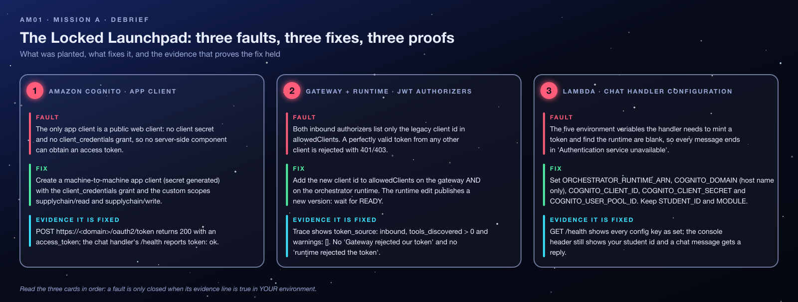</p>

---

## 2. Where You Start

Nothing in this mission is built from scratch. Your instructor ran **one** Terraform deployment (`AM01-cognito-oauth-launchpad/terraform/broken`) that created a complete, deliberately broken copy of OrbitOps **for every student** in one shared AWS account.

### 2.1 What you are given, and where it comes from

After deploying, the instructor runs `terraform output`. Every output is a *map keyed by student id* (for example `student07`), and you receive the entries for **your** id. The repository does not prescribe how the values reach you (a sheet, a chat message, a learning platform); if you do not have them, ask your instructor. You can also find every resource in the console by searching for your student id.

| Output | Example shape | What it is |
|---|---|---|
| `chat_urls[<you>]` | `https://abc123….lambda-url.us-west-2.on.aws/` | Your OrbitOps chat console. It is a **Lambda Function URL**: a public HTTPS address that runs your chat-handler Lambda directly. |
| `chat_function_names[<you>]` | `orbit-student07-am01-chat-handler` | The Lambda function behind that URL. |
| `cognito_user_pool_id` | `us-west-2_AbCdEfGhI` | The **shared** Cognito user pool (one for the whole class). |
| `cognito_domain` | `orbit-am01-12345678.auth.us-west-2.amazoncognito.com` | The pool's hosted domain. The token endpoint is `https://<domain>/oauth2/token`. |
| `cognito_discovery_url` | `https://cognito-idp.us-west-2.amazonaws.com/<pool id>/.well-known/openid-configuration` | The address every JWT authorizer uses to look up Cognito's public signing keys. |
| `legacy_client_ids[<you>]` | `3n4…` | The unusable app client the authorizers currently trust. |
| `gateway_ids[<you>]`, `gateway_urls[<you>]` | `orbit-student07-am01-gateway-…` | Your AgentCore Gateway (the tool front door). |
| `orchestrator_runtime_ids[<you>]`, `orchestrator_runtime_arns[<you>]` | `orbit_student07_am01_orchestrator-…` | Your AI agent's hosting environment in AgentCore Runtime. |

### 2.2 Region, permissions and naming

- **Region:** everything lives in **US West (Oregon), `us-west-2`**. A console set to another region shows *nothing*, which looks like "my resources are gone". Check the region selector first.
- **Permissions:** you need console (or CLI) access to Cognito app clients, Lambda configuration and Bedrock AgentCore. The instructor setup suggests a policy along the lines of `BedrockAgentCoreFullAccess` plus Lambda and Cognito app-client rights. Those permissions are broad, which leads to the next point.
- **Naming:** per-student resources are named `orbit-<student id>-am01-…` (hyphens) or `orbit_<student id>_am01_…` (underscores, for AgentCore runtimes, whose names cannot contain hyphens).

### 2.3 Sharing the account with classmates

| Shared by the whole class (do **not** modify) | Yours alone |
|---|---|
| Cognito user pool `orbit-am01-pool`, its hosted domain and the `supplychain` resource server | Your legacy app client and the M2M client you create |
| S3 code bucket `orbit-am01-<account id>` (agent code, tool schemas) | Chat-handler Lambda + its Function URL |
| Shared IAM roles for the chat Lambda and the tool Lambdas | Four tool Lambdas, gateway (+ its role and targets), orchestrator runtime (+ its role) |

> [!WARNING]
> **The pool is shared.** When you open *App clients* you will see every classmate's clients (by default the class has up to 22 students). Your permissions technically allow you to edit any of them, so the student id in the name is your only safeguard. Read it before every **Save**.

**Cost and cleanup:** you do not delete anything. The instructor destroys the stack, which deletes the pool and every app client in it. Cognito bills each M2M token request (fractions of a cent); the chat handler caches its token for up to an hour, so a lab session costs pennies. **Never share your chat URL:** its Function URL has no authentication of its own (`authorization_type = "NONE"`), so anyone who has it can drive your agent.

---

## 3. Architecture Explained

### 3.1 The cast of characters

| Component | What it does | Where its code runs | Analogy |
|---|---|---|---|
| **Browser page** | Shows the chat window, sends your message to `POST /chat`, draws the reply and the **trace** panel. | In *your* browser. The HTML and JavaScript are served by the chat-handler Lambda itself (`GET /`). | The front desk |
| **Chat handler** (AWS Lambda) | Serves the page, answers `GET /health`, and for each chat message: gets a token from Cognito, then calls the agent with it. Contains **no AI**. | AWS Lambda (Python 3.12), started on demand when its Function URL is hit. | The receptionist who phones upstairs for you |
| **Amazon Cognito** | Checks the app's credentials and issues **access tokens**. | Fully managed AWS service. | The security office that prints passes |
| **Orchestrator** (AgentCore Runtime) | The AI agent. It reasons with the Amazon Nova 2 Lite model and calls tools when needed. | Amazon Bedrock AgentCore Runtime: AWS runs `main.py` from a zip in S3 inside an isolated, AWS-managed environment. | The flight controller in the control tower |
| **AgentCore Gateway** | One controlled front door to all tools, speaking the **MCP** protocol (Model Context Protocol, a standard way for agents to list and call tools). | Fully managed AWS service. | The tool cage with a guarded door |
| **Tool Lambdas** ×4 | Inventory, supplier, logistics, quality: return (fictional) company data. | AWS Lambda, invoked by the gateway. | Specialist droids behind the cage |

> [!IMPORTANT]
> **The chat app is not the AI agent.** The browser page and the chat-handler Lambda are an ordinary web app: they pass messages along. The "intelligence" lives in a *separate* environment, AgentCore Runtime, which hosts the orchestrator. Lambda and AgentCore Runtime are two different places where code runs, and Mission A is about the trust between them.

### 3.2 The request, end to end

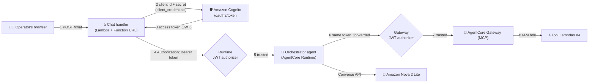

1. You type a message; the page sends it to the chat handler.
2. The chat handler asks Cognito for a token, proving *its own* identity with a client id and client secret.
3. Cognito returns a signed **access token**.
4. The chat handler calls the orchestrator's HTTPS address with `Authorization: Bearer <token>`.
5. Before your agent code runs, AgentCore Runtime's **JWT authorizer** checks the token. If it is not trusted, the request stops here.
6. The orchestrator's hosting configuration lets the `Authorization` header through to the agent (`request_header_allowlist = ["Authorization"]`), and the agent **forwards the same token** to the gateway when it needs tools.
7. The gateway's own JWT authorizer checks the token again, independently.
8. The gateway invokes the tool Lambda using its **IAM role**: a different kind of credential, explained in §4.6.

### 3.3 What happens when one part fails

| If this fails… | …you see | Who produced the message |
|---|---|---|
| Chat handler has no configuration | `⚠ Authentication service unavailable` + `missing environment configuration: …` | The chat handler's own Python code |
| Cognito refuses the credentials | `Authentication service unavailable` + `Cognito token endpoint returned 400: {"error":"invalid_client"}` | Cognito's error, relayed by the chat handler |
| Runtime authorizer refuses the token | `Authentication service unavailable` + `the orchestrator runtime rejected the token (HTTP 401/403 …)` | AgentCore Runtime's status code, worded by the chat handler |
| Gateway authorizer refuses the token | A normal-looking reply, but the trace shows `tools_discovered: 0` and a warning `gateway: Gateway rejected our token (401 or 403)` | The gateway's status code, worded by the orchestrator |

Notice the trap: **three different failures share the same headline.** The line *under* the headline (the `detail`) is what tells them apart.

---

## 4. Concepts You Need to Understand

Read this section in order: each idea builds on the previous one.

### 4.1 Identity basics

**① What Amazon Cognito is.** Applications constantly need to answer "who is calling me, and are they allowed?". Writing that logic yourself (storing passwords, signing tokens, rotating keys) is hard and risky. Amazon Cognito is AWS's managed identity service: it keeps the list of who (or what) may sign in and issues the digital passes they present elsewhere. *Analogy:* the security office of a large building.

**② Authentication vs authorization.** *Authentication* (**authN**) answers "**who are you?**" (proving identity). *Authorization* (**authZ**) answers "**what may you do?**" (checking permission). In this mission Cognito *authenticates* the chat app and writes its permissions onto the token; the AgentCore authorizers *authorize* by deciding whether to let the token holder in. A guard who recognises your face (authN) may still refuse you entry to the server room (authZ).

**③ User pool.** A Cognito *user pool* is one directory of identities plus the machinery to issue tokens for them: signing keys, a hosted domain with a token endpoint, scope definitions. Every token in this lab is signed by the pool `orbit-am01-pool`, and the pool's id appears inside every token as the *issuer*.

**④ App client.** An *app client* is a **registration** of one application with the pool: a record saying "this application exists, here is its id, here is what it may do". It is *not* a running program and it does not deploy anything. Creating one is like registering a delivery van with the security office: the paperwork exists, but no van has moved.

**⑤ Why one pool has many app clients.** Different applications talk to the same pool in different ways: a website where humans sign in, a mobile app, a background service. Each gets its own client with its own settings. In this lab every student also gets their own clients inside the one shared pool, so a mistake on one client affects only one application.

**⑥ Client ID.** The client's public identifier, a string such as `7h3n3wcl13nt1d4b2c`. It is not secret: it appears inside every token the client receives. *Analogy:* a licence plate. It identifies the vehicle but proves nothing on its own, because anyone can read it.

**⑦ Client secret.** A long random password that Cognito generates for a client, shown to you so you can store it. Presenting *id + secret* is how an application proves it really is that client. *Analogy:* the key to the van. Anyone holding it can drive away as you.

**⑧ Public vs confidential clients.** OAuth 2.0 (next section) sorts applications into two kinds:

| | Public client | Confidential client |
|---|---|---|
| Where it runs | On the user's device: browser, mobile app | On a server you control: Lambda, a container |
| Can it keep a secret? | **No**: users can read anything shipped to them | **Yes**: the secret stays in server-side configuration |
| How it proves itself | A human signs in (the app has no secret of its own) | With its client secret |
| In this lab | `…-web-client-legacy` | The `…-m2m` client you create |

**⑨ Why a browser cannot keep a secret.** Every byte a web page uses is downloaded to the visitor's computer, where *View source* or the developer tools reveal it. A secret placed in browser JavaScript is a secret given to everyone who opens the page. That is why the OrbitOps page never sees the client secret: the Lambda holds it and asks for tokens on the browser's behalf.

<p align="center">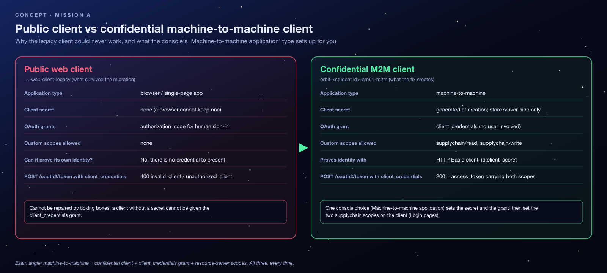</p>

### 4.2 OAuth 2.0 and tokens

**⑩ OAuth 2.0.** An industry-standard *set of rules* for how a program obtains an access token and how other programs use that token, so that services never pass passwords to each other. *Analogy:* the security office's rulebook for printing passes: who may request one, what proof they must bring, and what gets printed on it.

**⑪ Grant type.** OAuth defines several ways (*grants*, or *flows*) to obtain a token, each for a different situation. `authorization_code` is for a human signing in through a browser; `refresh_token` renews a session; `client_credentials` is for software acting as itself. An app client lists which grants it may use, and Cognito refuses the others.

**⑫ `client_credentials`.** The grant where an application sends **its own** client id and secret to the token endpoint and receives an access token. No human, no password, no sign-in page. The OrbitOps chat handler does exactly this:

```http
POST https://<cognito_domain>/oauth2/token
Authorization: Basic base64(<client id>:<client secret>)
Content-Type: application/x-www-form-urlencoded

grant_type=client_credentials&scope=supplychain/read supplychain/write
```

Because the secret is the proof, **Cognito only allows this grant on an app client that has a secret.** A public client can never use it.

**⑬ Machine-to-machine (M2M) authentication.** "Software talking to software." The token identifies an **application**, not a person. In an M2M token from Cognito, the `sub` (subject) claim is the client id itself, and there is no `username`. When the orchestrator receives the token, it knows "this is the OrbitOps chat handler", not "this is Captain Nova".

**⑭ Access token.** A short-lived pass the client attaches to its requests as `Authorization: Bearer <token>`. "Bearer" means *whoever holds it can use it*, like cash, so tokens expire quickly (60 minutes here) and must never be logged or shared. *Analogy:* a temporary visitor badge that stops working at 5 p.m.

**⑮ JWT, and how it is validated.** Cognito access tokens are **JSON Web Tokens**: three base64url-encoded parts separated by dots, `header.payload.signature`. The payload is readable by anyone (it is *encoded*, not encrypted); the **signature** is what makes it trustworthy. A validator:

1. reads the token's `iss` (issuer) and fetches the issuer's public keys via the **OIDC discovery document** (the `discoveryUrl` → `jwks_uri`);
2. verifies the signature with the matching key (`kid`), which proves Cognito issued it and nobody edited it;
3. checks it has not expired (`exp`);
4. checks the claims it cares about, here `client_id` against its **allowed clients** list.

<p align="center">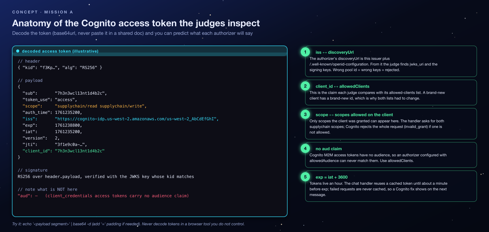</p>

> [!NOTE]
> **`invalid_grant` vs `invalid_scope`.** When a client requests a scope that *exists* but is not allowed for that client, Cognito answers **`invalid_grant`**; `invalid_scope` is for a scope or resource server that does not exist at all ([AWS token endpoint documentation](https://docs.aws.amazon.com/cognito/latest/developerguide/token-endpoint.html)). Both arrive as HTTP 400 and reject the *whole* request.

### 4.3 Permissions inside the token

**⑯ Resource server.** In Cognito, a *resource server* is a **definition** of an API you want to protect: an identifier (`supplychain`) plus the permissions that API understands. It is a *name and a list*. It does not deploy, host or run an API. The real "API" in this lab is the agent and its tools.

**⑰ Scopes.** A *scope* is a named permission, written `<resource server>/<permission>`. Cognito prints the scopes a client was granted into the token's `scope` claim. *Analogy:* the access levels printed on the badge.

**⑱ `supplychain/read` and `supplychain/write`.** The two scopes defined on the `supplychain` resource server: permission to read supply-chain data and permission to change it. The chat handler always requests **both**, so the client must be allowed both or Cognito rejects the whole request.

**⑲ Who actually enforces scopes?** This is where most people's intuition is wrong. **A scope does not enforce itself.** It is just text on the badge, and someone has to read it:

| Who | Does it check scopes in this lab? |
|---|---|
| Cognito | **Yes, at issue time**: a client only receives scopes it was allowed. |
| AgentCore Runtime and Gateway authorizers | **No**: they are configured with `allowedClients` only. AgentCore *can* also require scopes (`allowedScopes` in the authorizer configuration), but this lab does not turn that on. |
| Tool Lambdas | **No**: they never look at the token. |

So in OrbitOps the scopes are *carried* but not *checked* downstream. A production design would add `allowedScopes` on the gateway, or check the claim in the API itself, so that a read-only client could not call write tools.

### 4.4 Why both judges must trust the client id

**⑳ The JWT authorizer, and why there are two.** AgentCore Runtime and AgentCore Gateway can each validate tokens themselves before any code runs. Each one is configured with:

- `discoveryUrl`: *which issuer do I trust?* (the shared pool), and
- `allowedClients`: *which applications from that issuer do I trust?* (a list of client ids).

They never ask Cognito "is this client okay?". They only compare the token's `client_id` claim with their own list. So when you create a new client, Cognito happily issues it tokens, and **every** authorizer still rejects them until its list includes the new id. OrbitOps has two such judges on one token's path (§3.2, steps 5 and 7), so the new id must go into **both** lists.

<p align="center">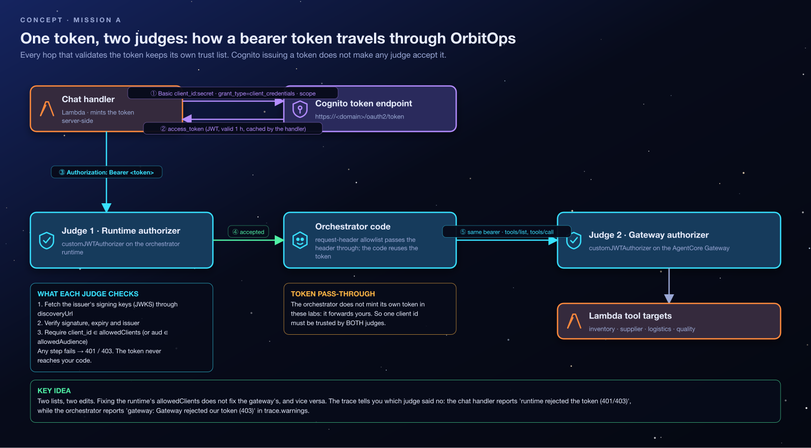</p>

> [!TIP]
> **Why `allowedClients` and not `allowedAudience`?** Authorizers can also match the `aud` (audience) claim. Cognito M2M access tokens carry **no `aud` claim** unless you configure a resource binding, so an audience check could never match. For these tokens, `client_id` is the claim to check.

### 4.5 Jargon decoder

| Term | Plain-English analogy | What it really is |
|---|---|---|
| Cognito | Security office | Managed identity service that issues tokens |
| User pool | The office's registry and badge printer | A directory plus token-issuing machinery |
| App client | A vehicle registration | A record of one application allowed to request tokens |
| Client ID | Licence plate | Public identifier of the app client |
| Client secret | Ignition key | Private password proving you are that client |
| OAuth 2.0 | Rulebook for issuing passes | Standard protocol for obtaining and using access tokens |
| Access token | Temporary visitor badge | Signed JWT presented as `Bearer` on each request |
| Scope | Access level printed on the badge | Named permission inside the token |
| JWT authorizer | Guard checking the badge | AgentCore's built-in token validator with an allow-list |
| Lambda | A worker who appears when called | Code that runs on demand, billed per invocation |
| AgentCore Runtime | The control tower the AI works in | Managed hosting for agent code |
| AgentCore Gateway | Guarded door to the tool room | Managed MCP server fronting your tools |

### 4.6 Misconceptions to unlearn

- ❌ *"An app client is an application."* ✅ It is a registration. Nothing runs when you create one.
- ❌ *"Creating the resource server deployed an API."* ✅ It only defined a name and two scopes.
- ❌ *"A valid token will be accepted everywhere."* ✅ Each service decides for itself. A perfectly valid, unexpired, correctly signed token is still rejected by an authorizer whose list does not include its client id.
- ❌ *"M2M means a user signed in."* ✅ M2M identifies an *application*. No human is involved.
- ❌ *"IAM roles and Cognito app clients are the same kind of thing."* ✅ They are different credential systems. The **gateway** calls the tool Lambdas with its **IAM role** (AWS-signed requests checked by IAM). The **chat handler** calls the runtime with a **Cognito token** (an OAuth bearer token checked by the JWT authorizer). In fact the chat handler's IAM role (`orbit-am01-chat-role`) has *no* permission to call AgentCore at all, and it does not need one, because the runtime accepts a Cognito JWT instead of AWS IAM-signed requests. (An **IAM role** is an AWS identity with a list of allowed actions; AWS services "wear" roles to act.)

---

## 5. Understanding the Failure

### 5.1 Supposed to happen vs actually happens

| | Supposed to happen | Actually happened |
|---|---|---|
| Getting a token | The chat handler sends an M2M client's id and secret to Cognito and receives a token with both scopes. | The handler's configuration is blank, so it never calls Cognito. Even if it did, your only client in the pool has no secret and no `client_credentials` grant. |
| Entering the agent | The runtime authorizer sees `client_id` = the M2M client and lets the request in. | The runtime trusts only the legacy client id. |
| Reaching the tools | The gateway authorizer accepts the forwarded token. | The gateway also trusts only the legacy client id. |

### 5.2 The three faults

| # | Fault | Where | Why it breaks the chain |
|---|---|---|---|
| 1 | No machine-to-machine app client. The surviving client is a **public** client: `generate_secret = false`, no OAuth flows enabled. | Cognito user pool | `client_credentials` requires a secret and an enabled grant, so nothing server-side can obtain a token. |
| 2 | Gateway **and** Runtime JWT authorizers list only the legacy client id in `allowedClients`. | AgentCore Gateway + Runtime | A valid token from a new client is rejected (401/403) until **both** lists include its id. |
| 3 | All five chat-handler environment variables are empty strings. | Lambda | The handler cannot build a token request, so it raises its own "Authentication service unavailable" before contacting any AWS service. |

**How it happened (the story).** During the identity migration the M2M client was deleted and the Lambda's configuration was reset, but both authorizers kept pointing at the client that survived: a browser-style client that can never perform `client_credentials`. The repair therefore has three parts: recreate the confidential client, re-trust it *everywhere a token is validated*, and restore the caller's configuration. Fixing any two of the three still leaves the chain broken.

### 5.3 Broken vs repaired, side by side

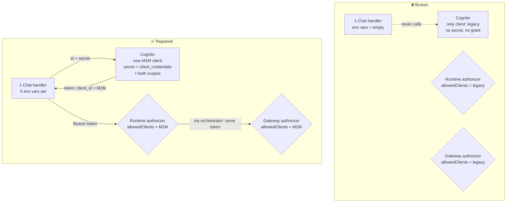

### 5.4 The symptoms, decoded

The faults reveal themselves in layers: each repair uncovers the next fault's symptom. That is normal, and reading each new symptom correctly is the skill being tested.

| Symptom you saw | Generated by | What it means in plain English |
|---|---|---|
| `⚠ Authentication service unavailable` / `missing environment configuration: COGNITO_DOMAIN, COGNITO_CLIENT_ID, COGNITO_CLIENT_SECRET` (HTTP 503) | Chat handler code (`get_token`) | "I don't even know where Cognito is or who I am." |
| `GET /health` shows keys as `MISSING`, and `token: "Authentication service unavailable: …"` | Chat handler code (`health()`) | The same, as a checklist. |
| The pool's only client for you is `…-web-client-legacy`, with no client secret | Cognito console | No confidential client exists, so `client_credentials` is impossible. |
| `Cognito token endpoint returned 400: {"error":"invalid_client"}` (or `unauthorized_client`) | **Cognito**, relayed by the handler | "I don't recognise that id + secret pair" or "that client isn't allowed this grant". |
| `Cognito token endpoint returned 400: {"error":"invalid_grant"}` | **Cognito**, relayed | A requested scope exists but is not allowed on the client. |
| `the orchestrator runtime rejected the token (HTTP 401/403 …)` | **AgentCore Runtime** status code, worded by the handler | Cognito issued a token, but the runtime's `allowedClients` does not include its `client_id`. The agent code never ran, so there is **no trace**. |
| A reply arrives, `trace.warnings` contains `gateway: Gateway rejected our token (401 or 403)…`, `tools_discovered: 0` | **AgentCore Gateway** status code, worded by the orchestrator | The runtime judge said yes; the gateway judge did not. The model answered without tools. |
| `RuntimeError: ORCHESTRATOR_RUNTIME_ARN is not configured on the chat handler` (HTTP 502) | Chat handler code | Cognito worked; only the runtime ARN is missing. Note the **different** headline. |

---

## 6. Step-by-Step Solution

Recommended order: **Fault 1 → Fault 2 → Fault 3.** Each step produces something the next step needs: the client id from Fault 1 goes into both authorizers *and* the Lambda.

### Fault 1: Create the machine-to-machine app client

**What the setting controls:** which application may ask Cognito for tokens, how it proves itself, and which scopes it may receive.
**Why the app needs it:** the chat handler runs on a server and acts as itself, which is the textbook case for a confidential client with `client_credentials`.

<p align="center">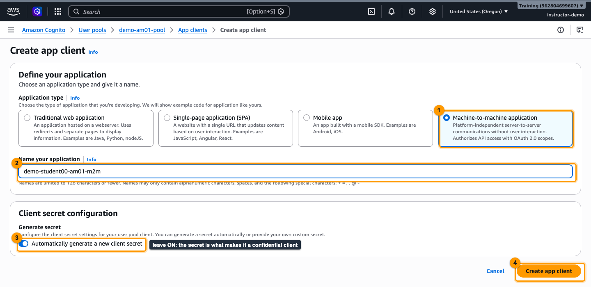</p>

1. Amazon Cognito → **User pools** → `orbit-am01-pool` → **App clients** → **Create app client**.
2. Application type: **Machine-to-machine application**. *Why:* this one choice generates a client secret and enables the `client_credentials` grant. You cannot reach the same result by "upgrading" the legacy client, because a client without a secret cannot be given this grant.
3. Name: `orbit-<you>-am01-m2m` (for example `orbit-student07-am01-m2m`). Leave **Automatically generate a new client secret** on. **Create app client**. *Why the name:* the pool is shared, so a unique name keeps you from editing a classmate's client.
4. Copy the **Client ID** and **Client secret** from the client page. Treat the secret like a password: paste it only into the Lambda configuration, never into chat, screenshots or shared documents.
5. **Fix the scopes.** The wizard has no scope picker: it creates its own resource server (`default-m2m-resource-server-…`) and grants only that server's `/read` scope. Open the client's **Login pages** tab → **Edit** (*Managed login pages configuration*) → **Custom scopes**: select **`supplychain/read`** and **`supplychain/write`**, remove `default-m2m-resource-server-…/read`, keep the grant type **Client credentials** → **Save changes**. *Why:* the chat handler requests both `supplychain` scopes, and Cognito rejects the whole token request with `invalid_grant` if the client is not allowed every scope it asks for.

**Effect on the system:** Cognito can now issue tokens to the chat handler. Nobody else trusts those tokens yet.

### Fault 2: Trust the new client on BOTH JWT authorizers

**What the setting controls:** the `allowedClients` list each judge compares the token's `client_id` against.
**What the wrong value caused:** a list containing only the legacy id rejects every token from the new client.

<p align="center">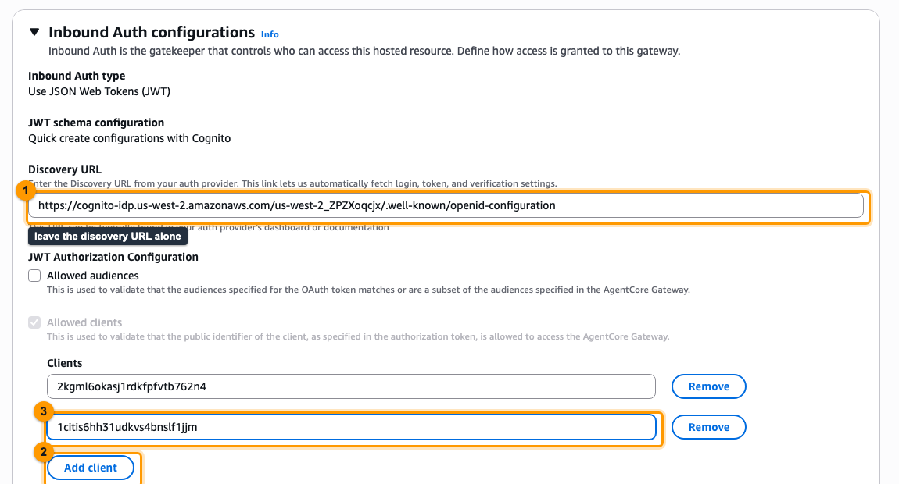</p>

1. **Gateway judge:** Bedrock AgentCore → **Gateways** → `orbit-<you>-am01-gateway` → ***Inbound Auth** panel* → Edit. Keep the discovery URL (it is correct). Add the new client id to **Allowed clients**; removing the legacy id is optional. Save.
2. **Runtime judge:** Bedrock AgentCore → **Runtime** → `orbit_<you>_am01_orchestrator` → **Update runtime** (**Inbound Auth** section). Add the same client id to **Allowed clients**. Save.
3. Wait for the runtime status to return to **READY**. *Why:* every runtime update creates a new, immutable **version**. The `DEFAULT` endpoint, which the chat handler calls, switches to the new version automatically once it is ready, and the old version keeps answering until then.

**Effect on the system:** both judges now accept tokens whose `client_id` is your M2M client.

### Fault 3: Restore the chat handler's configuration

**What the setting controls:** environment variables are configuration values the Lambda reads at start-up (`os.environ`). The handler's code is correct; it simply has nothing to work with.

<p align="center">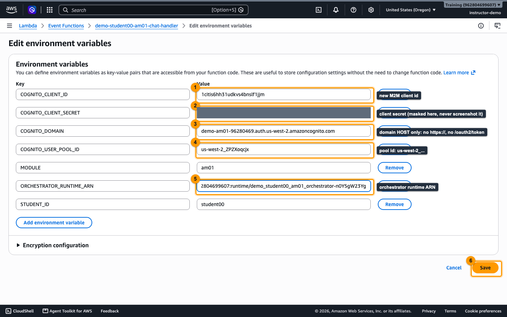</p>

Lambda → `orbit-<you>-am01-chat-handler` → **Configuration → Environment variables → Edit**. **Keep** `STUDENT_ID` and `MODULE`, and set:

| Key | Value | How the code uses it |
|---|---|---|
| `ORCHESTRATOR_RUNTIME_ARN` | `orchestrator_runtime_arns[<you>]` | URL-encoded into `https://bedrock-agentcore.us-west-2.amazonaws.com/runtimes/<arn>/invocations?qualifier=DEFAULT` |
| `COGNITO_DOMAIN` | the `cognito_domain` output, host name only, e.g. `orbit-am01-12345678.auth.us-west-2.amazoncognito.com` | The code builds `https://<domain>/oauth2/token` itself (it tolerates a leading `https://`, but not a path or a pool id) |
| `COGNITO_CLIENT_ID` | the new client id | First half of the Basic-auth header |
| `COGNITO_CLIENT_SECRET` | the new client secret | Second half of the Basic-auth header |
| `COGNITO_USER_POOL_ID` | the `cognito_user_pool_id` output (`us-west-2_…`) | Used only by `/health` to test the OIDC discovery URL; the chat path itself does not need it |

**Effect on the system:** the next request starts a fresh Lambda execution environment with the new values, mints a token and calls the runtime.

### CLI equivalent (AWS CLI v2.30+ for `bedrock-agentcore-control`)

```bash
POOL=<cognito_user_pool_id>; ME=<student id>
GW_ID=<gateway_ids[ME]>; RT_ID=<orchestrator_runtime_ids[ME]>; FN=<chat_function_names[ME]>

# Fault 1: confidential M2M client with client_credentials + both scopes
read CLIENT_ID CLIENT_SECRET <<< "$(aws cognito-idp create-user-pool-client --user-pool-id "$POOL" --client-name "orbit-$ME-am01-m2m" \
  --generate-secret --allowed-o-auth-flows client_credentials --allowed-o-auth-flows-user-pool-client \
  --allowed-o-auth-scopes supplychain/read supplychain/write --supported-identity-providers COGNITO \
  --query 'UserPoolClient.[ClientId,ClientSecret]' --output text)"

# Fault 2a: gateway authorizer (UpdateGateway replaces the whole config: re-send name/role/protocol)
aws bedrock-agentcore-control get-gateway --gateway-identifier "$GW_ID" \
  | jq --arg c "$CLIENT_ID" '{gatewayIdentifier: .gatewayId, name, description, roleArn, protocolType, protocolConfiguration, authorizerType,
      authorizerConfiguration: (.authorizerConfiguration | .customJWTAuthorizer.allowedClients = [$c])} | del(..|nulls)' > gw.json
aws bedrock-agentcore-control update-gateway --cli-input-json file://gw.json

# Fault 2b: runtime authorizer (UpdateAgentRuntime is also a full replacement)
aws bedrock-agentcore-control get-agent-runtime --agent-runtime-id "$RT_ID" \
  | jq --arg c "$CLIENT_ID" '{agentRuntimeId, description, agentRuntimeArtifact, roleArn, networkConfiguration, protocolConfiguration,
      requestHeaderConfiguration, environmentVariables, lifecycleConfiguration,
      authorizerConfiguration: (.authorizerConfiguration | .customJWTAuthorizer.allowedClients = [$c])} | del(..|nulls)' > rt.json
aws bedrock-agentcore-control update-agent-runtime --cli-input-json file://rt.json
aws bedrock-agentcore-control get-agent-runtime --agent-runtime-id "$RT_ID" --query status   # wait for READY

# Fault 3: chat handler configuration (replaces the whole map: keep STUDENT_ID and MODULE)
aws lambda update-function-configuration --function-name "$FN" --environment "Variables={STUDENT_ID=$ME,MODULE=am01,\
ORCHESTRATOR_RUNTIME_ARN=<runtime arn>,COGNITO_DOMAIN=<domain host>,COGNITO_CLIENT_ID=$CLIENT_ID,COGNITO_CLIENT_SECRET=$CLIENT_SECRET,COGNITO_USER_POOL_ID=$POOL}"
```

> [!CAUTION]
> Both `update-*` calls and `update-function-configuration --environment` **replace** the whole configuration they touch. That is why the commands start from a `get-*` and re-send everything, and why the Lambda command repeats `STUDENT_ID` and `MODULE`. Leaving a field out deletes it.

### The permanent fix (what `terraform/solution` does)

An `aws_cognito_user_pool_client` with `generate_secret = true`, `allowed_oauth_flows = ["client_credentials"]`, `allowed_oauth_flows_user_pool_client = true` and both scopes (access tokens valid for 60 minutes); `allowed_clients = [m2m client id]` on **both** authorizers; and the five chat-handler variables wired from resource attributes instead of pasted by hand. Console and CLI edits are lost on the next `terraform apply` of the broken stack. That is the point: infrastructure as code is where a fix should live.

---

## 7. Verification

<p align="center">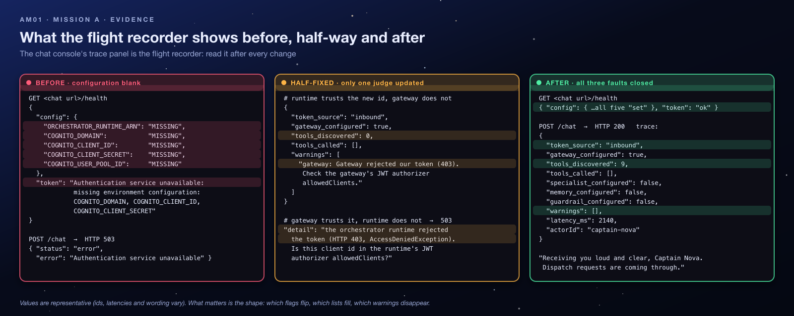</p>

### 7.1 Checklist

- [ ] Cognito: your `…-m2m` client shows a **client secret**, the **`client_credentials`** grant and both `supplychain` scopes.
- [ ] Gateway **and** runtime authorizers both list the new client id; the runtime is `READY`.
- [ ] `GET <chat url>/health` → every config value `set`, `token: "ok"`, `cognito_discovery.http_status: 200`.
- [ ] A chat message returns a reply with `token_source: inbound`, `tools_discovered: 9` and `warnings: []`.
- [ ] *"Check our cargo stock levels"* lists `inventory-target___…` in `tools_called`: proof that the **forwarded** token also passed the gateway judge.

### 7.2 Commands

```bash
CHAT=<chat_urls[ME]>
curl -s "$CHAT/health" | jq '.config, .token'
# every value "set", "token": "ok"

curl -s -X POST "$CHAT/chat" -H 'content-type: application/json' \
  -d '{"prompt":"Flight control, are you receiving my cargo dispatch requests?","actorId":"captain-nova"}' \
  | jq '.response, .trace.token_source, .trace.tools_discovered, .trace.warnings'
# "I'm online, Captain Nova. I can help with …"   "inbound"   9   []   (the wording varies)
```

**Why 9?** The gateway exposes 3 inventory + 2 supplier + 2 logistics + 2 quality tools. `token_source: inbound` proves the orchestrator received the chat handler's token, rather than minting its own.

Optional deeper proof: decode the token's payload (base64url, the middle part) and check that `client_id` equals your new client and `scope` contains both `supplychain/read` and `supplychain/write`. Never paste a live token into a shared document or a website you do not control.

> [!TIP]
> **Evidence discipline.** "It works now" is not evidence. The three lines that close this mission are `/health` → `token: ok`, `trace.token_source: inbound` with `warnings: []`, and a tool call in `tools_called`.

---

## 8. Troubleshooting

### 8.1 Decision tree

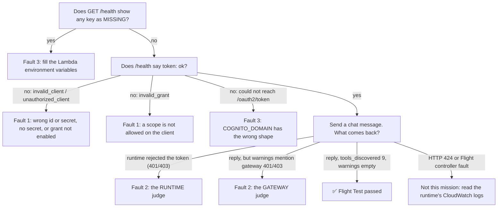

### 8.2 Lessons learned from common mistakes

| Mistake | What you see | The lesson |
|---|---|---|
| Creating a *traditional web* client and ticking boxes | The grant cannot be enabled, or the token endpoint returns `invalid_client` / `unauthorized_client` | `client_credentials` needs a confidential client. Pick the M2M type; the console does the rest. |
| Trusting the wizard's scopes | `/health` → `Cognito token endpoint returned 400: {"error":"invalid_grant"}` although the client has a secret and `client_credentials` | The M2M wizard grants its own `default-m2m-resource-server-…/read` scope, not `supplychain/*`. Always read the client's **Login pages → Custom scopes** after creating it. |
| Ticking only one scope | `/health` → `Cognito token endpoint returned 400: {"error":"invalid_grant"}` | The handler asks for both scopes, and Cognito rejects the *whole* request if any one is not allowed. |
| Updating only one authorizer | Runtime fixed, gateway not: a reply arrives with `gateway: Gateway rejected our token (403)` and `tools_discovered: 0`. Gateway fixed, runtime not: *runtime rejected the token (401/403)* | Every hop that validates the token is a separate judge. List them before you start editing. |
| Putting a path or the pool id in `COGNITO_DOMAIN` | DNS failure (`could not reach … /oauth2/token`) or an HTML page instead of JSON | Read how the code *uses* a value before you set it: the handler appends `/oauth2/token` itself. |
| Testing seconds after editing the runtime | Still 401/403 | The update publishes a new version; the old one serves until the new one is `READY`. |
| Mixing up the pool id and the domain | `/health` shows `cognito_discovery` errors, or token requests fail | The pool id starts with `us-west-2_`; the domain is a host name ending in `amazoncognito.com`. |
| Forgetting `STUDENT_ID` / `MODULE` when saving env vars (CLI) | The page header shows an empty student id | `--environment` replaces the whole map. |
| Editing a classmate's gateway or runtime | Your fix "does nothing" and someone else's lab breaks | Up to 22 people share this account: check the student id in every name before you save. |

### 8.3 Distinguish from similar failures

| Symptom | This lab? | Actually is |
|---|---|---|
| `Authentication service unavailable` with `/health` MISSING values | ✅ | Blank configuration |
| Cognito returns `invalid_client` | ✅ | Public client / no secret / wrong secret |
| Cognito returns `invalid_grant` | ✅ | Scope exists but is not allowed on the client |
| Cognito returns `invalid_scope` | ❌ | A scope name or resource server that does not exist (typo); the lab's scopes exist |
| Runtime 401/403 with a freshly minted token | ✅ | `allowedClients` mismatch |
| Runtime 424 `RuntimeClientError` | ❌ | The agent's code crashed; read its log group `/aws/bedrock-agentcore/runtimes/…` |
| Reply arrives but tools never appear | Partly | Gateway authorizer still trusts the old client (or Mission B's faults) |

---

## 9. Key Takeaways

- **M2M = confidential client + `client_credentials` + resource-server scopes.** All three, every time.
- **Authentication ≠ authorization.** Cognito proves *who* the app is; each AgentCore authorizer decides independently whether to let it in.
- **JWT authorizers trust client ids, not pools.** A new client means updating `allowedClients` on *every* AgentCore resource that validates the token.
- **Cognito M2M access tokens carry `client_id`, not `aud`.** Use `allowedClients`, not `allowedAudience`.
- **Scopes are only as strong as whoever checks them.** Here Cognito enforces them at issue time; nothing downstream does.
- **Configuration is part of the auth chain.** A perfect identity setup still fails if the caller does not know the domain, client id, secret or runtime ARN.
- **Secrets live server-side.** Lambda environment variables (better: AWS Secrets Manager), never the browser, never a screenshot.

**Real-world connection:** every company that lets services call each other (payment processors, internal microservices, CI pipelines calling cloud APIs) uses this exact pattern. "We rotated a client and forgot one consumer's allow-list" is one of the most common causes of authentication outages.

---

## 10. Knowledge Check

<details><summary><b>1. A teammate says: "Cognito issued the token, so the runtime has to accept it." What is wrong with that?</b></summary>

Issuing and accepting are separate decisions made by separate services. Cognito *authenticates* the client and signs a token; the runtime's JWT authorizer independently checks the signature, the expiry and whether the token's `client_id` is on *its* `allowedClients` list. A valid token from an unlisted client is rejected with 401/403.
</details>

<details><summary><b>2. Which claim inside the token does <code>allowedClients</code> compare, and why not <code>aud</code>?</b></summary>

`client_id`. Cognito M2M access tokens have no `aud` claim (unless a resource binding is configured), so an audience check could never match.
</details>

<details><summary><b>3. You untick <code>supplychain/write</code> on your client. Which component reports the error, what does it say, and where do you see it?</b></summary>

Cognito's token endpoint returns HTTP 400 `invalid_grant`, because the chat handler still requests both scopes and Cognito rejects the whole request. The chat handler relays it: the console shows `Authentication service unavailable` with the detail `Cognito token endpoint returned 400: …invalid_grant…`, and `/health` shows the same text in `token`.
</details>

<details><summary><b>4. Where does the chat page's HTML come from, and where does the AI reasoning happen?</b></summary>

The same chat-handler Lambda serves the page (`GET /`), and your browser runs it. The reasoning happens in the orchestrator in AgentCore Runtime, which calls the Nova 2 Lite model. The Lambda contains no AI.
</details>

<details><summary><b>5. Why does the orchestrator need no <code>COGNITO_*</code> variables of its own?</b></summary>

Token pass-through: its runtime allow-lists the `Authorization` header, so the agent receives the chat handler's token and forwards it to the gateway. It only mints its own token as a fallback when no inbound token exists.
</details>

<details><summary><b>6. The gateway invokes the tool Lambdas. Does it use the Cognito token to do so?</b></summary>

No. The gateway validates the Cognito token on the way *in*, then calls the Lambdas with its own **IAM role** (`orbit-<you>-am01-gateway-role`, allowed `lambda:InvokeFunction` on your four tools). Inbound and outbound credentials are different systems.
</details>

---

## 11. Exam Angle

The micro-credential's Challenge A checks for: a Cognito app client with a generated secret and the `client_credentials` grant; both custom scopes allowed on it; both AgentCore authorizers listing the new client id; and the chat handler's configuration pointing at the existing runtime and domain. Expect questions that probe *why* a public client cannot do M2M, and *where* a token is validated (each hop independently). The assessment's brief also asks for `COGNITO_*` settings on the orchestrator runtime. In this lab the orchestrator forwards the caller's token instead, so that step does not exist here; the concept it tests (every component that presents or validates the token must know the right client) is the same.

---

## 12. Reflection Questions: Model Answers

1. **Why does the chat handler mint the token server-side instead of letting the browser call Cognito?** Because `client_credentials` requires the client secret, and anything shipped to a browser is public. Minting server-side keeps the secret in Lambda configuration, lets the handler cache the token for its lifetime, and means the browser never holds a credential that could call the runtime directly.
2. **If only the Gateway's allowed clients were updated, where would the chain break, and what would the trace show?** At the runtime authorizer: the chat handler's call would be refused with 401/403 before the agent code runs, so there would be *no* trace at all, only the handler's detail saying the runtime rejected the token. (If only the runtime were updated, a trace would exist and show `gateway: Gateway rejected our token (403)` with `tools_discovered: 0`.)
3. **What would change if the authorizers used `allowedAudience` instead of `allowedClients`?** Nothing would ever be accepted: Cognito `client_credentials` access tokens do not include an `aud` claim unless the client requests a resource binding, so the audience check can never match. `allowedAudience` suits identity providers (or ID tokens) that set `aud`; for Cognito M2M tokens the right setting is `allowedClients`.

---

## 13. Going Further (optional)

- Rotate the client secret in Cognito and watch which component fails, and how long it takes. (Hint: a warm chat handler keeps using its cached token until about a minute before it expires; tokens already issued stay valid until their `exp`.)
- Move the secret into AWS Secrets Manager and read it at cold start; compare the trade-offs with environment variables.
- In a sandbox account of your own (the after-class `student-terraform/`), add `allowedScopes: ["supplychain/admin"]`, a scope no token carries, to the gateway authorizer and watch the *gateway*, not Cognito, refuse the forwarded token. Then change it to `supplychain/read` and watch the call pass. This is scope enforcement made real.

---

> [!TIP]
> Back to this mission's [after-class runbook](README.md).

<sub>[⬅ All missions](../README.md) · [AM02 The Case of the Misrouted Cargo Droids ➡](../AM02-gateway-tool-routing/README.md)</sub>
