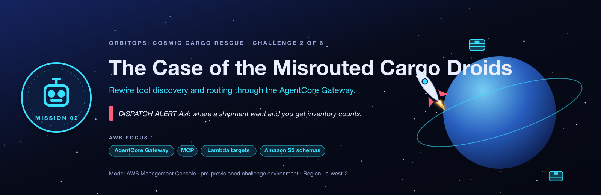

<sub>[⬅ All missions](../README.md) · [⬅ AM01 The Locked Launchpad](../AM01-cognito-oauth-launchpad/README.md) · [AM03 The Vanishing Starport Manuals ➡](../AM03-knowledge-base-specialist/README.md)</sub>

<p align="center"></p>

# AM02 · Mission B: The Case of the Misrouted Cargo Droids — After-Class Runbook

> 🚨 Ask where a shipment went and you get *inventory counts*; ask for a quality inspection and the tool doesn't exist.

| | |
|---|---|
| **You'll practise** | AgentCore Gateway, MCP tool discovery, Lambda targets, S3 tool schemas |
| **Fix time** | about 40 minutes |
| **Deploy time** | about 2½ min for either stack (plus ~1 min for the first `terraform init`) |
| **Cost** | Cents. Nothing bills by the hour. |
| **Files here** | [`HANDOUT.md`](HANDOUT.md) (the brief, no answers) · [`SOLUTION.md`](SOLUTION.md) (the answer key) · `student-terraform/` (broken) · `student-terraform-solution/` (fixed) |

New to the loop? [02-RUN-A-MISSION.md](../02-RUN-A-MISSION.md) explains every step in detail. Below are the exact commands for this mission. Replace `jsmith42` with your id everywhere.

## ① Deploy the broken environment

```bash
cd AM02-gateway-tool-routing/student-terraform
terraform init
terraform apply -var 'student_id=jsmith42'
```

## ② Load your values

Run this from `student-terraform/` (needs `jq`). It fills every variable that [SOLUTION.md](SOLUTION.md)'s CLI uses, so its commands work as written:

```bash
ME=jsmith42                                                   # your student_id
GW_ID=$(terraform output -raw gateway_ids)
RT_ID=$(terraform output -raw orchestrator_runtime_ids)
LOGI_ARN=$(terraform output -json tool_function_arns | jq -r --arg k "$ME-logistics" '.[$k]')
QUAL_ARN=$(terraform output -json tool_function_arns | jq -r --arg k "$ME-quality" '.[$k]')
QSCHEMA=$(terraform output -raw quality_schema_s3_uri)
CHAT=$(terraform output -raw chat_urls)
echo "chat console: $CHAT"
```

<details><summary><b>Every output of this stack</b> (the handout's <code>name[&lt;you&gt;]</code> is just <code>terraform output</code> here)</summary>

| Output | What it is | Print it |
|---|---|---|
| `chat_urls` | OrbitOps chat console URL (open in a browser; GET /health shows the config state). | `terraform output -raw chat_urls` |
| `chat_function_names` | Chat handler Lambda name. | `terraform output -raw chat_function_names` |
| `orchestrator_runtime_arns` | Orchestrator AgentCore Runtime ARN. | `terraform output -raw orchestrator_runtime_arns` |
| `orchestrator_runtime_ids` | Orchestrator AgentCore Runtime id. | `terraform output -raw orchestrator_runtime_ids` |
| `cognito_user_pool_id` | Shared Cognito user pool id. | `terraform output -raw cognito_user_pool_id` |
| `cognito_domain` | Cognito hosted domain (token endpoint is https://<domain>/oauth2/token). | `terraform output -raw cognito_domain` |
| `cognito_discovery_url` | OIDC discovery URL used by every JWT authorizer. | `terraform output -raw cognito_discovery_url` |
| `m2m_client_ids` | Machine-to-machine app client id. | `terraform output -raw m2m_client_ids` |
| `m2m_client_secrets` | Machine-to-machine app client secret (sensitive). | `terraform output -raw m2m_client_secrets` |
| `tool_function_arns` | Tool Lambda ARN and domain. | `terraform output -json tool_function_arns` |
| `code_bucket` | Shared S3 bucket holding agent zips, tool schemas and manuals. | `terraform output -raw code_bucket` |
| `quality_schema_s3_uri` | S3 URI of the quality tool schema (used when creating quality-target). | `terraform output -raw quality_schema_s3_uri` |
| `gateway_urls` | AgentCore Gateway MCP endpoint (value for GATEWAY_URL). | `terraform output -raw gateway_urls` |
| `gateway_ids` | AgentCore Gateway id. | `terraform output -raw gateway_ids` |

</details>

## ③ Confirm it's broken

```bash
python3 ../../tools/flight_test.py .
```

**Expect:** 0 of 6 checks pass: `tools_discovered=0` on every question, because the orchestrator doesn't know where its gateway is. Open the chat URL in a browser too, and read the trace yourself.

## ④ Fix it

- **Practise for real:** open [HANDOUT.md](HANDOUT.md), work the objectives with the hint ladder, and keep SOLUTION.md closed.
- **Follow along:** open [SOLUTION.md](SOLUTION.md) **§6 Step-by-step solution**. Console steps work as written; for the CLI, run the block in ② first.

## ⑤ Prove it's fixed

```bash
python3 ../../tools/flight_test.py .
```

The Flight Test checks that:

- all 9 tools are discovered
- an inventory, a supplier, a logistics and a quality tool are each called
- the logistics answer really comes from the logistics service, not inventory

It exits `0` with **Mission accomplished** when everything passes.

## ⑥ Compare with the solution

```bash
cd ../student-terraform-solution
terraform init
terraform apply -var 'student_id=jsmith42' -var 'course_prefix=orbitsol'
python3 ../../tools/flight_test.py .                  # passes out of the box
diff ../student-terraform/main.tf main.tf             # every fix, as code
```

<details><summary><b>Spoiler:</b> every fault and its fix, in one list</summary>

1. **Fault 1, discovery off:** set the orchestrator runtime's `GATEWAY_URL` to the gateway's MCP endpoint.
2. **Fault 2, silent misroute:** point `logistics-target` at the **logistics** Lambda (it invoked the inventory Lambda).
3. **Fault 3, missing tool:** create `quality-target`: the quality Lambda, the S3 tool schema `schemas/quality_tools.json`, gateway IAM-role credentials.

</details>

## ⑦ Clean up

**Things you created by hand:**

**Nothing to delete by hand.** The `quality-target` you create belongs to the gateway Terraform owns, and `terraform destroy` removes the gateway together with its targets. (Verified: the broken stack was destroyed with a hand-made `quality-target` still attached, and it went cleanly.)

**Then destroy both stacks**, with the same flags you applied with:

```bash
# from the repo root
cd AM02-gateway-tool-routing/student-terraform-solution && terraform destroy -var 'student_id=jsmith42' -var 'course_prefix=orbitsol'
cd ../student-terraform              && terraform destroy -var 'student_id=jsmith42'
python3 ../../tools/find_leftovers.py jsmith42        # should find nothing
```

<sub>[⬅ All missions](../README.md) · [⬅ AM01 The Locked Launchpad](../AM01-cognito-oauth-launchpad/README.md) · [AM03 The Vanishing Starport Manuals ➡](../AM03-knowledge-base-specialist/README.md)</sub>
