<sub>[⬅ All missions](../README.md) · [⬅ AM01 The Locked Launchpad](../AM01-cognito-oauth-launchpad/README.md) · [AM03 The Vanishing Starport Manuals ➡](../AM03-knowledge-base-specialist/README.md)</sub>

<p align="center">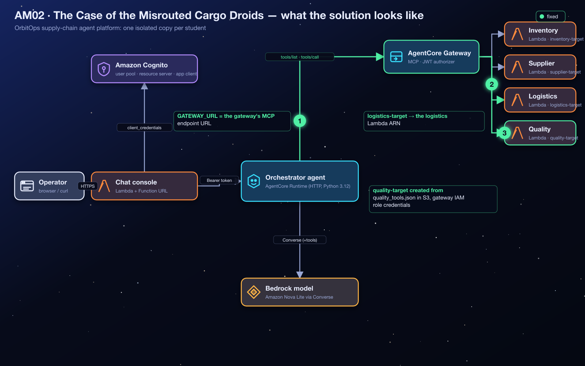</p>

# AM02 — Mission B: The Case of the Misrouted Cargo Droids — Solution Handout

> [!NOTE]
> **Answer key and debrief.** Open this after your Flight Test, or when your instructor calls time. It explains *what* to change and *why* the system behaves the way it does. No prior AWS knowledge is assumed: terms are explained before they are used. Console images in this guide are **real screenshots** from an instructor run on 2026-10-25, taken on a demo copy, so resource names read `demo-student00-…` where yours read `orbit-<your id>-…`. The console changes over time; if a label differs slightly, look for the same idea nearby.

**Contents:** [1 Mission recap](#1-mission-recap) · [2 Where you start](#2-where-you-start) · [3 Architecture explained](#3-architecture-explained) · [4 Concepts you need](#4-concepts-you-need-to-understand) · [5 Understanding the failure](#5-understanding-the-failure) · [6 Step-by-step solution](#6-step-by-step-solution) · [7 Verification](#7-verification) · [8 Troubleshooting](#8-troubleshooting) · [9 Key takeaways](#9-key-takeaways) · [10 Knowledge check](#10-knowledge-check) · [11 Exam angle](#11-exam-angle) · [12 Reflection answers](#12-reflection-questions-model-answers) · [13 Going further](#13-going-further-optional)

> [!TIP]
> **New to AWS?** Skim the vocabulary table below first. Every other term is explained where it first matters.

| Words you'll meet | In plain English |
|---|---|
| **AWS console** | The website where you view and change AWS resources by clicking. |
| **Terraform** | A tool that builds cloud resources from code files. Your instructor used it to create your environment; `terraform output` prints the values you were given. |
| **AWS Lambda** | A service that runs a small piece of code on demand, only when something calls it. |
| **IAM role** | An AWS identity that a service or program temporarily "wears" to get a specific, limited set of permissions (IAM = Identity and Access Management). |
| **ARN** | Amazon Resource Name: the full, unique address of an AWS resource, e.g. `arn:aws:lambda:us-west-2:123456789012:function:…`. |
| **AgentCore Runtime** | AWS's managed hosting service for AI agents; OrbitOps's agents run there. |
| **Trace** | The panel under each chat reply that shows what the agent did (tools, memory, guardrail, warnings). It is your main evidence. |
| **MCP** | Model Context Protocol: a standard way for an AI agent to list and call tools (§4.4). |
| **Gateway / target** | The managed tool front door, and one entry on it that binds a tool schema to a Lambda (§4.5). |
| **Converse** | The Amazon Bedrock API the agent uses to talk to the Nova 2 Lite model. |
| **CloudWatch Logs** | AWS's log storage; every Lambda writes its log lines there. |
| **SKU** | Stock-keeping unit: a product code such as `ION-COIL-7`. |

---

## 1. Mission Recap

**The app in one sentence:** OrbitOps is a chat website where cargo operators ask an AI agent (the *flight controller*) about stock, suppliers, shipments and quality inspections, and the agent answers by calling company **tools**.

**What went wrong:** the agent's connection to its tools was rebuilt from a half-finished runbook. It cannot find its tools at all; once it can, shipment questions come back full of *stock levels*; and quality questions get "I have no quality-inspection tool". Nothing crashes. The answers are just missing or wrong.

| | |
|---|---|
| **Scenario** | The orchestrator cannot discover its tools, one tool is routed to the wrong Lambda, and a whole tool domain was never registered. |
| **Faults planted** | 3: an empty `GATEWAY_URL`, a logistics target wired to the inventory function, and a missing quality target. |
| **Services** | Amazon Bedrock AgentCore Gateway (MCP), Lambda targets with S3-hosted tool schemas, AgentCore Runtime environment variables. |
| **The big idea** | Discovery, routing and execution are three separate contracts, governed by three separate settings. |
| **Time budget** | 40 minutes. The silent misroute (fault 2) is where students burn time, because nothing errors. |

<p align="center">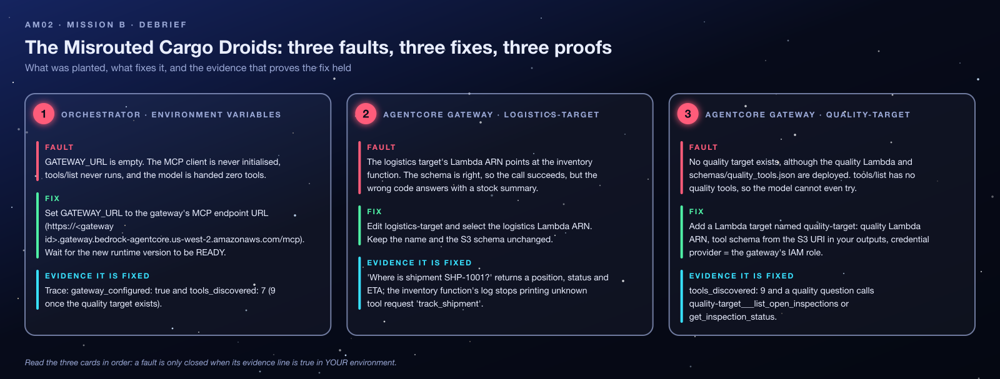</p>

---

## 2. Where You Start

Your instructor deployed `AM02-gateway-tool-routing/terraform/broken` once for the whole class and handed you the `terraform output` values for **your** student id (the repository does not prescribe the delivery channel; ask your instructor if you do not have them). Everything is in **`us-west-2`**. The authentication chain from Mission A is already **working** here: an M2M client exists, both authorizers trust it, and the chat handler is configured. This mission is purely about tools.

| Output | Example | What it is |
|---|---|---|
| `chat_urls[<you>]` | `https://….lambda-url.us-west-2.on.aws/` | Your chat console (a Lambda Function URL). Each reply has a **trace** panel. |
| `gateway_ids[<you>]`, `gateway_urls[<you>]` | `https://<gateway id>.gateway.bedrock-agentcore.us-west-2.amazonaws.com/mcp` | Your AgentCore Gateway and its MCP endpoint URL. |
| `orchestrator_runtime_ids[<you>]` | `orbit_student07_am02_orchestrator-…` | Your agent's runtime; `GATEWAY_URL` lives in its environment variables. |
| `tool_function_arns["<you>-inventory"]` (and `-supplier`, `-logistics`, `-quality`) | `arn:aws:lambda:us-west-2:…:function:orbit-student07-am02-logistics` | Your four tool Lambdas. The map is keyed `<student id>-<domain>`. |
| `quality_schema_s3_uri` | `s3://orbit-am02-<account id>/schemas/quality_tools.json` | The quality tools' schema. The other three schemas sit next to it. |
| `code_bucket` | `orbit-am02-<account id>` | The shared bucket with agent code and schemas. |

**Shared vs yours.** The Cognito pool, the S3 code bucket (including the four schema files) and the tool-Lambda IAM role are **shared by the class**. Never edit a schema file: every classmate's gateway reads the same object. Your gateway, its IAM role (`orbit-<you>-am02-gateway-role`), its targets, your runtime and your four Lambdas are yours alone. Check the student id in every name before you save. Up to 22 students share the account by default.

**Permissions and cost.** You need AgentCore Gateway and Runtime edit rights, plus read access to the code bucket's `schemas/` prefix if the console reads the schema as you create the target. Gateway calls and Lambda invocations cost fractions of a cent. Targets you create belong to a gateway Terraform owns, so they disappear when the instructor destroys the stack: there is nothing for you to clean up.

---

## 3. Architecture Explained

### 3.1 The components

| Component | Role in this mission | Where its code runs |
|---|---|---|
| Browser page + **chat handler** Lambda | Sends your question to the agent with a valid token (fixed in Mission A). | Your browser + AWS Lambda |
| **Orchestrator** (AgentCore Runtime) | The AI agent: an MCP *client* that discovers tools, lets the Nova 2 Lite model choose one, and calls it. | Amazon Bedrock AgentCore Runtime (`main.py` from a zip in S3) |
| **AgentCore Gateway** | A managed MCP *server*: it publishes the tool list and forwards each tool call to the right backend. | Fully managed AWS service |
| **Targets** (×4 when fixed) | Entries on the gateway, each binding one Lambda + one tool schema + one credential method. | Configuration only, not code |
| **Tool Lambdas** (×4) | Return fictional inventory, supplier, logistics and quality data. | AWS Lambda (Python 3.12) |
| **Tool schemas** (×4 JSON files) | Describe each tool's name, purpose and arguments. | Files in S3, read by the gateway |

### 3.2 The request, end to end

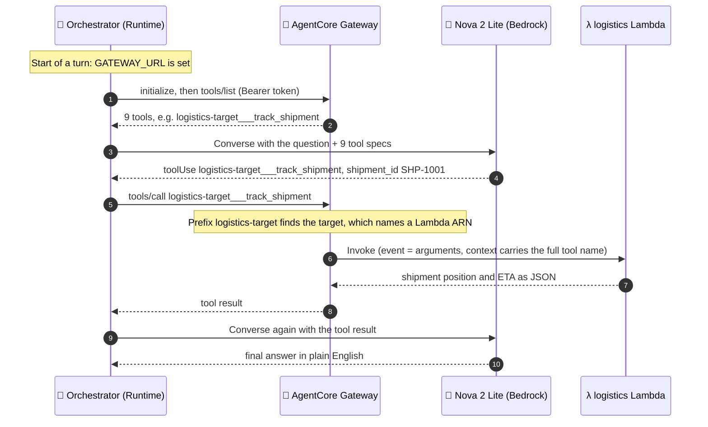

**Discovery** is steps 1–2, **routing** happens inside step 5 (the gateway looks up the target and its Lambda ARN), and **execution** is steps 6–7. In this mission one fault sits in each stage.

<p align="center">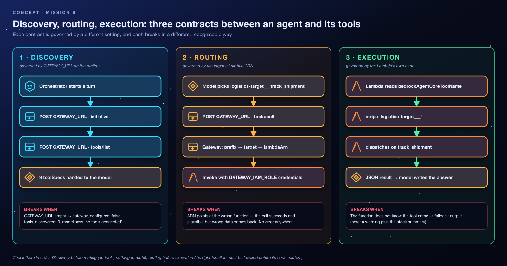</p>

Check them in order: no discovery means nothing to route, and wrong routing means the right code never runs.

### 3.3 What happens when one part fails

| If this is wrong… | …the agent | …and the trace shows |
|---|---|---|
| `GATEWAY_URL` empty | never asks for tools; the model says it has none connected | `gateway_configured: false`, `tools_discovered: 0`, **no warning** |
| `GATEWAY_URL` malformed | tries and fails | `tools_discovered: 0` and a `gateway: …` warning with an HTTP or URL error |
| A target points at the wrong Lambda | calls the right *tool name*; the wrong *code* answers | `tools_called` looks correct; `result_preview` shows the wrong `service` |
| A target is missing | never sees that domain's tools | `tools_discovered` is lower than expected; no `quality-target___…` names |

---

## 4. Concepts You Need to Understand

### 4.1 Why an agent needs tools

A large language model (LLM) like Nova 2 Lite has learned language and general knowledge, but it knows **nothing** about OrbitOps's live stock levels or where shipment SHP-1001 is. If you ask anyway, it may invent a plausible answer, which is called *hallucination*. **Tools** fix this: small programs the agent can run to fetch real data, after which the model writes its answer *from that data*. The orchestrator's system prompt even says "When a tool exists for the question, ALWAYS call the tool… Never invent stock numbers."

### 4.2 Tool calling

The model never runs code itself. The loop works like this:

1. The program sends the model the question **plus a menu of tools** (name, description, arguments).
2. If a tool would help, the model replies with a structured request (`toolUse`): "call `track_shipment` with `shipment_id = SHP-1001`".
3. The *program* runs the tool and sends the result back (`toolResult`).
4. The model writes the final answer, or asks for another tool.

*Analogy:* a manager (the model) who cannot leave the office but can send runners (tools) with written instructions.

### 4.3 Tool schema

The **menu entry** for one tool, written as JSON:

```json
{
  "name": "track_shipment",
  "description": "Track one cargo shipment by shipment id (SHP-1001 .. SHP-1004): current position, status, carrier, last checkpoint and ETA.",
  "inputSchema": {
    "type": "object",
    "properties": { "shipment_id": { "type": "string", "description": "Shipment id such as SHP-1001" } },
    "required": ["shipment_id"]
  }
}
```

The `description` is what the model reads to decide *when* to use the tool, and `inputSchema` (standard JSON Schema) says *which arguments* to send. A schema **describes**; it does not say which code runs. Keep that in mind for fault 2.

### 4.4 MCP: a standard plug for tools

The **Model Context Protocol (MCP)** is an open standard for how an agent (the *client*) talks to a tool provider (the *server*). Messages are JSON-RPC (small JSON request/response objects) sent over HTTPS. Three methods matter here:

| MCP method | Plain English | Who calls it in OrbitOps |
|---|---|---|
| `initialize` | "Hello, let's agree on a protocol version." | Orchestrator → gateway |
| `tools/list` | "What tools do you have?" (**discovery**) | Orchestrator → gateway |
| `tools/call` | "Run this tool with these arguments." | Orchestrator → gateway |

*Analogy:* a universal power socket. Any MCP-speaking agent can plug into any MCP server.

### 4.5 AgentCore Gateway and targets

An **AgentCore Gateway** is an MCP server that AWS runs for you. It has an inbound JWT authorizer (the "judge" from Mission A) and a list of **targets**. A **target** is a *binding* of three things:

| Part of a target | Question it answers | `logistics-target` should say |
|---|---|---|
| **Tool schema** (inline or an S3 object) | *Which tools exist?* | `schemas/logistics_tools.json` |
| **Lambda ARN** | *Which code runs them?* | `…:function:orbit-<you>-am02-logistics` |
| **Credential provider** | *How does the gateway authenticate to that code?* | `GATEWAY_IAM_ROLE` |

An **ARN** (Amazon Resource Name) is the full, unique address of an AWS resource, such as `arn:aws:lambda:us-west-2:123456789012:function:orbit-student07-am02-logistics`. A *name* like `logistics-target` is just a label; the ARN is the actual wiring.

### 4.6 The naming contract: `<target>___<tool>`

The gateway publishes every tool as **`<target name>___<tool name>`** (three underscores), for example `logistics-target___track_shipment`. The prefix tells the gateway which target, and therefore which Lambda, should handle a call. When it invokes the Lambda, it passes the *arguments* as the event and the *full tool name* in the Lambda context (`bedrockAgentCoreToolName`). Each OrbitOps Lambda strips the prefix and dispatches on the bare name (`track_shipment`). Rename a target and every tool name it publishes changes. That is why the target names are part of the contract and must not change.

### 4.7 The credential provider: the gateway's IAM role

Mission A was about *inbound* trust (who may call the gateway). This is *outbound* trust: how the gateway is allowed to call your Lambda. With `GATEWAY_IAM_ROLE`, the gateway assumes **its own IAM role** and invokes the function as that role. IAM (Identity and Access Management) is AWS's permission system: a **role** is an identity that AWS services can temporarily "wear", and its **policy** lists exactly what it may do. Your gateway role's policy already allows `lambda:InvokeFunction` on **all four** of your tool functions (quality included) and `s3:GetObject` on `schemas/*`. That is why adding the quality target needs no IAM change.

> [!IMPORTANT]
> **Two different credentials, two different jobs.** The Cognito **token** gets a request *into* the gateway (checked by the JWT authorizer). The **IAM role** lets the gateway call *out* to Lambda (checked by IAM). Neither substitutes for the other.

### 4.8 Runtime environment variables and versions

`GATEWAY_URL` is an **environment variable** on the orchestrator's runtime: a setting the agent code reads at start-up (`os.environ`). Changing any runtime setting creates a new immutable **version**, and the `DEFAULT` endpoint (the one the chat handler calls) switches to it once it is `READY`. Until then, the old version, with the empty `GATEWAY_URL`, keeps answering. The orchestrator also **caches** the tool list for 60 seconds, so a brand-new target can take up to a minute to appear.

### 4.9 Misconceptions to unlearn

- ❌ *"If the gateway is READY, the agent has tools."* ✅ Discovery is the **client's** job. A gateway pushes nothing to anyone; the agent must know its URL and ask.
- ❌ *"The target name decides which Lambda runs."* ✅ The **Lambda ARN** decides. The name only prefixes the tool names.
- ❌ *"A correct schema means correct behaviour."* ✅ A perfect schema bound to the wrong ARN produces confident, wrong answers.
- ❌ *"No error means it worked."* ✅ Every component in fault 2 returns success. Evidence comes from `tools_called` and `result_preview`, not from the absence of errors.

---

## 5. Understanding the Failure

### 5.1 The three faults

| # | Fault | Where | Why it breaks |
|---|---|---|---|
| 1 | `GATEWAY_URL = ""` | Orchestrator runtime environment variables | The code checks `if not GATEWAY_URL: return []`, so discovery never starts and the model is offered zero tools. |
| 2 | `logistics-target` → Lambda ARN of `…-am02-inventory` | Gateway target configuration | `track_shipment` executes in the inventory Lambda, which does not know that tool and answers with its stock summary. |
| 3 | No `quality-target` | Gateway | `tools/list` contains no quality tools although the quality Lambda and `schemas/quality_tools.json` both exist. |

**How it happened (the story).** The gateway was rebuilt from a half-finished runbook: the runtime's configuration was never given the new endpoint, the logistics target was cloned from the inventory target and only *renamed*, and the quality target was never added. Each fault is a different kind of omission: a missing pointer, a wrong pointer and a missing registration.

### 5.2 Broken vs repaired wiring

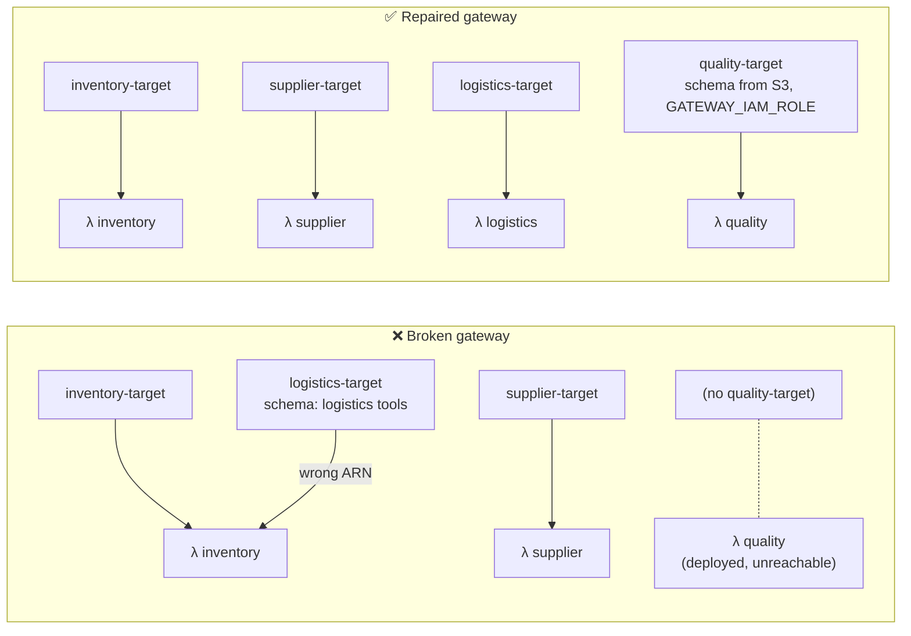

### 5.3 Why the misroute is silent

<p align="center">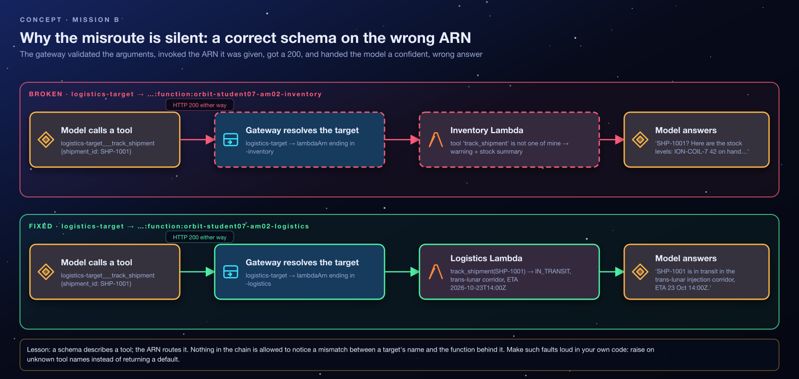</p>

Follow one call through the broken wiring:

1. The model sees `logistics-target___track_shipment` in the menu (the logistics *schema* is correct) and calls it with `shipment_id: "SHP-1001"`.
2. The gateway finds `logistics-target`, reads its Lambda ARN, which points at the **inventory** function, and invokes it. The invocation succeeds.
3. The inventory code strips the prefix, gets `track_shipment`, does not recognise it, and **chooses** to return its stock summary with a warning: *"inventory service received an unknown tool request 'track_shipment' - returning the stock summary instead"*.
4. The gateway returns that JSON as a successful result, and the model writes a confident paragraph about SKUs.

No component is designed to notice that a target's *name* and the *function behind it* disagree. Lesson for your own designs: **raise an error on unknown tool names** instead of returning a default, so misrouting fails loudly.

### 5.4 The symptoms, decoded

| Symptom | Generated by | Plain-English meaning |
|---|---|---|
| *"Check our cargo stock levels"* → the agent says it has **no tools connected**; `gateway_configured: false`, `tools_discovered: 0` | The orchestrator's own trace; the wording comes from the model following its system prompt | Discovery never started: a **client-side** setting on the runtime, not a gateway problem. |
| After fault 1 is fixed: `tools_discovered: 7` | Orchestrator (count of `tools/list` results) | 3 inventory + 2 supplier + 2 logistics. The two quality tools are missing. |
| *"Where is shipment SHP-1001?"* → an answer full of **SKUs and stock levels** | Inventory Lambda's fallback, then the model | Right tool name (`logistics-target___track_shipment` in `tools_called`), wrong function. |
| `tools_called[].result_preview` contains `"service": "inventory"` and `"warning": "inventory service received an unknown tool request 'track_shipment'…` | The inventory Lambda's **response** | The smoking gun: a function answering a tool name it does not own. |
| *"Show the status of cargo quality inspections"* → **no quality-inspection tool** | The model, correctly reporting its menu | `tools/list` had nothing prefixed `quality-target___`. |

> [!NOTE]
> The OrbitOps tool Lambdas do not print to their logs, so the warning text appears in the function's **response** (visible in `result_preview`), not as a log line. In CloudWatch the evidence is *which* function ran: the inventory function's log group (`/aws/lambda/orbit-<you>-am02-inventory`) shows an invocation (`START` / `END` / `REPORT` lines) at the moment you asked about a shipment, while the logistics function shows none.

---

## 6. Step-by-Step Solution

### Fault 1: Point the orchestrator at the gateway

**What it controls:** whether, and where, the agent's MCP client looks for tools. **Why the wrong value broke things:** an empty string switches discovery off entirely.

<p align="center">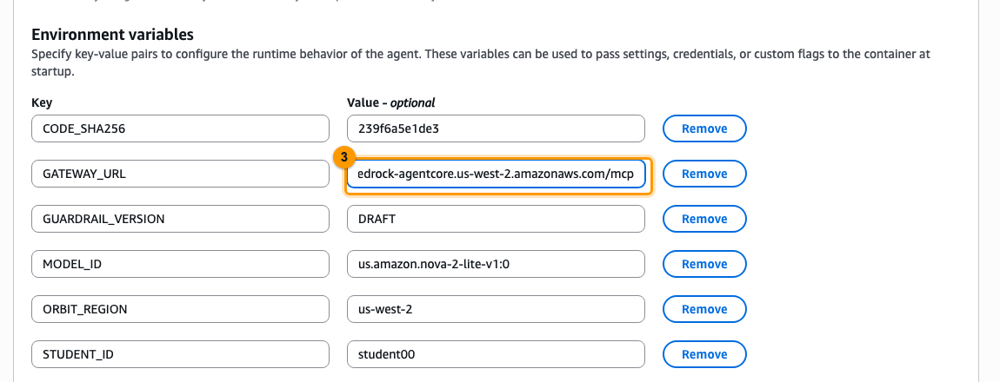</p>

1. Bedrock AgentCore → **Gateways** → `orbit-<you>-am02-gateway` → copy the **Gateway URL**. It is the MCP endpoint `https://<gateway id>.gateway.bedrock-agentcore.us-west-2.amazonaws.com/mcp`, and it matches `gateway_urls[<you>]`. *Why the URL and not the ID or ARN:* the code sends HTTPS POST requests to exactly this string.
2. Bedrock AgentCore → **Runtime** → `orbit_<you>_am02_orchestrator` → **Update runtime** → **Advanced configurations** → **Environment variables** → set `GATEWAY_URL` to that URL. Keep every other variable. Save.
3. Wait for **READY**. **Effect:** the next turn runs `initialize` + `tools/list` and offers the model 7 tools, which reveals faults 2 and 3.

### Faults 2 and 3: Read the targets table critically, then fix and add

<p align="center">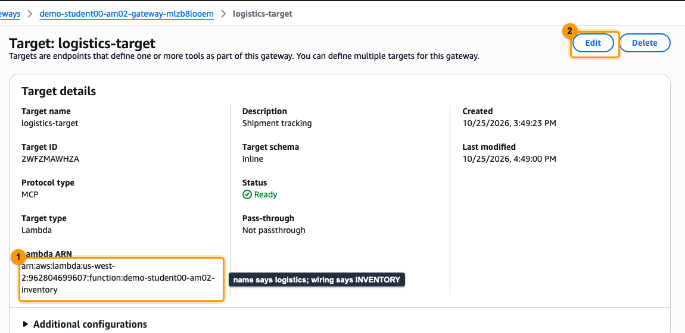</p>

Read the targets as **wiring**, not as names. The targets table lists three rows (no `quality-target`) but shows only names and status, so open `logistics-target`: its **Lambda ARN** ends in `-inventory`. (The details page reports the schema as *Inline*: the gateway stores a resolved copy of the S3 schema; the **Edit** form still shows the S3 location.)

4. **Fault 2:** Gateway → **Targets** → `logistics-target` → **Edit** → Lambda function: choose `orbit-<you>-am02-logistics` (ARN from `tool_function_arns["<you>-logistics"]`) → save. **Keep the name and the schema.** *Why:* only the ARN was wrong; renaming would change every published tool name and break the contract.

<p align="center">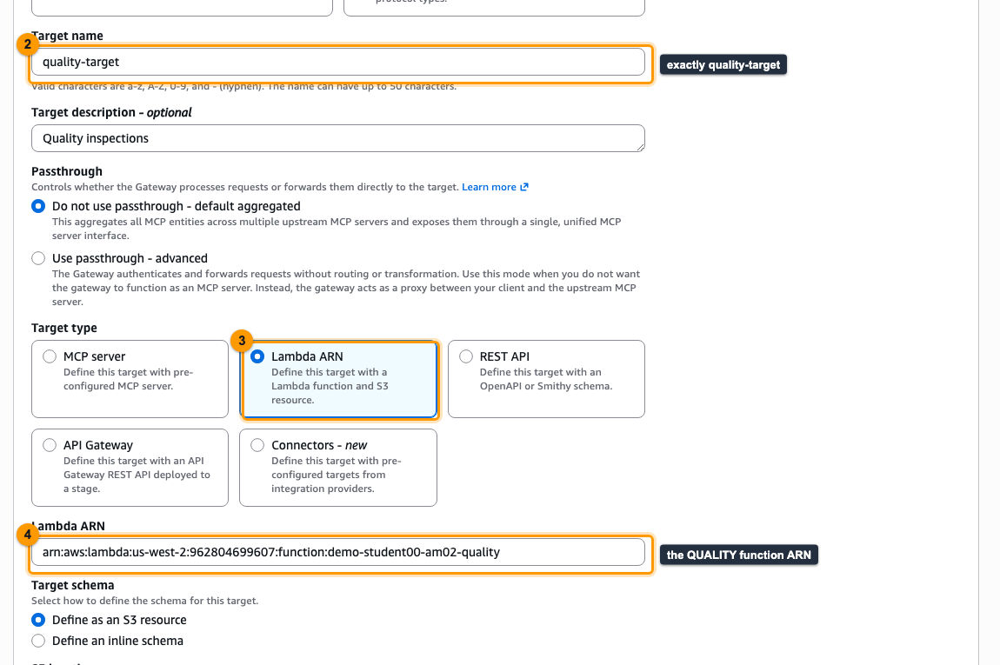</p>

5. **Fault 3:** Gateway → **Targets** → **Add target**:
   - Name: **`quality-target`**. *Why exactly this:* tool names become `quality-target___get_inspection_status` and `quality-target___list_open_inspections`, matching the other `<domain>-target` names and the validation checks.
   - Type: **Lambda**; function `orbit-<you>-am02-quality` (`tool_function_arns["<you>-quality"]`).
   - Tool schema: **from S3** → `quality_schema_s3_uri`. *Why reuse it:* the file is already correct and shared; pasting JSON by hand invites typos.
   - Credential provider: **Gateway IAM role**. *Why:* the gateway's role already has `lambda:InvokeFunction` on your quality function.
   - Create and wait for the target to be `READY`. The orchestrator re-runs discovery on the first turn more than 60 seconds after its last discovery, so wait a minute before judging.

**Effect on the system:** `tools/list` now returns 9 tools, and each tool name routes to the function that owns it.

### CLI equivalent (AWS CLI v2.30+)

```bash
ME=<student id>; GW_ID=<gateway_ids[ME]>; RT_ID=<orchestrator_runtime_ids[ME]>
GW_URL=$(aws bedrock-agentcore-control get-gateway --gateway-identifier "$GW_ID" --query gatewayUrl --output text)
LOGI_ARN=<tool_function_arns[ME-logistics]>; QUAL_ARN=<tool_function_arns[ME-quality]>; QSCHEMA=<quality_schema_s3_uri>

# Fault 1 (UpdateAgentRuntime is a full replacement: start from GetAgentRuntime)
aws bedrock-agentcore-control get-agent-runtime --agent-runtime-id "$RT_ID" \
  | jq --arg u "$GW_URL" '{agentRuntimeId, description, agentRuntimeArtifact, roleArn, networkConfiguration, protocolConfiguration,
      authorizerConfiguration, requestHeaderConfiguration, lifecycleConfiguration,
      environmentVariables: (.environmentVariables | .GATEWAY_URL = $u)} | del(..|nulls)' > rt.json
aws bedrock-agentcore-control update-agent-runtime --cli-input-json file://rt.json

# Fault 2
TID=$(aws bedrock-agentcore-control list-gateway-targets --gateway-identifier "$GW_ID" --query "items[?name=='logistics-target'].targetId" --output text)
aws bedrock-agentcore-control update-gateway-target --gateway-identifier "$GW_ID" --target-id "$TID" --name logistics-target --description "Shipment tracking" \
  --target-configuration "{\"mcp\":{\"lambda\":{\"lambdaArn\":\"$LOGI_ARN\",\"toolSchema\":{\"s3\":{\"uri\":\"s3://<code bucket>/schemas/logistics_tools.json\"}}}}}" \
  --credential-provider-configurations '[{"credentialProviderType":"GATEWAY_IAM_ROLE"}]'

# Fault 3
aws bedrock-agentcore-control create-gateway-target --gateway-identifier "$GW_ID" --name quality-target \
  --target-configuration "{\"mcp\":{\"lambda\":{\"lambdaArn\":\"$QUAL_ARN\",\"toolSchema\":{\"s3\":{\"uri\":\"$QSCHEMA\"}}}}}" \
  --credential-provider-configurations '[{"credentialProviderType":"GATEWAY_IAM_ROLE"}]'
```

> [!CAUTION]
> `update-agent-runtime` and `update-gateway-target` **replace** the whole configuration. That is why fault 1 starts from `get-agent-runtime`, and why fault 2 re-sends the name, the description, the schema and the credential provider.

### The permanent fix (what `terraform/solution` does)

`GATEWAY_URL = aws_bedrockagentcore_gateway.gw[each.key].gateway_url` on the runtime, `lambda_arn = …tool["<student>-logistics"].arn` on the logistics target, and an `aws_bedrockagentcore_gateway_target.quality` resource (S3 schema, `gateway_iam_role {}` credentials). In code the misroute is a one-word diff (`inventory` → `logistics`), which is exactly why reviews should read ARNs and not names.

---

## 7. Verification

<p align="center">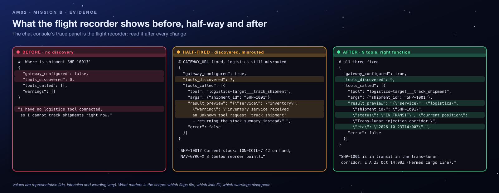</p>

### 7.1 Checklist

- [ ] Runtime `READY`, and its environment shows `GATEWAY_URL` ending in `/mcp`.
- [ ] Targets: `inventory-target`, `supplier-target`, `logistics-target` (function `…-logistics`), `quality-target` (function `…-quality`), all `READY`.
- [ ] Trace: `gateway_configured: true`, `tools_discovered: 9`, `warnings: []`.
- [ ] Shipment question: `tools_called[].tool = logistics-target___track_shipment`, `result_preview` contains `"service": "logistics"`, and the answer gives a position and ETA.
- [ ] Quality question: a `quality-target___…` tool appears in `tools_called`.
- [ ] Inventory and supplier questions still work (you did not break the targets that were right).

### 7.2 Commands

```bash
CHAT=<chat_urls[ME]>
ask() { curl -s -X POST "$CHAT/chat" -H 'content-type: application/json' -d "{\"prompt\":\"$1\",\"actorId\":\"captain-nova\"}"; }
ask "Where is shipment SHP-1001?" | jq '.trace.tools_discovered, .trace.tools_called[].tool, .trace.tools_called[].result_preview, .response'
# 9   "logistics-target___track_shipment"   "{\"service\": \"logistics\", …"   "… Trans-lunar injection corridor … ETA 2026-10-23 …"
ask "Show the status of cargo quality inspections" | jq '.trace.tools_called[].tool'
# "quality-target___list_open_inspections"
```

**Why 9 is itself evidence:** 3 inventory + 2 supplier + 2 logistics + 2 quality tools. In CloudWatch, `/aws/lambda/orbit-<you>-am02-logistics` now shows an invocation each time you ask about a shipment.

> [!TIP]
> **Evidence discipline.** The model's prose is not evidence; `tools_called[].tool` and `result_preview` are. A shipment answer that mentions a *position and ETA* proves routing, and `"service": "logistics"` in the preview proves it even when the prose is vague.

---

## 8. Troubleshooting

### 8.1 Decision tree

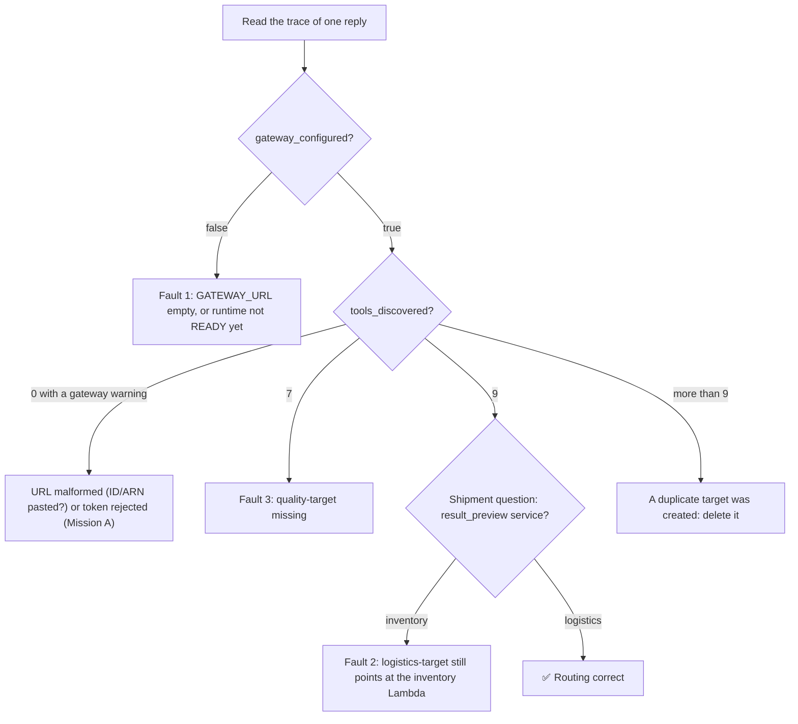

### 8.2 Lessons learned from common mistakes

| Mistake | What you see | The lesson |
|---|---|---|
| Pasting the gateway ARN or ID into `GATEWAY_URL` | `warnings: ["gateway: …"]` with a URL or HTTP error, `tools_discovered: 0` | The MCP client needs `https://<id>.gateway.bedrock-agentcore.us-west-2.amazonaws.com/mcp`. Read how a value is *used* before you set it. |
| Creating a second logistics target instead of fixing the first | Duplicate tools; the model may pick either | Fix the existing resource. Two targets exposing the same tools is a new fault. |
| Naming the new target `quality` or `quality_target` | Tool names become `quality___…`; validation and handouts no longer match | Target names are part of the contract because they prefix every tool. |
| Choosing an inline schema and pasting the wrong JSON | Target `FAILED`, or tools with odd names | The S3 object is already correct; reuse it. |
| Editing a shared schema file in S3 | Classmates' tools change too | The code bucket is shared by the class. Treat it as read-only. |
| Testing before the runtime version is `READY` | Still `gateway_configured: false` | The old version (without `GATEWAY_URL`) is still serving. Wait, then retest. |
| Trusting the answer text | "Looks plausible" for a wrong-domain answer | Trust `tools_called` and `result_preview` over the model's wording. |
| Vague question, model calls `get_stock_summary` for everything | Correct wiring, odd tool choice | Ask with ids (SHP-1001, ION-COIL-7) so the model's choice is unambiguous. |

### 8.3 Distinguish from similar failures

| Symptom | This lab? | Actually is |
|---|---|---|
| `tools_discovered: 0` and `gateway_configured: false` | ✅ | Empty `GATEWAY_URL` |
| `warnings: gateway: Gateway rejected our token (401/403)` | ❌ | Authorizer / client id mismatch (Mission A) |
| Tool called, error mentioning `AccessDeniedException` | ❌ | Gateway role lacks `lambda:InvokeFunction` on that ARN (the provided role has it) |
| Tool returns plausible but wrong-domain data | ✅ | Target wired to the wrong function |
| Model never calls a domain's tool | ✅ | Target missing (or a schema description too vague) |
| `tools_discovered: 9` but a call times out | ❌ | Lambda or network issue (Mission E territory) |

---

## 9. Key Takeaways

- **An agent only knows the tools it can discover.** No gateway URL, no `tools/list`, no tools.
- **Discovery, routing, execution:** three stages, three settings (`GATEWAY_URL`, the target's Lambda ARN, the Lambda's code). Check them in that order.
- **Target name ≠ target wiring.** The Lambda ARN is the routing; the name is a prefix on the tool names.
- **Schemas describe, they don't route.** A perfect schema on the wrong ARN produces confident, wrong answers.
- **Inbound and outbound trust are separate:** a Cognito token to enter the gateway, the gateway's IAM role to call Lambda.
- **Validate with evidence:** `tools_discovered`, `tools_called`, `result_preview` and which function ran, never the model's prose.

**Real-world connection:** "silent wrong answers" are the most expensive bugs in agent systems because users trust fluent text. Production teams add contract tests that call each tool through the gateway and assert on the returned `service`, exactly the check you did by hand.

---

## 10. Knowledge Check

<details><summary><b>1. The gateway is <code>READY</code> with four healthy targets, yet the agent says it has no tools. Name the most likely cause.</b></summary>

The agent does not know the gateway's URL (`GATEWAY_URL` empty, or the runtime version carrying it is not yet `READY`). Discovery is initiated by the client; the gateway never pushes tools to anyone.
</details>

<details><summary><b>2. Which part of a target decides which code runs: the name, the schema or the Lambda ARN?</b></summary>

The Lambda ARN. The name only becomes a prefix on the published tool names, and the schema only describes the tools to the model.
</details>

<details><summary><b>3. What tool name does the quality Lambda see in its context, and what does it do with it?</b></summary>

`quality-target___get_inspection_status` (or `…___list_open_inspections`) in `bedrockAgentCoreToolName`. It strips everything up to and including `___` and dispatches on the bare name.
</details>

<details><summary><b>4. Why did creating <code>quality-target</code> not require any IAM change?</b></summary>

The gateway role's policy already allowed `lambda:InvokeFunction` on all four of your tool functions, including quality, and `s3:GetObject` on `schemas/*`. The credential provider `GATEWAY_IAM_ROLE` makes the gateway use exactly that role.
</details>

<details><summary><b>5. With only fault 1 fixed, how many tools are discovered and why that number?</b></summary>

Seven: 3 inventory + 2 supplier + 2 logistics. The logistics *schema* still publishes its two tools even though its ARN is wrong, and the quality tools are absent because no target exists for them.
</details>

---

## 11. Exam Angle

Challenge B checks: `GATEWAY_URL` on the orchestrator equals the existing gateway's endpoint; `logistics-target` invokes the logistics function (name unchanged); a target named exactly `quality-target` exists with the quality Lambda ARN, the S3 schema `quality_tools.json` and `GATEWAY_IAM_ROLE` credentials; and all four domains answer through the gateway. Expect questions on MCP methods (`initialize`, `tools/list`, `tools/call`), the `<target>___<tool>` naming rule, and what a credential provider is for.

---

## 12. Reflection Questions: Model Answers

1. **Why did the misrouted logistics call return inventory data instead of an error? What would you change in the Lambda to make the fault loud?** The inventory handler's final branch treats any unknown tool name as "return the stock summary and add a warning". The call is valid end to end: the gateway invoked the ARN it was given and the function returned success. Make it loud by raising an exception (or returning an error result) for tool names the function does not own; the trace would then show `error: true` and the model would say the tool failed instead of inventing a logistics answer.
2. **How could the gateway's `tools/list` output alone have revealed fault 3 before you ever chatted?** The list contained seven tools and none prefixed `quality-target___`. Counting tools per prefix against the four expected domains is a two-minute check that does not depend on the model choosing to call anything.
3. **If a target's schema in S3 is edited, does the gateway pick it up automatically? What has to happen?** Do not count on it. Treat the schema as read when the target is created or updated: after editing the S3 object, update the target (re-point it at the same URI) so the gateway re-reads it. Then allow for the orchestrator's 60-second `tools/list` cache before expecting the agent to see the change.

---

## 13. Going Further (optional)

In a sandbox account of your own (the after-class `student-terraform/` stacks), not the shared class bucket:

- Add a second tool to `quality_tools.json` (for example `reopen_inspection`), update the target, and watch `tools_discovered` become 10.
- Replace the inventory function's silent fallback with a raised error and observe how the trace and the model's reply change.
- Point a target at an OpenAPI schema instead of Lambda and compare the credential-provider options.

---

> [!TIP]
> Back to this mission's [after-class runbook](README.md).

<sub>[⬅ All missions](../README.md) · [⬅ AM01 The Locked Launchpad](../AM01-cognito-oauth-launchpad/README.md) · [AM03 The Vanishing Starport Manuals ➡](../AM03-knowledge-base-specialist/README.md)</sub>
