<sub>[⬅ All missions](../README.md) · [⬅ AM02 The Case of the Misrouted Cargo Droids](../AM02-gateway-tool-routing/README.md) · [AM04 The Forgetful Flight Computer ➡](../AM04-agentcore-memory/README.md)</sub>

<p align="center">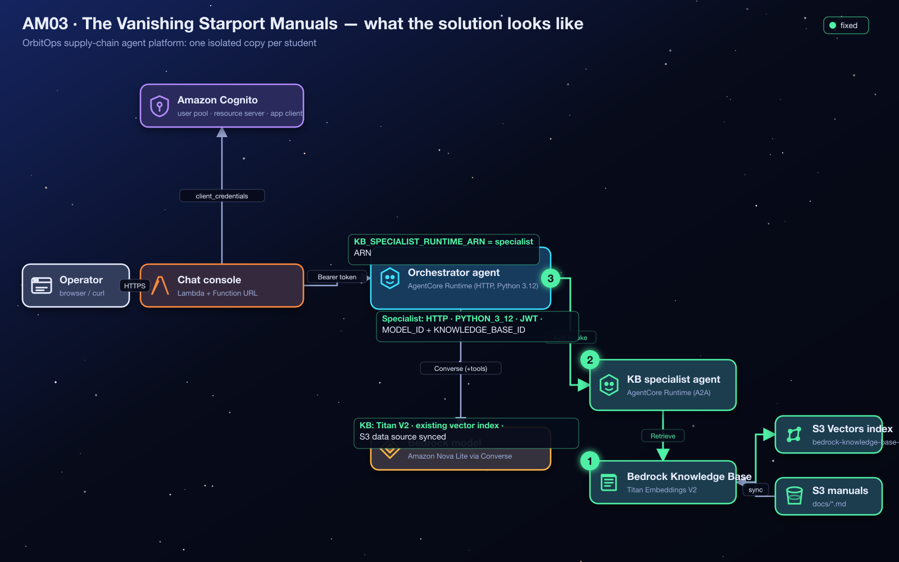</p>

# AM03 — Mission C: The Vanishing Starport Manuals — Solution Handout

> [!NOTE]
> **Answer key and debrief.** Open this after your Flight Test, or when your instructor calls time. It explains *what* to build and *why* the system behaves the way it does. No prior AWS or AI knowledge is assumed: terms are explained before they are used. Console images in this guide are **real screenshots** from an instructor run on 2026-10-25, taken on a demo copy, so resource names read `demo-student00-…` where yours read `orbit-<your id>-…`. The console changes over time; if a label differs slightly, look for the same idea nearby.

**Contents:** [1 Mission recap](#1-mission-recap) · [2 Where you start](#2-where-you-start) · [3 Architecture explained](#3-architecture-explained) · [4 Concepts you need](#4-concepts-you-need-to-understand) · [5 Understanding the failure](#5-understanding-the-failure) · [6 Step-by-step solution](#6-step-by-step-solution) · [7 Verification](#7-verification) · [8 Troubleshooting](#8-troubleshooting) · [9 Key takeaways](#9-key-takeaways) · [10 Knowledge check](#10-knowledge-check) · [11 Exam angle](#11-exam-angle) · [12 Reflection answers](#12-reflection-questions-model-answers) · [13 Going further](#13-going-further-optional)

> [!TIP]
> **New to AWS?** Skim the vocabulary table below first. Every other term is explained where it first matters.

| Words you'll meet | In plain English |
|---|---|
| **AWS console** | The website where you view and change AWS resources by clicking. |
| **Terraform** | A tool that builds cloud resources from code files. Your instructor used it to create your environment; `terraform output` prints the values you were given. |
| **AWS Lambda** | A service that runs a small piece of code on demand, only when something calls it. |
| **IAM role** | An AWS identity that a service or program temporarily "wears" to get a specific, limited set of permissions (IAM = Identity and Access Management). |
| **ARN** | Amazon Resource Name: the full, unique address of an AWS resource, e.g. `arn:aws:lambda:us-west-2:123456789012:function:…`. |
| **AgentCore Runtime** | AWS's managed hosting service for AI agents; OrbitOps's agents run there. |
| **Trace** | The panel under each chat reply that shows what the agent did (tools, memory, guardrail, warnings). It is your main evidence. |
| **S3** | Amazon's file storage service; the manuals live in an S3 bucket. |
| **Vector, embedding, knowledge base** | Explained in §4.2–4.5: numbers that capture meaning, and the service that searches them. |
| **OpenSearch Serverless** | Another AWS vector store, used by the real assessment; much more expensive than S3 Vectors. |

---

## 1. Mission Recap

**The app in one sentence:** OrbitOps is a chat website where cargo operators ask an AI agent (the *flight controller*) questions, including questions about company procedures that are written down in three manuals.

**What went wrong:** the flight controller was designed to hand procedure questions to a second agent, a *knowledge-base specialist* that answers **only** from the manuals. But the searchable library of manuals was never built, the specialist was never deployed, and the flight controller was never told where to find it. So *"What do our procedures say about inventory checks?"* gets a generic guess instead of a quote from the manual.

| | |
|---|---|
| **Scenario** | The orchestrator is designed to delegate document questions to a knowledge-base specialist, but neither the knowledge base nor the specialist exists, and the orchestrator does not know where to delegate. |
| **Gaps planted** | 3: no Bedrock knowledge base over the pre-built S3 Vectors index, no specialist runtime, an empty `KB_SPECIALIST_RUNTIME_ARN`. |
| **Services** | Amazon Bedrock Knowledge Bases, Amazon S3 Vectors, Titan Text Embeddings V2, AgentCore Runtime (direct code deployment), agent-to-agent (A2A) invocation. |
| **The big idea** | A retrieval path is a chain of four links built in dependency order; "created" is not "ingested"; dimensions are a contract. |
| **Time budget** | 60 minutes. The two classic time sinks: letting the wizard create a new (expensive) vector store, and forgetting to sync. |

<p align="center">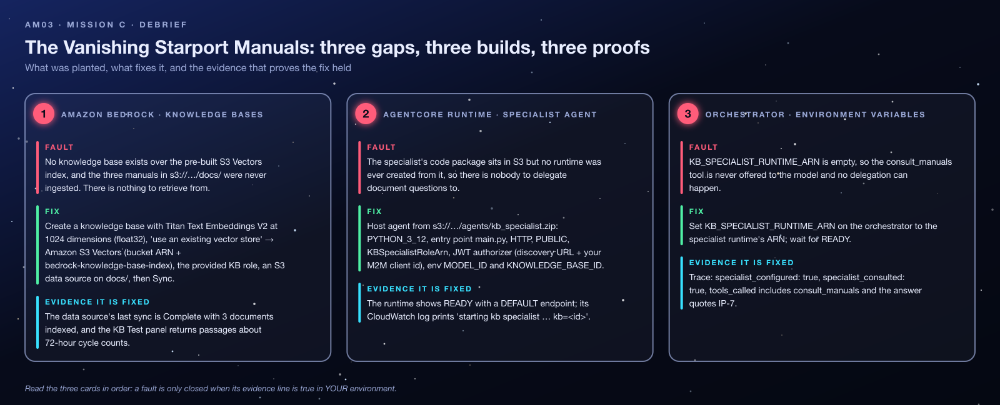</p>

---

## 2. Where You Start

Your instructor deployed `AM03-knowledge-base-specialist/terraform/broken` once for the whole class and gave you the outputs for **your** student id (the repository does not say how they are delivered; ask your instructor if you do not have them). Region: **`us-west-2`**. Unlike Missions A and B, this mission is mostly about **building** three missing resources from parts that were prepared for you.

### 2.1 What is already provisioned

Your `solution_resources_kb[<you>]` output:

| Key | Example | What it is, and why it exists |
|---|---|---|
| `KnowledgeBaseBucketName` + `KnowledgeBaseDocsPrefix` | `orbit-am03-<account id>` + `docs/` | The S3 bucket and folder holding **inventory-procedures.md**, **supplier-manual.md**, **quality-control-manual.md**. |
| `VectorBucketName`, `VectorBucketArn` | `orbit-student07-am03-vectors` | Your **S3 Vectors** bucket: cheap storage built for vectors. |
| `VectorIndexName`, `VectorIndexArn` | `bedrock-knowledge-base-index` | The index inside it: **1024 dimensions, float32, cosine distance**, with `AMAZON_BEDROCK_TEXT` and `AMAZON_BEDROCK_METADATA` as non-filterable metadata (fields Bedrock uses to store each chunk's text and source). |
| `EmbeddingModelId`, `EmbeddingDimensions` | `amazon.titan-embed-text-v2:0`, `1024` | The model and vector size the index was built for. |
| `KnowledgeBaseRoleArn` | `…:role/orbit-student07-am03-kb-role` | IAM role Bedrock uses *on the knowledge base's behalf*. |
| `KBSpecialistRoleArn` | `…:role/orbit-student07-am03-kb-specialist-role` | IAM role the specialist agent runs as. |
| `KBSpecialistAgentCodeS3Uri` | `s3://orbit-am03-<account id>/agents/kb_specialist.zip` | The specialist's code package (entry point `main.py`). |
| `KBSpecialistModelId` | `us.amazon.nova-2-lite-v1:0` | The model the specialist uses to write answers. |

Plus `cognito_discovery_url`, `m2m_client_ids[<you>]` (the working client from Mission A's design), `orchestrator_runtime_ids[<you>]`, `orchestrator_runtime_arns[<you>]` and `chat_urls[<you>]`.

> [!NOTE]
> **This stack has no AgentCore Gateway.** The trace's *gateway* pill stays off and `tools_discovered` stays `0` in Mission C. That is expected, not a fault. The four tool Lambdas are deployed but unused.

### 2.2 Shared vs yours, permissions, cost

| Shared by the class (read only) | Yours alone |
|---|---|
| Cognito pool; code bucket `orbit-am03-<account id>` with the manuals, agent zips and schemas | Vector bucket + index, KB role, specialist role, orchestrator runtime, chat handler, the KB and specialist **you create** |

- Your **KB role can only write to *your* vector index**. Pointing your knowledge base at a classmate's index fails, by design.
- Name what you create like the rest of the stack: `orbit-<you>-am03-kb` for the knowledge base and `<you>_kb_specialist` for the runtime. The instructor's cleanup sweep looks for `orbit` in knowledge-base names and `kb_specialist` in runtime names; a leftover knowledge base blocks deletion of the vector bucket.
- You need Bedrock Knowledge Base and AgentCore Runtime create rights, plus `iam:PassRole` on the two provided roles (the instructor policy covers this).
- **Cost:** S3 Vectors storage and Titan embeddings for three short manuals cost fractions of a cent. The expensive mistake is letting the wizard create a new **OpenSearch Serverless** collection (roughly $0.50 per hour *each*). The knowledge base and specialist runtime you create are **not** tracked by Terraform; the instructor sweeps them before destroying the stack. The account has a per-region quota on knowledge bases, so create one, not several.

---

## 3. Architecture Explained

### 3.1 The components

| Component | Role | Where it runs |
|---|---|---|
| Browser page + **chat handler** Lambda | Sends your question with a valid Cognito token (Mission A's chain, already working). | Your browser + AWS Lambda |
| **Orchestrator** agent | Decides whether a question is about procedures; if so, calls its `consult_manuals` tool. | AgentCore Runtime |
| **Knowledge-base specialist** agent *(you deploy it)* | A second, narrow agent: searches the knowledge base and answers *only* from what it finds, citing the source file. | AgentCore Runtime (its own runtime, role and settings) |
| **Bedrock knowledge base** *(you create it)* | Turns a question into the most relevant passages from the manuals. | Fully managed (Amazon Bedrock) |
| **S3 Vectors index** | Stores one vector per chunk of manual text. | Fully managed (Amazon S3 Vectors) |
| **S3 docs folder** | The raw manuals (Markdown files). | Amazon S3 |
| **Titan Text Embeddings V2** | Converts text into vectors, at sync time and at question time. | Amazon Bedrock |
| **Nova 2 Lite** | Writes the final wording for both agents. | Amazon Bedrock |

### 3.2 Two lanes: building the library, and using it

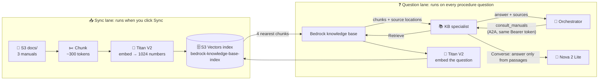

### 3.3 The delegation call, step by step

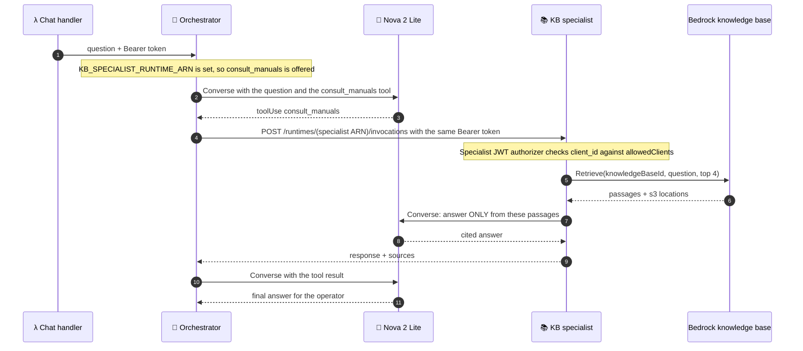

### 3.4 What happens when one link is missing

| Missing link | What the operator gets | Trace evidence |
|---|---|---|
| Orchestrator variable empty | *"I have no manuals specialist connected, so I cannot look that up."* (the orchestrator tells the model which tools exist, so it doesn't make a procedure up) | `specialist_configured: false`, no `consult_manuals` call |
| Specialist rejects the token | The model says it could not consult the manuals (wording varies) | `tools_called[0].error` contains `Specialist runtime returned 401/403` |
| Specialist missing `KNOWLEDGE_BASE_ID` | An apology or a vague answer | `result_preview` contains `Specialist fault: RuntimeError: KNOWLEDGE_BASE_ID is not configured…` |
| Knowledge base empty (never synced) | "The manuals do not contain anything relevant to that question" | `result_preview` contains `0 passages retrieved` |

---

## 4. Concepts You Need to Understand

### 4.1 Retrieval-augmented generation (RAG)

A language model cannot know your private documents, and it cannot read 1,000 pages for every question. **RAG** is the standard fix: *retrieve* the few passages that matter, then let the model *generate* an answer from them. *Analogy:* an open-book exam. The student (model) is fast, but must first find the right pages (retrieval).

### 4.2 Embeddings: meaning as numbers

An **embedding model** turns a piece of text into a list of numbers called a **vector**, with the property that texts with similar *meaning* get vectors that point in similar *directions*. "How often are bays counted?" and "Every storage bay is cycle-counted every 72 hours" share few words but land close together. Titan Text Embeddings V2 produces vectors of 256, 512 or **1024** numbers; more numbers capture more nuance.

### 4.3 Vector store, index and dimensions

A **vector store** holds millions of vectors and quickly finds the ones *nearest* to a query vector. Here it is **Amazon S3 Vectors**: a vector bucket containing an **index** named `bedrock-knowledge-base-index`. When the index was created, it was fixed to **1024 dimensions** and **cosine** distance (which compares directions). That makes **dimensions a contract**: every vector written into or compared against the index must have exactly 1024 numbers. A 512-number vector cannot be compared with 1024-number ones, just as a 5-digit ZIP code will not fit a 9-digit form field.

> [!NOTE]
> The micro-credential's environment uses an **OpenSearch Serverless** collection with the same index name; this lab uses S3 Vectors because it costs cents instead of hundreds of dollars per student per month. The idea, "use an existing vector store, matching its dimensions", is identical.

### 4.4 Chunking

Manuals are too long to embed as one vector (one vector would blur every topic together). Ingestion therefore cuts them into **chunks**. The provided solution uses fixed-size chunks of about **300 tokens with 20 % overlap**, so a sentence cut at a boundary still appears whole in one chunk. A *text* token is roughly ¾ of a word (nothing to do with the Cognito *access* token in §4.10).

### 4.5 Knowledge base, data source and sync

An **Amazon Bedrock knowledge base** is the managed service that wires the pieces together: *which* embedding model, *which* vector store, *which* documents. Its **data source** says where the documents live (`s3://<bucket>/docs/`). Creating a data source only *registers* the location. Nothing is read until an **ingestion job** (the console's **Sync** button) runs: read S3 → chunk → embed → write vectors. A knowledge base that was never synced shows *Available* and contains **zero vectors**. "Created" is not "ingested".

<p align="center">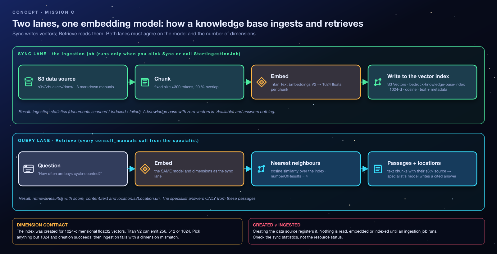</p>

### 4.6 `Retrieve`

At question time the specialist calls the knowledge base's **`Retrieve`** API with its **knowledge base ID** (a short 10-character code, not the name or ARN). Bedrock embeds the question with the *same* model, asks the index for the nearest chunks (the specialist asks for 4) and returns each chunk's text, a relevance score and its S3 location. The specialist then calls Nova 2 Lite with an instruction to answer *only* from those passages and to name the document.

### 4.7 Why a second agent? Agent-to-agent (A2A)

The orchestrator could search the manuals itself, but a dedicated **specialist** keeps responsibilities narrow: different instructions ("answer only from passages"), different permissions (retrieve from the knowledge base and call models, nothing more), and it can be updated independently. The orchestrator sees it as just another tool, `consult_manuals`, that only exists in its tool menu when `KB_SPECIALIST_RUNTIME_ARN` is set. Calling it is an HTTPS request to the AgentCore data plane: **agent-to-agent** delegation.

### 4.8 Hosting an agent: direct code deployment and the runtime contract

**AgentCore Runtime** can run a **zip file from S3** with no container build ("direct code deployment"). You tell it the Python version (`PYTHON_3_12`), the **entry point** (`main.py`) and the **protocol** (`HTTP`). In return, your code must keep a promise, the *runtime contract*: serve `POST /invocations` (do the work) and `GET /ping` (report healthy) on port 8080. Both OrbitOps agents are small Python HTTP servers that keep exactly this promise. Each runtime also gets:

- an **execution role**: the IAM identity the agent's code runs as;
- **environment variables**: settings the code reads (`MODEL_ID`, `KNOWLEDGE_BASE_ID`);
- an **inbound authorizer**: who may call it;
- a **`DEFAULT` endpoint**, created automatically and always pointing at the latest `READY` version.

### 4.9 Two IAM roles, two jobs (least privilege)

<p align="center">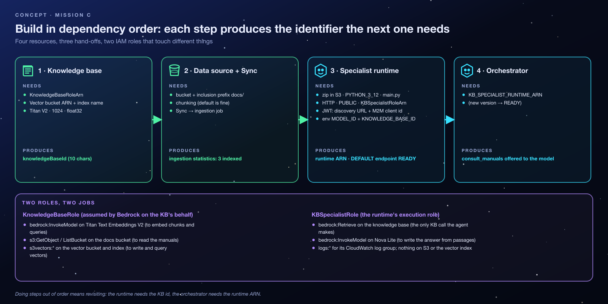</p>

| Role | Who "wears" it | Allowed to |
|---|---|---|
| `…-kb-role` (`KnowledgeBaseRoleArn`) | **Amazon Bedrock**, while syncing and retrieving for your KB | Invoke Titan V2; list the code bucket and read `docs/*`; read/write **your** vector index |
| `…-kb-specialist-role` (`KBSpecialistRoleArn`) | **Your specialist's code** in AgentCore Runtime | `bedrock:Retrieve` / `RetrieveAndGenerate` on knowledge bases; invoke models; write logs; read its own code package |

The agent never gets write access to the index or raw access to the documents; the KB service never gets to run arbitrary agent code. This is **least privilege**: each identity gets only what its job requires.

### 4.10 One access token, two judges

The orchestrator forwards the **same Cognito bearer token** it received to the specialist. So the specialist needs a **JWT authorizer** with the same `discoveryUrl` and the same `allowedClients` (`m2m_client_ids[<you>]`) as the orchestrator. Without an authorizer, a runtime expects AWS IAM-signed requests instead and rejects a bearer token.

### 4.11 Misconceptions to unlearn

- ❌ *"The knowledge base is Available, so it has my documents."* ✅ Only a completed **sync** with non-zero statistics proves ingestion.
- ❌ *"Any embedding size will do."* ✅ It must equal the index's dimension (1024).
- ❌ *"`specialist_consulted: true` means the answer came from the manuals."* ✅ It means the specialist *replied*; its reply may be an error or "0 passages". Read `result_preview`.
- ❌ *"The specialist reads the S3 files."* ✅ It only queries the knowledge base. Bedrock (with the KB role) read the files at sync time.

---

## 5. Understanding the Failure

| # | Gap | Where | Why the system fails |
|---|---|---|---|
| 1 | No Bedrock knowledge base over the pre-built S3 Vectors index; manuals never ingested | Bedrock Knowledge Bases | Nothing to retrieve *from*. The index, documents and roles exist; the resource that joins them does not. |
| 2 | Specialist runtime never deployed from `agents/kb_specialist.zip` | AgentCore Runtime | Nobody to delegate *to*. |
| 3 | `KB_SPECIALIST_RUNTIME_ARN = ""` on the orchestrator | Orchestrator environment variables | The code only adds `consult_manuals` to the tool menu when this is set, so the model is never offered the option. |

**How it happened (the story).** The platform team prepared everything that costs time or money up front (the vector index, the IAM roles, the documents, the code package) and left the three resources that *join* them for a hand-over that never happened. This is a realistic shape: half-built pipelines where every ingredient exists and nothing is connected.

### 5.1 The symptoms, decoded

| Symptom | Generated by | Plain-English meaning |
|---|---|---|
| *"What do our cargo handling procedures say about inventory checks?"* → *"I have no manuals specialist connected…"*; trace `specialist_configured: false` | Orchestrator trace; wording from Nova 2 Lite | The orchestrator was never told a specialist exists. |
| Bedrock → Knowledge Bases shows nothing for your id | Bedrock console | Nothing to retrieve from. |
| AgentCore → Runtime shows only your orchestrator | AgentCore console | Nobody to delegate to, although the code package sits in S3. |
| (Partial fix) `result_preview`: *0 passages retrieved* | Specialist code | The chain is connected, but the index is empty: no sync, or a failed sync. |
| (Partial fix) tool error `Specialist runtime returned 401` or `403` | AgentCore Runtime status, worded by the orchestrator | The specialist's authorizer is missing or does not list your client id. |
| (Partial fix) `Specialist fault: … ResourceNotFoundException` or `ValidationException` | Bedrock, relayed by the specialist | `KNOWLEDGE_BASE_ID` holds a name, an ARN or a typo instead of the ID. |

---

## 6. Step-by-Step Solution

Build in **dependency order**: each step produces the identifier the next one needs.

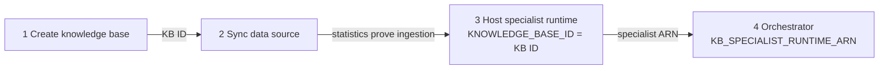

### Gap 1: Knowledge base on the existing S3 Vectors index, data source, sync

<p align="center">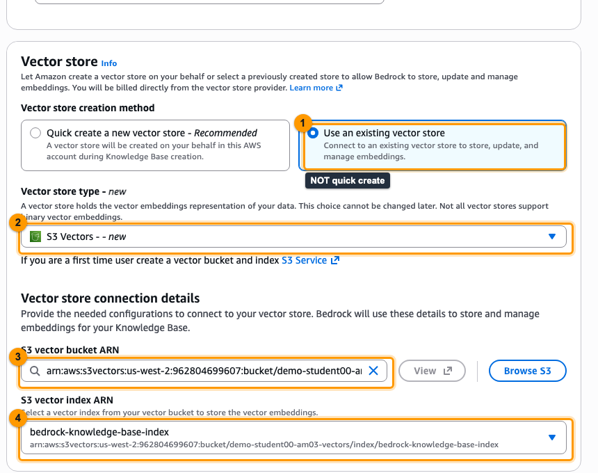</p>

1. Amazon Bedrock → **Knowledge Bases** → **Create** → *Knowledge base with vector store*.
2. Name `orbit-<you>-am03-kb`. IAM role: **use an existing role** → `KnowledgeBaseRoleArn`. *Why:* that role already has exactly the permissions Bedrock needs; a new role would lack access to your index.
3. Data source **Amazon S3**, URI `s3://<KnowledgeBaseBucketName>/docs/`. Chunking: default, or fixed size 300 tokens with 20 % overlap. *Why the `docs/` prefix:* the bucket also holds code zips and schemas you do not want in the library.
4. Embeddings model **Titan Text Embeddings V2**, **1024** dimensions, floating point. *Why:* it must match the index. 256 or 512 would break ingestion.
5. Vector store: **Use an existing vector store** → **Amazon S3 Vectors** → vector bucket `VectorBucketArn`, index `bedrock-knowledge-base-index` (if the console asks for the index ARN, use `VectorIndexArn`). *Why:* the "quick create" branch builds a new, more expensive store and ignores your prepared index.
6. Review and create. Copy the **Knowledge base ID**.

<p align="center">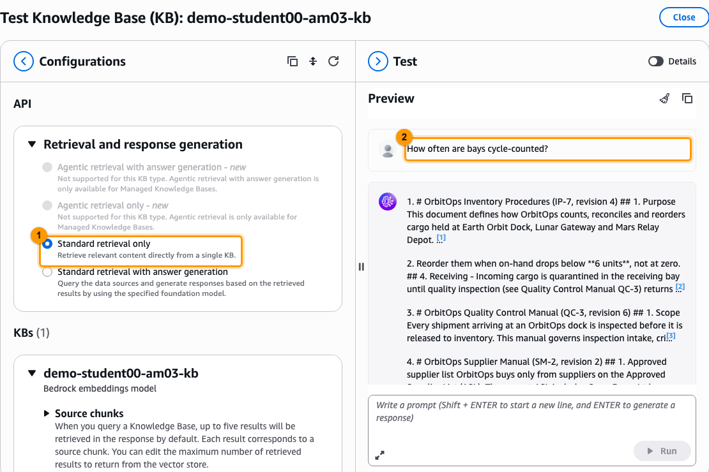</p>

7. Open the data source → **Sync**. Wait for *Complete* and read the statistics: **3 documents** scanned and indexed. *Why this matters:* this is the only proof that vectors now exist.
8. **Test** panel: ask *"How often are bays cycle-counted?"* and confirm a passage from `inventory-procedures.md` comes back. Retrieval is now proven; everything after this is agent wiring.

### Gap 2: Host the specialist runtime

<p align="center">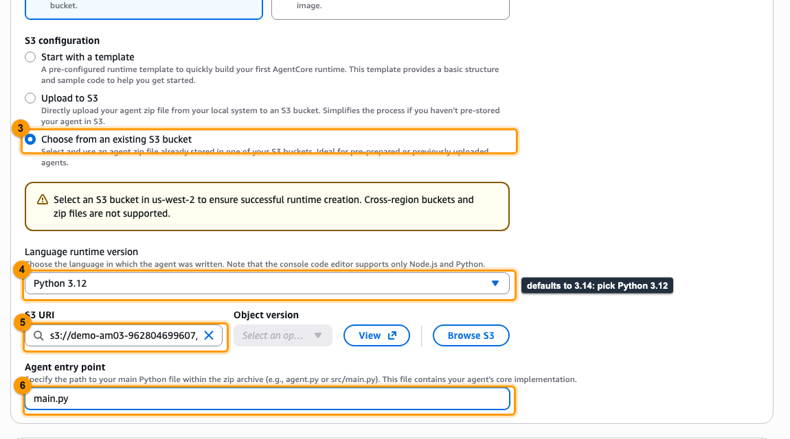</p>

9. Bedrock AgentCore → **Runtime** → **Create runtime**. Source **S3** → `KBSpecialistAgentCodeS3Uri`. Runtime **Python 3.12**. Entry point `main.py`. Protocol **HTTP**. Network **Public**. *Why these values:* they describe the code package (a Python HTTP server whose entry file is `main.py`).
10. Execution role: existing → `KBSpecialistRoleArn`. Name `<you>_kb_specialist` (letters, digits and underscores only; runtime names reject hyphens).
11. Inbound identity: **OAuth / JWT** → discovery URL `cognito_discovery_url`, allowed clients `m2m_client_ids[<you>]`. *Why:* the orchestrator will call with the forwarded Cognito token (§4.10).
12. Environment variables: `MODEL_ID=<KBSpecialistModelId>` and `KNOWLEDGE_BASE_ID=<the KB ID from step 6>`.
13. Create. The `DEFAULT` endpoint is created with it. Wait for **READY** and copy the **runtime ARN**.

### Gap 3: Delegation

14. Runtime → your **orchestrator** → **Update runtime** → **Advanced configurations** → **Environment variables** → add `KB_SPECIALIST_RUNTIME_ARN=<specialist ARN>`, keeping the existing variables → save → wait for **READY**. **Effect:** from the next turn, the model's tool menu includes `consult_manuals`.

### CLI equivalent (AWS CLI v2.30+)

```bash
ME=<student id>
KB_ROLE=<KnowledgeBaseRoleArn>; INDEX_ARN=<VectorIndexArn>; BUCKET=<KnowledgeBaseBucketName>
SPEC_ROLE=<KBSpecialistRoleArn>; DISC=<cognito_discovery_url>; CLIENT=<m2m_client_ids[ME]>; RT_ID=<orchestrator_runtime_ids[ME]>

# Gap 1: knowledge base over the existing S3 Vectors index, data source, sync
KB=$(aws bedrock-agent create-knowledge-base --name "orbit-$ME-am03-kb" --role-arn "$KB_ROLE" \
  --knowledge-base-configuration '{"type":"VECTOR","vectorKnowledgeBaseConfiguration":{"embeddingModelArn":"arn:aws:bedrock:us-west-2::foundation-model/amazon.titan-embed-text-v2:0","embeddingModelConfiguration":{"bedrockEmbeddingModelConfiguration":{"dimensions":1024,"embeddingDataType":"FLOAT32"}}}}' \
  --storage-configuration "{\"type\":\"S3_VECTORS\",\"s3VectorsConfiguration\":{\"indexArn\":\"$INDEX_ARN\"}}" \
  --query knowledgeBase.knowledgeBaseId --output text)
DS=$(aws bedrock-agent create-data-source --knowledge-base-id "$KB" --name manuals \
  --data-source-configuration "{\"type\":\"S3\",\"s3Configuration\":{\"bucketArn\":\"arn:aws:s3:::$BUCKET\",\"inclusionPrefixes\":[\"docs/\"]}}" \
  --query dataSource.dataSourceId --output text)
aws bedrock-agent start-ingestion-job --knowledge-base-id "$KB" --data-source-id "$DS"
aws bedrock-agent list-ingestion-jobs --knowledge-base-id "$KB" --data-source-id "$DS" --query 'ingestionJobSummaries[0].[status,statistics]'

# Gap 2: specialist runtime (direct code deployment)
SPEC_ARN=$(aws bedrock-agentcore-control create-agent-runtime --agent-runtime-name "${ME}_kb_specialist" \
  --agent-runtime-artifact "{\"codeConfiguration\":{\"code\":{\"s3\":{\"bucket\":\"$BUCKET\",\"prefix\":\"agents/kb_specialist.zip\"}},\"runtime\":\"PYTHON_3_12\",\"entryPoint\":[\"main.py\"]}}" \
  --role-arn "$SPEC_ROLE" --network-configuration '{"networkMode":"PUBLIC"}' --protocol-configuration '{"serverProtocol":"HTTP"}' \
  --authorizer-configuration "{\"customJWTAuthorizer\":{\"discoveryUrl\":\"$DISC\",\"allowedClients\":[\"$CLIENT\"]}}" \
  --environment-variables "MODEL_ID=us.amazon.nova-2-lite-v1:0,KNOWLEDGE_BASE_ID=$KB,ORBIT_REGION=us-west-2" \
  --query agentRuntimeArn --output text)

# Gap 3: orchestrator delegation (full-replacement update)
aws bedrock-agentcore-control get-agent-runtime --agent-runtime-id "$RT_ID" \
  | jq --arg a "$SPEC_ARN" '{agentRuntimeId, description, agentRuntimeArtifact, roleArn, networkConfiguration, protocolConfiguration,
      authorizerConfiguration, requestHeaderConfiguration, lifecycleConfiguration,
      environmentVariables: (.environmentVariables | .KB_SPECIALIST_RUNTIME_ARN = $a)} | del(..|nulls)' > rt.json
aws bedrock-agentcore-control update-agent-runtime --cli-input-json file://rt.json
```

`ORBIT_REGION` in the CLI version is optional: the specialist falls back to the runtime's `AWS_REGION`.

### The permanent fix (what `terraform/solution` does)

`aws_bedrockagent_knowledge_base` (S3_VECTORS storage, Titan V2 at 1024), `aws_bedrockagent_data_source` (fixed 300-token chunks, 20 % overlap) plus a `terraform_data` resource that runs `agents/start_ingestion.py`, because Terraform can create a data source but has no built-in "sync" action. Then `aws_bedrockagentcore_agent_runtime.specialist` and `KB_SPECIALIST_RUNTIME_ARN` on the orchestrator.

---

## 7. Verification

<p align="center">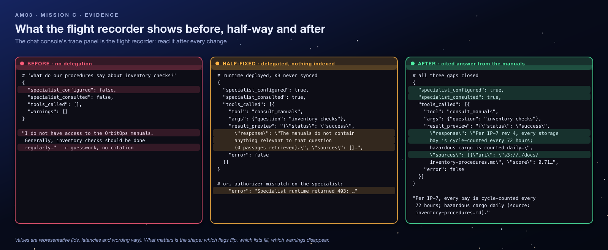</p>

**Test inside-out.** The KB Test panel proves retrieval; a specialist reply proves hosting and identity; the chat proves delegation. When something fails, the innermost layer that still passes tells you where to look.

- [ ] Sync job **Complete**, statistics show **3** documents indexed.
- [ ] KB **Test** panel returns a passage from `inventory-procedures.md`.
- [ ] Specialist runtime **READY**, with the JWT authorizer, `MODEL_ID` and `KNOWLEDGE_BASE_ID` set.
- [ ] Orchestrator **READY**; trace shows `specialist_configured: true`.
- [ ] A procedure question shows `consult_manuals` in `tools_called`, `specialist_consulted: true`, a `result_preview` that is **not** an error or "0 passages", and an answer that cites the manual.

```bash
CHAT=<chat_urls[ME]>
curl -s -X POST "$CHAT/chat" -H 'content-type: application/json' \
  -d '{"prompt":"What do our cargo handling procedures say about inventory checks?","actorId":"captain-nova"}' \
  | jq '.trace.specialist_consulted, .trace.tools_called[0].tool, .trace.tools_called[0].result_preview, .response'
# true   "consult_manuals"   "Per IP-7 …"   "Per IP-7, every storage bay is cycle-counted every 72 hours … hazardous cargo daily …"

aws bedrock-agent-runtime retrieve --knowledge-base-id "$KB" --retrieval-query text="cycle counts" --query 'retrievalResults[0].location'
# an s3Location ending in docs/inventory-procedures.md
```

---

## 8. Troubleshooting

### 8.1 Decision tree

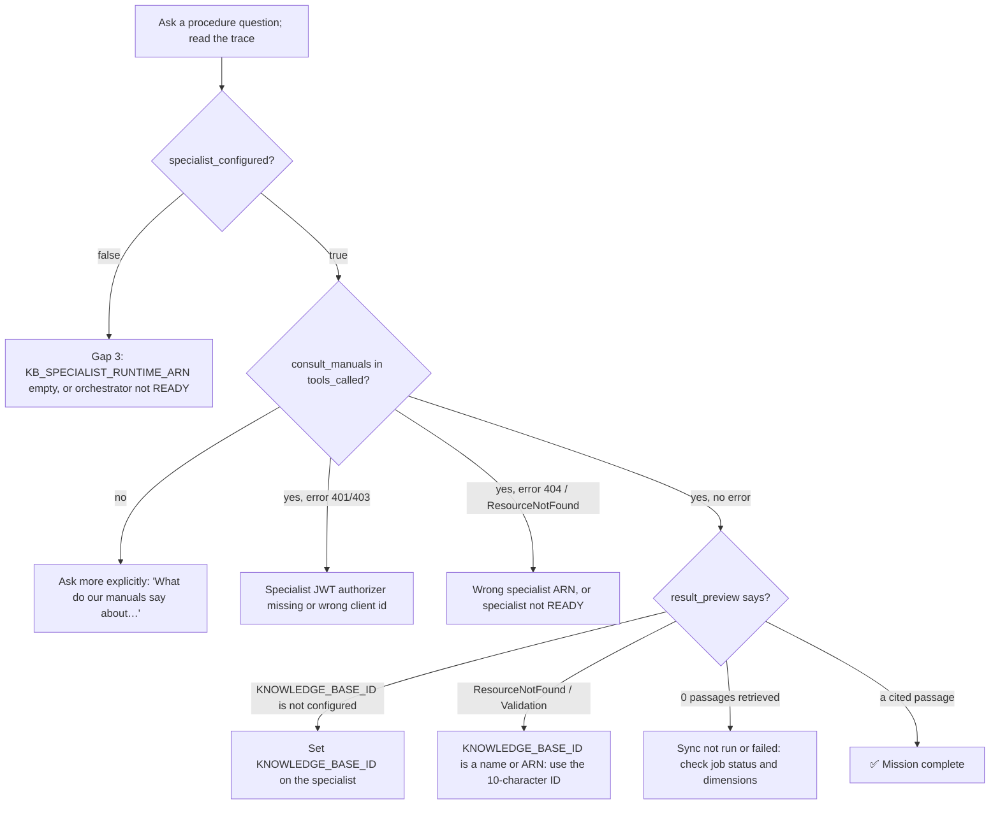

### 8.2 Lessons learned from common mistakes

| Mistake | What you see | The lesson |
|---|---|---|
| Letting the wizard **create a new vector store** | An OpenSearch Serverless collection appears (expensive) and your index is unused | Read the vector-store step slowly: "use an existing store" is the branch you were given everything for. |
| Choosing **256 or 512** dimensions | The KB may be created, but the sync fails on a dimension mismatch | The index defines the contract. Check `EmbeddingDimensions` before the wizard asks. |
| Creating the KB and **never syncing** | Specialist answers "0 passages retrieved" | Resource status is not ingestion status. Read the sync statistics. |
| Picking a classmate's vector bucket or index | Sync fails with an access error | Your KB role can only write to *your* index, by design. |
| Forgetting the specialist's **authorizer** or allowing a different client id | `consult_manuals` error 401/403 | A2A reuses the caller's token; the callee must trust the same client. |
| Naming the runtime with **hyphens** | Validation error on create | Runtime names accept letters, digits and underscores only. |
| Setting `KNOWLEDGE_BASE_ID` to the **name or ARN** | Specialist error on `Retrieve` (`ResourceNotFoundException` / validation) | The 10-character ID is what the data-plane API expects. |
| Fixing the orchestrator **first** | You come back to edit it again once the ARN exists | Build in dependency order: KB → sync → specialist → orchestrator. |

### 8.3 Distinguish from similar failures

| Symptom | This lab? | Actually is |
|---|---|---|
| `specialist_configured: false` | ✅ | Orchestrator variable unset |
| `consult_manuals` error 401/403 | ✅ | Specialist authorizer mismatch |
| `consult_manuals` error 424 | ❌ | Specialist code crashed; read its log group under `/aws/bedrock-agentcore/runtimes/` |
| "0 passages retrieved" | ✅ | Not synced, dimension mismatch, or wrong KB |
| `AccessDeniedException` on `bedrock:Retrieve` | ❌ | Specialist role lacks `bedrock:Retrieve` (the pre-built role has it) |
| Ingestion job `FAILED` with an S3 error | ❌ | KB role cannot read the bucket, or the prefix is wrong |
| `gateway_configured: false`, `tools_discovered: 0` | ❌ | Expected: Mission C has no gateway |

---

## 9. Key Takeaways

- **KB creation checklist:** embedding model + dimensions, existing vector store + index, service role, data source, **sync**.
- **Index dimensions must match the embedding model configuration.** Mismatches surface at ingestion, not at creation.
- **A data source is inert until synced.** Validate ingestion statistics, not resource status.
- **Direct code deployment checklist:** S3 zip, `PYTHON_3_12`, `main.py`, HTTP, role, JWT authorizer, environment variables, `DEFAULT` endpoint `READY`.
- **Delegation = an environment variable + a trusted identity.** The orchestrator only delegates when it knows the specialist's ARN *and* holds a token the specialist trusts.
- **Separate roles, separate powers.** The KB role touches documents and vectors; the specialist role retrieves and calls models but cannot write the index or read the raw manuals.

**Real-world connection:** company chatbots that answer "what is our policy on…" are almost always RAG systems like this one. Most of their production incidents are "the documents changed but nobody re-synced", which is gap 1 in a different costume.

---

## 10. Knowledge Check

<details><summary><b>1. The knowledge base shows <i>Available</i>, but the specialist says "0 passages retrieved". What do you check first?</b></summary>

The data source's sync history: was an ingestion job run, did it complete, and do the statistics show documents indexed? "Available" describes the resource, not its contents.
</details>

<details><summary><b>2. Why must the knowledge base use 1024 dimensions in this lab?</b></summary>

The pre-built S3 Vectors index was created with `dimension = 1024`. Every vector written to it or compared with it must have exactly that many numbers.
</details>

<details><summary><b>3. Which identity reads the manuals from S3: the specialist agent or Bedrock?</b></summary>

Bedrock, using the knowledge-base role, at sync time. The specialist only calls `Retrieve` on the knowledge base and never touches the files.
</details>

<details><summary><b>4. You created the specialist without an inbound JWT authorizer. What happens when the orchestrator calls it, and why?</b></summary>

The call is rejected (401/403). Without a JWT authorizer the runtime expects AWS IAM-signed requests, but the orchestrator sends a Cognito bearer token. The specialist must trust the same `discoveryUrl` and client id as the orchestrator.
</details>

<details><summary><b>5. <code>specialist_consulted</code> is <code>true</code>. Does that prove the answer came from the manuals?</b></summary>

No. It only means the specialist returned HTTP 200. Its body can still be an error ("KNOWLEDGE_BASE_ID is not configured") or "0 passages retrieved". Check `result_preview` and look for a cited source.
</details>

---

## 11. Exam Angle

Challenge C checks: a knowledge base using the existing vector store and index name with Titan V2 at the index's dimensions and the provided role; an S3 data source on the documents, **synced**; a second AgentCore runtime deployed from the provided code package with the specified Python version, entry point, protocol, network mode, role and JWT authorizer; `MODEL_ID` and `KNOWLEDGE_BASE_ID` on it; a `DEFAULT` endpoint; and the orchestrator's `KB_SPECIALIST_RUNTIME_ARN`. Expect questions on why dimensions matter, what an ingestion job does, and the runtime HTTP contract (`/invocations`, `/ping`, port 8080). In the assessment the vector store is OpenSearch Serverless with field mappings; the reasoning is the same.

---

## 12. Reflection Questions: Model Answers

1. **Why does the knowledge base need its own IAM role, separate from the specialist runtime's role? What does each role touch?** Bedrock assumes the KB role to do the KB's work: invoke the embedding model, read the documents bucket, and write and query the vector index. The specialist's execution role only needs `bedrock:Retrieve` on the KB and `InvokeModel` on the answer model (plus logs). Keeping them separate means the agent never holds write access to the index or read access to raw documents: least privilege at each layer.
2. **What would happen if you chose 512 dimensions? At which step would it fail?** The knowledge base itself may well be created. The first ingestion job fails when it tries to write 512-number vectors into an index declared for 1024, and the sync status shows the error. Nothing becomes retrievable, so the specialist reports 0 passages.
3. **The orchestrator forwards its bearer token to the specialist. What would you change if the specialist belonged to another team with its own identity provider?** The forwarded token would not be trusted. The orchestrator would need to obtain a token the specialist accepts: typically a `client_credentials` token from the other team's identity provider (or Cognito pool), using a client id registered on the specialist's authorizer, stored in configuration or an AgentCore credential provider, and cached like the chat handler does. The specialist's `discoveryUrl` and `allowedClients` would then point at that provider.

---

## 13. Going Further (optional)

In a sandbox account of your own (the after-class `student-terraform/` stacks), not the shared class bucket:

- Add a fourth manual to `docs/`, sync again, and confirm the statistics show 4 documents and the Test panel finds it.
- Set `NUM_RESULTS` on the specialist to 1 and observe how answer quality changes; then raise it to 8.
- Replace the specialist's `Retrieve` call with `RetrieveAndGenerate` and compare what the orchestrator receives.

---

> [!TIP]
> Back to this mission's [after-class runbook](README.md).

<sub>[⬅ All missions](../README.md) · [⬅ AM02 The Case of the Misrouted Cargo Droids](../AM02-gateway-tool-routing/README.md) · [AM04 The Forgetful Flight Computer ➡](../AM04-agentcore-memory/README.md)</sub>
