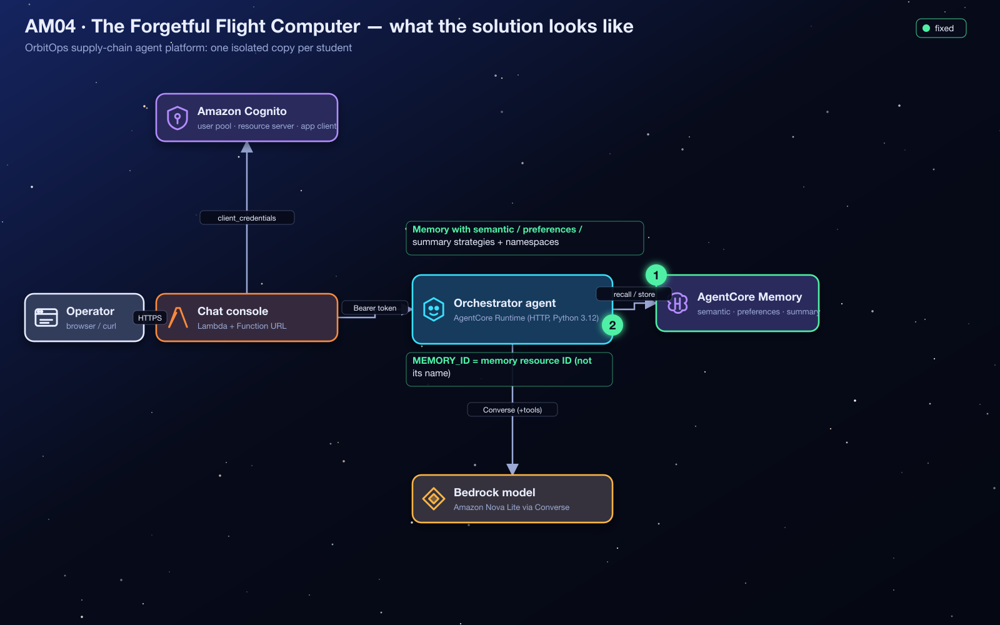
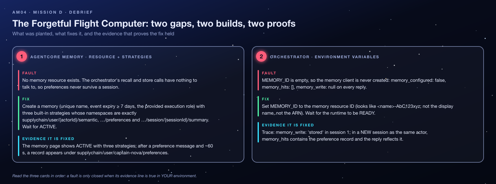
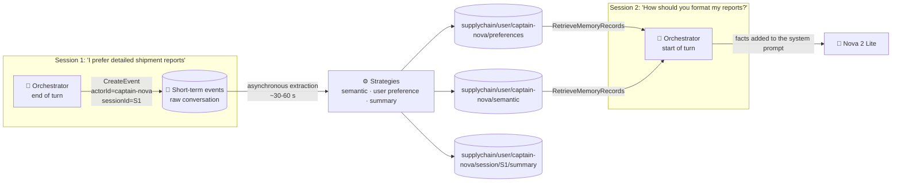
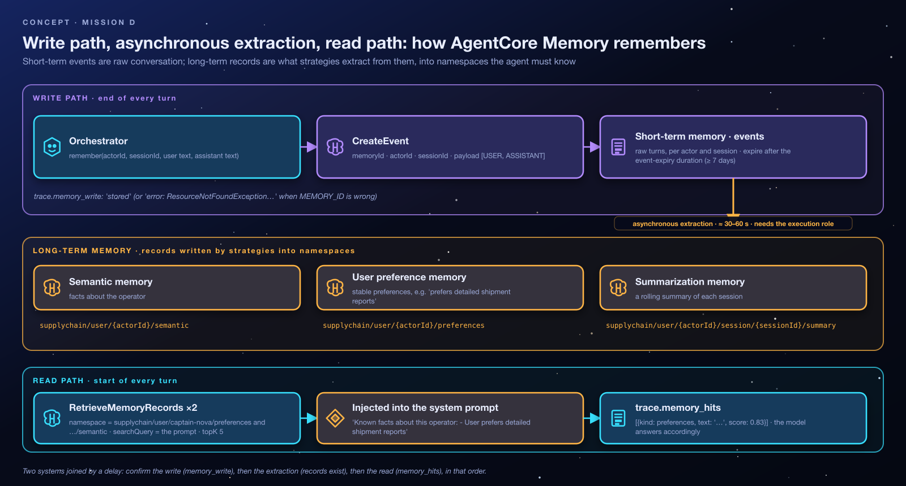
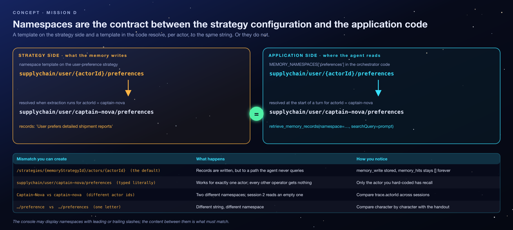
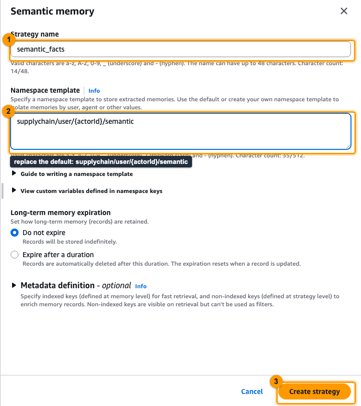
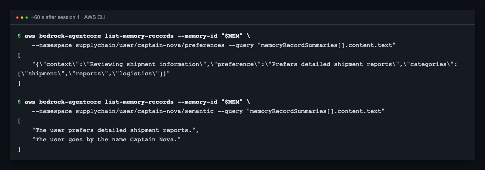
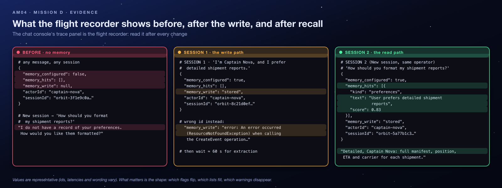
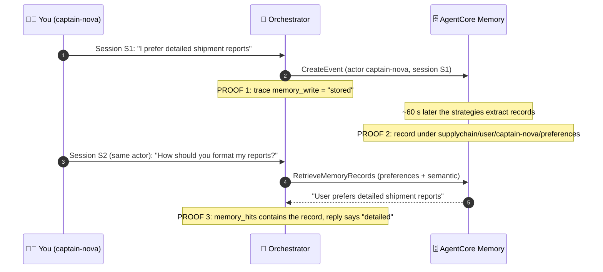
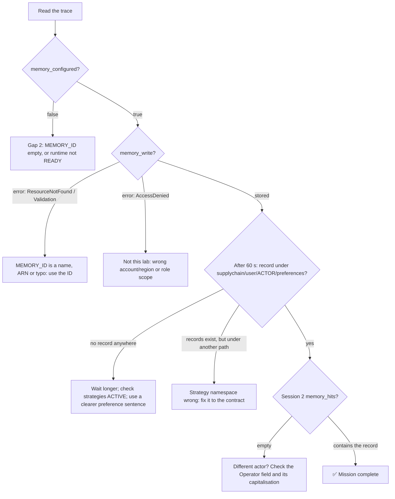

<sub>[⬅ All missions](../README.md) · [⬅ AM03 The Vanishing Starport Manuals](../AM03-knowledge-base-specialist/README.md) · [AM05 Close the Exposed Hyperspace Lanes ➡](../AM05-vpc-private-networking/README.md)</sub>

<p align="center"></p>

# AM04 — Mission D: The Forgetful Flight Computer — Solution Handout

> [!NOTE]
> **Answer key and debrief.** Open this after your Flight Test, or when your instructor calls time. It explains *what* to build and *why* the system behaves the way it does. No prior AWS or AI knowledge is assumed: terms are explained before they are used. Console images in this guide are **real screenshots** from an instructor run on 2026-10-25, taken on a demo copy, so resource names read `demo-student00-…` where yours read `orbit-<your id>-…`. The console changes over time; if a label differs slightly, look for the same idea nearby.

**Contents:** [1 Mission recap](#1-mission-recap) · [2 Where you start](#2-where-you-start) · [3 Architecture explained](#3-architecture-explained) · [4 Concepts you need](#4-concepts-you-need-to-understand) · [5 Understanding the failure](#5-understanding-the-failure) · [6 Step-by-step solution](#6-step-by-step-solution) · [7 Verification](#7-verification) · [8 Troubleshooting](#8-troubleshooting) · [9 Key takeaways](#9-key-takeaways) · [10 Knowledge check](#10-knowledge-check) · [11 Exam angle](#11-exam-angle) · [12 Reflection answers](#12-reflection-questions-model-answers) · [13 Going further](#13-going-further-optional)

> [!TIP]
> **New to AWS?** Skim the vocabulary table below first. Every other term is explained where it first matters.

| Words you'll meet | In plain English |
|---|---|
| **AWS console** | The website where you view and change AWS resources by clicking. |
| **Terraform** | A tool that builds cloud resources from code files. Your instructor used it to create your environment; `terraform output` prints the values you were given. |
| **AWS Lambda** | A service that runs a small piece of code on demand, only when something calls it. |
| **IAM role** | An AWS identity that a service or program temporarily "wears" to get a specific, limited set of permissions (IAM = Identity and Access Management). |
| **ARN** | Amazon Resource Name: the full, unique address of an AWS resource, e.g. `arn:aws:lambda:us-west-2:123456789012:function:…`. |
| **AgentCore Runtime** | AWS's managed hosting service for AI agents; OrbitOps's agents run there. |
| **Trace** | The panel under each chat reply that shows what the agent did (tools, memory, guardrail, warnings). It is your main evidence. |
| **Data plane** | The AWS APIs that do the everyday work (write an event, read records), as opposed to the *control plane* that creates and configures resources. |
| **Cognito token** | The access pass the chat app gets from Amazon Cognito so the agent will accept its requests (Mission A). |

---

## 1. Mission Recap

**The app in one sentence:** OrbitOps is a chat website where cargo operators talk to an AI agent (the *flight controller*) about their supply chain.

**What went wrong:** Captain Nova tells the agent *"I prefer detailed shipment reports"*, starts a new chat session the next day, and the agent has no idea. The agent's code already knows how to remember things, but the **memory store** it is supposed to use was never created, and the agent was never given its ID. The code quietly skips memory when it has no ID, so there is no error, just forgetfulness.

| | |
|---|---|
| **Scenario** | The orchestrator already contains its memory integration, but no memory resource exists and the agent holds no ID for one, so operator preferences vanish between sessions. |
| **Gaps planted** | 2: no AgentCore Memory resource (with the three strategies and namespaces), and an empty `MEMORY_ID`. |
| **Services** | Amazon Bedrock AgentCore Memory: short-term events, long-term strategies (semantic, user preference, summarization), namespaces, `actorId` / `sessionId`. |
| **The big idea** | Write path and read path are different systems joined by asynchronous extraction, and the namespace string is the contract between them. |
| **Time budget** | 35 minutes plus a 60-second wait. Students lose time by testing too early or as a different actor. |

<p align="center"></p>

---

## 2. Where You Start

Your instructor deployed `AM04-agentcore-memory/terraform/broken` once for the class and gave you the outputs for **your** student id (the repository does not say how they are delivered; ask your instructor if you do not have them). Region: **`us-west-2`**.

| Output | Example | What it is |
|---|---|---|
| `chat_urls[<you>]` | `https://….lambda-url.us-west-2.on.aws/` | Your chat console. The sidebar has an **Operator (actorId)** field (default `captain-nova`) and a **New session** button. |
| `orchestrator_runtime_ids[<you>]` | `orbit_student07_am04_orchestrator-…` | Your agent's runtime; `MEMORY_ID` lives in its environment variables. |
| `memory_execution_role_arns[<you>]` | `…:role/orbit-student07-am04-memory-role` | An IAM role AgentCore Memory may use to run models for extraction (it carries the AWS-managed policy `AmazonBedrockAgentCoreMemoryBedrockModelInferenceExecutionRolePolicy`). |

The orchestrator's role **already** has permission to write events and read records in any AgentCore Memory in this account and region. You only need to create the memory and hand the agent its ID.

> [!NOTE]
> **This stack has no AgentCore Gateway.** `gateway_configured: false` and `tools_discovered: 0` are expected in Mission D, not a fault.

**Shared vs yours.** The Cognito pool and the code bucket are shared. Your runtime, memory role, chat handler and the **memory you create** are yours. Name it like the rest of the stack, `orbit_<you>_am04_memory` (the instructor's cleanup sweep looks for `orbit` in memory IDs). Memories are **not** tracked by Terraform: the instructor sweeps hand-made ones before resetting.

**Quotas, cost, privacy.** The region allows 150 memories by default, so create **one**. Events, records and retrievals cost fractions of a cent. Extraction shares a model-throughput quota across the class, so if everyone tests at the same second, records may take a little longer to appear. Memory keeps what you type, so use the fictional sample sentences and never real personal data.

---

## 3. Architecture Explained

### 3.1 The components

| Component | Role in this mission | Where it runs |
|---|---|---|
| Browser page | Lets you choose the **Operator** (becomes `actorId`) and start a **New session** (a new `sessionId`). | Your browser (served by the chat Lambda) |
| Chat handler Lambda | Passes your prompt, `actorId` and `sessionId` to the agent with a Cognito token. | AWS Lambda |
| **Orchestrator** agent | At the **start** of each turn, *reads* long-term memory for this actor; at the **end**, *writes* the conversation turn as an event. | AgentCore Runtime |
| **AgentCore Memory** *(you create it)* | Stores events (short-term) and runs **strategies** that extract long-term records into **namespaces**. | Fully managed AWS service |
| Nova 2 Lite | Writes the replies; memory facts are added to its instructions. | Amazon Bedrock |

### 3.2 Write path, extraction, read path



### 3.3 One turn, in order

1. The orchestrator calls **`RetrieveMemoryRecords`** twice, once per namespace it reads (`…/preferences` and `…/semantic`), searching with your prompt and taking up to 5 records each.
2. Any records it finds are appended to the system prompt as *"Known facts about this operator (from long-term memory)"*.
3. Nova 2 Lite answers.
4. The orchestrator calls **`CreateEvent`** with the user message and the assistant reply.
5. Later and in the background, AgentCore Memory's strategies read new events and write records.

> [!NOTE]
> **Honest detail:** this orchestrator reads only the `preferences` and `semantic` namespaces. The summarization strategy is still required (by the brief and the application's memory contract), and its records exist for other consumers, but this agent never reads them back.

### 3.4 What happens when one part fails

| If… | Trace shows |
|---|---|
| `MEMORY_ID` empty | `memory_configured: false`, `memory_hits: []`, `memory_write: null` (the code never tried) |
| `MEMORY_ID` wrong (name, ARN, typo) | `memory_write: "error: …"` and `memory_hits` entries with an `error` field |
| Memory fine, wrong namespace in a strategy | `memory_write: "stored"` but `memory_hits` empty, forever |
| Memory fine, tested too early or as another actor | `memory_write: "stored"`, `memory_hits` empty *for now* |

---

## 4. Concepts You Need to Understand

### 4.1 Why agents forget

A language model has **no memory between calls**. Each request starts from a blank page containing only what the program sends. Within one conversation, apps re-send recent messages; *across* conversations, something must store what matters and bring it back. That "something" is **AgentCore Memory**, a managed service so you do not build your own database, search and summariser.

### 4.2 Actor and session

- **`actorId`**: *who* the memory is about (here, the operator: `captain-nova`). Recall is **per actor**, and the ID is case-sensitive: `Captain-Nova` and `captain-nova` are different people to the system.
- **`sessionId`**: *which conversation* (the chat console generates a new one when you click **New session**).

*Analogy:* a doctor's records. The **actor** is the patient; each **session** is one visit.

### 4.3 Short-term memory: events

**`CreateEvent`** stores a raw conversation turn tagged with `actorId` and `sessionId`. Events are kept for the memory's **event expiry** (7 to 365 days; this lab uses 7) and then deleted automatically. *Analogy:* the transcript of a visit.

### 4.4 Long-term memory: strategies and records

A **strategy** is a background process that reads new events, uses a model to pull out what is worth keeping, and saves it as a **memory record**. The three built-in strategies extract different kinds of knowledge:

| Strategy | Extracts | Example record |
|---|---|---|
| **Semantic** | Facts stated in the conversation | "Captain Nova manages the Lunar Gateway bays." |
| **User preference** | How the person likes things done | "User prefers detailed shipment reports." |
| **Summarization** | A running summary of one session | "Traced SHP-1002, which is delayed by a solar storm." |

<p align="center"></p>

Extraction is **asynchronous**: it happens roughly 30 to 60 seconds after the event, not during the chat turn. Records do not expire with events. *Analogy:* the doctor's notes ("allergic to penicillin"), written after the visit and kept indefinitely.

### 4.5 Namespaces: the contract

Every record is saved under a **namespace**, a path-like string. A strategy is configured with a **namespace template** containing placeholders that the service fills in from each event:

```text
supplychain/user/{actorId}/preferences    →   supplychain/user/captain-nova/preferences
```

The agent code holds the **same template** and fills in the actor itself when it reads. If the strategy writes to one path and the code reads another (for example the console's default `/strategies/{memoryStrategyId}/actors/{actorId}`), the records exist but the agent never finds them. *Analogy:* two people agreeing on which drawer of the filing cabinet a document goes into. File it in the wrong drawer and it is "lost" even though it exists.

<p align="center"></p>

`{actorId}` and `{sessionId}` are **placeholders**. Typing `captain-nova` into the template would make memory work for exactly one operator. (AWS's general guidance suggests namespaces with leading and trailing slashes to avoid prefix collisions between tenants. This lab's templates omit them; what matters is that strategy and code agree exactly.)

### 4.6 Three identifiers: name, ID, ARN

| Identifier | Example | Used for |
|---|---|---|
| Name | `orbit_student07_am04_memory` | Humans, in the console |
| **ID** | `orbit_student07_am04_memory-AbC123xyZ9` | **Data-plane API calls**: this is what `MEMORY_ID` needs |
| ARN | `arn:aws:bedrock-agentcore:us-west-2:…:memory/orbit_student07_am04_memory-AbC123xyZ9` | IAM policies |

The ID is the part after `memory/` in the ARN.

### 4.7 The execution role

Some extraction work runs models on your behalf. The **memory execution role** is the IAM identity AgentCore Memory assumes to do that. It is a different identity from the orchestrator's runtime role, which only needs to *write events and read records*.

### 4.8 Misconceptions to unlearn

- ❌ *"`memory_write: stored` means the agent will remember."* ✅ It proves the **write**. Extraction and the read path are separate stages.
- ❌ *"Memory works instantly."* ✅ Extraction is asynchronous; test after about a minute.
- ❌ *"New session = new person."* ✅ New session changes `sessionId` only. Recall follows `actorId`.
- ❌ *"Namespaces are cosmetic labels."* ✅ They are an exact-match contract between configuration and code.

---

## 5. Understanding the Failure

| # | Gap | Where | Why it breaks |
|---|---|---|---|
| 1 | No AgentCore Memory resource with the three strategies and namespaces | AgentCore Memory | Nothing to write to or read from. |
| 2 | `MEMORY_ID = ""` on the orchestrator | Orchestrator environment variables | The code creates its memory client only `if MEMORY_ID`, so both `recall` and `remember` return immediately. |

**How it happened (the story).** The application was written against a memory contract (three namespaces, one actor per operator) before the resource was provisioned, and the provisioning never happened. The code is "inert but correct": it degrades gracefully, which is exactly why the symptom is silence rather than an error.

### 5.1 The symptoms, decoded

| Symptom | Generated by | Plain-English meaning |
|---|---|---|
| State a preference, click **New session**, ask about it → the agent has no idea | Nova 2 Lite, with no memory facts in its prompt | Nothing persisted across sessions. The code is present; its store is not. |
| Every reply: `memory_configured: false`, `memory_hits: []`, `memory_write: null` | Orchestrator trace | The memory client was never created. `null` (not `error`) means the code never even tried. |
| AgentCore → Memory shows nothing with your id | AgentCore console | No resource exists. |
| (Partial fix) `memory_write: "error: … ResourceNotFoundException"` or `ValidationException` | AgentCore Memory, relayed by the orchestrator | `MEMORY_ID` holds a name, an ARN or a typo. |
| (Partial fix) `memory_write: "stored"`, `memory_hits` empty after a minute | Orchestrator trace | Write works; the strategy namespace differs from the one the code reads, or the actor changed. |

---

## 6. Step-by-Step Solution

### Gap 1: Create the memory with three strategies

<p align="center"></p>

1. Bedrock AgentCore → **Memory** → **Create memory**: name `orbit_<you>_am04_memory`, a description, **Short-term memory (raw event) expiration: 7 days** (the console defaults to 90). *Why 7:* it is what the brief requires and plenty for a lab (the service accepts 3–365). The console does not ask for an execution role for built-in strategies; the CLI path below passes `memory_execution_role_arns[<you>]`.
2. **Built-in strategies → Add strategy** → add **Semantic memory**, **User preferences** and **Summarization** (not *Episodes*). Each opens a side panel with a default namespace template (`/strategies/{memoryStrategyId}/actors/{actorId}/`): **replace it** with:

   | Strategy | Namespace (copy exactly) |
   |---|---|
   | Semantic | `supplychain/user/{actorId}/semantic` |
   | User preference | `supplychain/user/{actorId}/preferences` |
   | Summarization | `supplychain/user/{actorId}/session/{sessionId}/summary` |

   *Why:* these are the paths the application's code reads (§4.5). The console's defaults are valid paths that this agent never looks at.
3. Create. Wait for the memory **and** its strategies to be **ACTIVE**, then copy the **Memory ID** (not the name, not the ARN).

**Effect on the system:** a store now exists, but the agent still does not know about it.

### Gap 2: Give the orchestrator the ID

4. Runtime → your orchestrator → **Update runtime** → **Advanced configurations** → **Environment variables** → add `MEMORY_ID=<memory id>`, keeping the existing variables → save → wait for **READY**. *Why the wait:* the update creates a new runtime version; the old one, without `MEMORY_ID`, answers until the new one is ready.

**Effect on the system:** from the next turn, the agent reads before answering and writes after.

### Prove it (console)

<p align="center"></p>

5. Chat as `captain-nova`: *"I'm Captain Nova, and I prefer detailed shipment reports."* Trace: `memory_write: "stored"`.
6. Wait about 60 seconds. The console has no browser for long-term records, so list them with the CLI: `aws bedrock-agentcore list-memory-records --memory-id <id> --namespace supplychain/user/captain-nova/preferences --query 'memoryRecordSummaries[].content.text'`. Expect one record, stored as JSON, similar to `{"context":"…","preference":"Prefers detailed shipment reports",…}`; the `…/semantic` namespace holds plain facts such as *The user prefers detailed shipment reports.* (The exact wording is the model's.) No CLI? Skip to step 7: `memory_hits` in the trace is the same proof.
7. Click **New session**, keep the **same operator**, and ask *"How should you format my shipment reports?"* → "detailed", with the record in `memory_hits`.

### CLI equivalent (AWS CLI v2.30+)

```bash
ME=<student id>; ROLE=<memory_execution_role_arns[ME]>; RT_ID=<orchestrator_runtime_ids[ME]>
MEM=$(aws bedrock-agentcore-control create-memory --name "orbit_${ME}_am04_memory" --event-expiry-duration 7 --memory-execution-role-arn "$ROLE" \
  --memory-strategies '[
    {"semanticMemoryStrategy":{"name":"semantic_facts","namespaces":["supplychain/user/{actorId}/semantic"]}},
    {"userPreferenceMemoryStrategy":{"name":"operator_preferences","namespaces":["supplychain/user/{actorId}/preferences"]}},
    {"summaryMemoryStrategy":{"name":"session_summaries","namespaces":["supplychain/user/{actorId}/session/{sessionId}/summary"]}}]' \
  --query memory.id --output text)
aws bedrock-agentcore-control get-memory --memory-id "$MEM" --query 'memory.[status, strategies[].namespaces]'   # ACTIVE

aws bedrock-agentcore-control get-agent-runtime --agent-runtime-id "$RT_ID" \
  | jq --arg m "$MEM" '{agentRuntimeId, description, agentRuntimeArtifact, roleArn, networkConfiguration, protocolConfiguration,
      authorizerConfiguration, requestHeaderConfiguration, lifecycleConfiguration,
      environmentVariables: (.environmentVariables | .MEMORY_ID = $m)} | del(..|nulls)' > rt.json
aws bedrock-agentcore-control update-agent-runtime --cli-input-json file://rt.json
```

### The permanent fix (what `terraform/solution` does)

`aws_bedrockagentcore_memory` (expiry 7, execution role) plus three `aws_bedrockagentcore_memory_strategy` resources (`SEMANTIC`, `USER_PREFERENCE`, `SUMMARIZATION`) with `namespace_templates`, and `MEMORY_ID = aws_bedrockagentcore_memory.mem[each.key].id` on the orchestrator. Note the attribute: `.id`, not `.name` or `.arn`.

---

## 7. Verification

<p align="center"></p>

**Three stages, three proofs.** Skip a stage and you cannot tell which half is broken.



- [ ] Memory and all three strategies **ACTIVE**; namespaces exactly as in §6.
- [ ] Orchestrator **READY**; trace `memory_configured: true`.
- [ ] Session 1: `memory_write: "stored"`.
- [ ] After about 60 s: a record exists under `supplychain/user/captain-nova/preferences`.
- [ ] Session 2, **same operator**: `memory_hits` contains the record and the reply reflects it.

```bash
CHAT=<chat_urls[ME]>; S1="orbit-captain-nova-$(uuidgen | tr -d - | tr A-Z a-z)"
curl -s -X POST "$CHAT/chat" -H 'content-type: application/json' \
  -d "{\"prompt\":\"I'm Captain Nova, and I prefer detailed shipment reports.\",\"actorId\":\"captain-nova\",\"sessionId\":\"$S1\"}" | jq '.trace.memory_write'
# "stored"
sleep 75
aws bedrock-agentcore list-memory-records --memory-id "$MEM" --namespace supplychain/user/captain-nova/preferences --query 'memoryRecordSummaries[].content.text'
# ["User prefers detailed shipment reports"]   (wording may vary)
S2="orbit-captain-nova-$(uuidgen | tr -d - | tr A-Z a-z)"
curl -s -X POST "$CHAT/chat" -H 'content-type: application/json' \
  -d "{\"prompt\":\"How should you format my shipment reports?\",\"actorId\":\"captain-nova\",\"sessionId\":\"$S2\"}" | jq '.response, .trace.memory_hits'
```

When testing by CLI, make session IDs at least 33 characters long (the chat handler silently replaces shorter ones, because AgentCore Runtime requires that length) and use only letters, digits, `-` and `_` (the chat handler rewrites any other character to `-`). The `orbit-captain-nova-<32 hex>` pattern above satisfies both, as do the IDs the chat console generates.

---

## 8. Troubleshooting

### 8.1 Decision tree



### 8.2 Lessons learned from common mistakes

| Mistake | What you see | The lesson |
|---|---|---|
| Keeping the **default strategy namespaces** | `memory_write: stored`, records exist, `memory_hits` empty forever | Namespaces are a contract between strategy configuration and code. Copy them exactly. |
| Typing a **real actor id** into the namespace template | Works for one operator only | `{actorId}` and `{sessionId}` are placeholders the service fills in per event. |
| Setting `MEMORY_ID` to the **name or ARN** | `memory_write: "error: … ResourceNotFoundException …"` (or a validation error) | The data plane wants the ID (`<name>-<random>`). Three identifiers, one correct. |
| Testing **immediately** | Session 2 knows nothing | Extraction is asynchronous. Wait a minute and check the records before chatting. |
| Testing session 2 **as a different actor** (or different capitalisation) | Session 2 knows nothing | Recall is per actor. Same Operator field, new session. |
| Event expiry below **7 days** | Accepted by the service (3–365), but fails the brief's check | The brief requires ≥ 7; the console default of 90 also passes. |
| A vague preference ("reports, you know") | No preference record extracted | Extraction is model-based: state preferences plainly. |

### 8.3 Distinguish from similar failures

| Symptom | This lab? | Actually is |
|---|---|---|
| `memory_configured: false` | ✅ | `MEMORY_ID` unset |
| `memory_write: error ResourceNotFoundException` | ✅ | Wrong ID |
| `memory_write: stored`, no hits after a minute | ✅ | Namespace or actor mismatch |
| `memory_write: error AccessDeniedException` | ❌ | Runtime role, or a memory in another account or region |
| Hits present but the model ignores them | ❌ | Prompting; the facts are injected as "Known facts about this operator" |
| Strategies stuck in `CREATING` | ❌ | Service-side delay; wait, or check the execution role |
| `gateway_configured: false` | ❌ | Expected: Mission D has no gateway |

---

## 9. Key Takeaways

- **Memory = resource + strategies + namespaces.** The agent code only supplies the ID, the actor and the session.
- **Write path ≠ read path.** Events go in; strategies extract records later; the agent reads records. Verify each stage separately.
- **Namespaces are an API contract**, matched exactly and case-sensitively.
- **Extraction is asynchronous;** validation needs a wait and the same `actorId`.
- **Use the resource ID** in `MEMORY_ID`, not the name or ARN.
- **Short-term events expire; long-term records do not.** Different retention, different APIs, different purposes.

**Real-world connection:** "personalised" assistants (support bots that remember your device, shopping assistants that remember your size) are built from exactly these pieces. "Forget me" requests and multi-user isolation are design questions you answer through the actor and namespace scheme.

---

## 10. Knowledge Check

<details><summary><b>1. The trace says <code>memory_write: null</code>. What does <code>null</code> (as opposed to an error) tell you?</b></summary>

The code never attempted a write: `MEMORY_ID` is empty, so no memory client exists. An `error: …` value would mean it tried and failed.
</details>

<details><summary><b>2. Session 1 shows <code>memory_write: "stored"</code>. Ten seconds later session 2 knows nothing. Is something broken?</b></summary>

Not necessarily. Extraction runs asynchronously, roughly 30 to 60 seconds after the event. Wait, confirm a record exists under the resolved namespace, then test again as the same actor.
</details>

<details><summary><b>3. You test session 2 as <code>Captain-Nova</code> after session 1 as <code>captain-nova</code>. Result?</b></summary>

No recall. The actor ID is case-sensitive, so the namespace `supplychain/user/Captain-Nova/preferences` is different from `supplychain/user/captain-nova/preferences`.
</details>

<details><summary><b>4. Which of the three namespaces does this orchestrator actually read?</b></summary>

`…/preferences` and `…/semantic`. The summary namespace is written by the summarization strategy but not read back by this agent.
</details>

<details><summary><b>5. What is the difference between an event and a memory record?</b></summary>

An event is the raw conversation turn (short-term, kept until the event expiry). A record is knowledge a strategy extracted from events (long-term, kept until deleted), stored under a namespace.
</details>

---

## 11. Exam Angle

Challenge D checks: a memory resource with an expiry of at least 7 days; the three built-in strategy types (semantic, user preference, summarization) with the exact namespace strings; `MEMORY_ID` on the orchestrator set to the resource ID; and recall of a previously supplied preference across sessions for the same actor. Expect questions on the difference between events and records, what a namespace template is, and why the test needs a wait.

---

## 12. Reflection Questions: Model Answers

1. **Why keep three strategies instead of one? What does a session summary give an operator that a preference record does not?** Each strategy extracts a different *kind* of knowledge: semantic facts ("Captain Nova manages the Lunar Gateway bays"), stable preferences ("prefers detailed reports"), and a per-session summary ("in this session we traced SHP-1002 and opened an incident"). A summary lets an operator, or a colleague, resume a long task mid-way; a preference only tells the agent *how* to talk, not *what was happening*. (This orchestrator does not yet read summaries; a "resume my last session" feature would.)
2. **If two operators share a laptop and the same `actorId`, what happens to their preferences? How would you fix that in the chat handler?** Their preferences merge into one namespace, so each sees the other's facts and possibly contradictory preferences. Fix it by deriving `actorId` from an authenticated identity (for example a Cognito user's `sub` from a user-facing sign-in) instead of a free-text field, and keep passing it in the payload and the `X-Amzn-Bedrock-AgentCore-Runtime-User-Id` header the handler already sets.
3. **Events expire; long-term records don't. Which would you clear for a "forget me" request, and how?** Both, but the records matter most: events age out on their own after the expiry period, whereas records persist until deleted. Delete the actor's records with `DeleteMemoryRecord` (per record, per namespace) and the actor's events with `DeleteEvent`, then confirm with `ListMemoryRecords` and `ListEvents` for that actor.

---

## 13. Going Further (optional)

- Add a custom strategy with its own prompt and namespace, and compare what it extracts from the same conversation.
- In your own sandbox copy of the code, lower `topK` in the orchestrator's retrieval to 1 and observe which record wins for an ambiguous question.
- Store a fact in session 1, delete its record, and confirm session 2 forgets it while the event still exists.

---

> [!TIP]
> Back to this mission's [after-class runbook](README.md).

<sub>[⬅ All missions](../README.md) · [⬅ AM03 The Vanishing Starport Manuals](../AM03-knowledge-base-specialist/README.md) · [AM05 Close the Exposed Hyperspace Lanes ➡](../AM05-vpc-private-networking/README.md)</sub>
