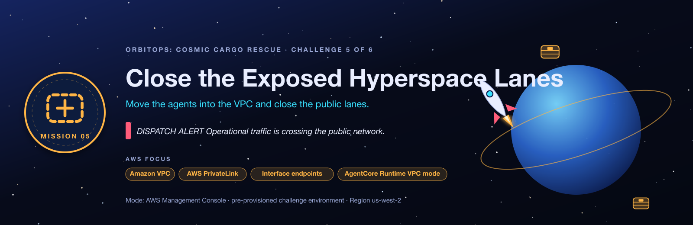

<sub>[⬅ All missions](../README.md) · [⬅ AM04 The Forgetful Flight Computer](../AM04-agentcore-memory/README.md) · [AM06 The Leaky Captain's Log ➡](../AM06-bedrock-guardrails/README.md)</sub>

<p align="center"></p>

# AM05 · Mission E: Close the Exposed Hyperspace Lanes — After-Class Runbook

> 🚨 Security wants both agent runtimes moved into private subnets, with private paths to every AWS service they call.

| | |
|---|---|
| **You'll practise** | VPCs, private subnets, PrivateLink interface endpoints, private DNS, AgentCore Runtime VPC mode |
| **Fix time** | about 45 minutes |
| **Deploy time** | about 3 min broken · **about 7½ min solution** (VPC-mode runtimes and five endpoints) |
| **Cost** | **Hourly while it runs:** the solution stack's 5 interface endpoints × 2 AZs ≈ **$0.10/hour**, plus any you create while fixing the broken stack. Destroy AM05 the same day. |
| **Files here** | [`HANDOUT.md`](HANDOUT.md) (the brief, no answers) · [`SOLUTION.md`](SOLUTION.md) (the answer key) · `student-terraform/` (broken) · `student-terraform-solution/` (fixed) |

New to the loop? [02-RUN-A-MISSION.md](../02-RUN-A-MISSION.md) explains every step in detail. Below are the exact commands for this mission. Replace `jsmith42` with your id everywhere.

## ① Deploy the broken environment

```bash
cd AM05-vpc-private-networking/student-terraform
terraform init
terraform apply -var 'student_id=jsmith42'
```

## ② Load your values

Run this from `student-terraform/` (needs `jq`). It fills every variable that [SOLUTION.md](SOLUTION.md)'s CLI uses, so its commands work as written:

```bash
ME=jsmith42                                                   # your student_id
VPC_JSON=$(terraform output -json solution_resources_vpc)
VPC=$(echo "$VPC_JSON" | jq -r .VpcId)
SUB_A=$(echo "$VPC_JSON" | jq -r '.PrivateSubnetIds[0]')
SUB_B=$(echo "$VPC_JSON" | jq -r '.PrivateSubnetIds[1]')
SG=$(echo "$VPC_JSON" | jq -r .SecurityGroupId)
CHAT=$(terraform output -raw chat_urls)
echo "chat console: $CHAT"
```

<details><summary><b>Every output of this stack</b> (the handout's <code>name[&lt;you&gt;]</code> is just <code>terraform output</code> here)</summary>

| Output | What it is | Print it |
|---|---|---|
| `chat_urls` | OrbitOps chat console URL (open in a browser; GET /health shows the config state). | `terraform output -raw chat_urls` |
| `chat_function_names` | Chat handler Lambda name. | `terraform output -raw chat_function_names` |
| `orchestrator_runtime_arns` | Orchestrator AgentCore Runtime ARN. | `terraform output -raw orchestrator_runtime_arns` |
| `orchestrator_runtime_ids` | Orchestrator AgentCore Runtime id. | `terraform output -raw orchestrator_runtime_ids` |
| `cognito_user_pool_id` | Shared Cognito user pool id. | `terraform output -raw cognito_user_pool_id` |
| `cognito_domain` | Cognito hosted domain (token endpoint is https://<domain>/oauth2/token). | `terraform output -raw cognito_domain` |
| `cognito_discovery_url` | OIDC discovery URL used by every JWT authorizer. | `terraform output -raw cognito_discovery_url` |
| `m2m_client_ids` | Machine-to-machine app client id. | `terraform output -raw m2m_client_ids` |
| `m2m_client_secrets` | Machine-to-machine app client secret (sensitive). | `terraform output -raw m2m_client_secrets` |
| `tool_function_arns` | Tool Lambda ARN and domain. | `terraform output -json tool_function_arns` |
| `code_bucket` | Shared S3 bucket holding agent zips, tool schemas and manuals. | `terraform output -raw code_bucket` |
| `quality_schema_s3_uri` | S3 URI of the quality tool schema (used when creating quality-target). | `terraform output -raw quality_schema_s3_uri` |
| `gateway_urls` | AgentCore Gateway MCP endpoint (value for GATEWAY_URL). | `terraform output -raw gateway_urls` |
| `gateway_ids` | AgentCore Gateway id. | `terraform output -raw gateway_ids` |
| `solution_resources_kb` | Mission C 'Solution resources': everything a student needs to build the knowledge base and specialist. | `terraform output -json solution_resources_kb` |
| `knowledge_base_ids` | Bedrock knowledge base id. | `terraform output -raw knowledge_base_ids` |
| `kb_specialist_runtime_arns` | Knowledge-base specialist runtime ARN. | `terraform output -raw kb_specialist_runtime_arns` |
| `solution_resources_vpc` | Mission E 'Solution resources': the prepared VPC. | `terraform output -json solution_resources_vpc` |

</details>

## ③ Confirm it's broken

```bash
python3 ../../tools/flight_test.py .
```

**Expect:** 3 of 5 checks **pass**: tools and manuals both answer. Only the two VPC-mode checks fail, because both runtimes run in `PUBLIC` mode. That's the trap: it *works*, it just isn't private. Open the chat URL in a browser too, and read the trace yourself.

## ④ Fix it

- **Practise for real:** open [HANDOUT.md](HANDOUT.md), work the objectives with the hint ladder, and keep SOLUTION.md closed.
- **Follow along:** open [SOLUTION.md](SOLUTION.md) **§6 Step-by-step solution**. Console steps work as written; for the CLI, run the block in ② first.

## ⑤ Prove it's fixed

```bash
python3 ../../tools/flight_test.py .
```

The Flight Test checks that:

- the orchestrator runtime is in VPC mode
- the specialist runtime is in VPC mode
- the tool path still works through the gateway
- the document path still works through the specialist
- no unreachable-endpoint warnings

It exits `0` with **Mission accomplished** when everything passes.

## ⑥ Compare with the solution

```bash
cd ../student-terraform-solution
terraform init
terraform apply -var 'student_id=jsmith42' -var 'course_prefix=orbitsol'
python3 ../../tools/flight_test.py .                  # passes out of the box
diff ../student-terraform/main.tf main.tf             # every fix, as code
```

<details><summary><b>Spoiler:</b> every fault and its fix, in one list</summary>

1. **Fault 1, no private paths:** create five interface endpoints with private DNS in the two private subnets, with the lab security group: `bedrock-agentcore.gateway`, `bedrock-agentcore`, `bedrock-runtime`, `bedrock-agent-runtime` and `logs`.
2. **Fault 2, runtimes public:** switch **both** runtimes (orchestrator and specialist) to **VPC** network mode in the private subnets with the lab security group.

</details>

## ⑦ Clean up

**Things you created by hand:**

**Do this the same day: interface endpoints bill by the hour.** Delete the endpoints you created **before** `terraform destroy`, because they keep the subnets and security group in use:

- **VPC → Endpoints →** filter by your VPC → select the **Interface** endpoints you created → **Actions → Delete VPC endpoints**, or:

```bash
IDS=$(aws ec2 describe-vpc-endpoints --filters Name=vpc-id,Values=$VPC Name=vpc-endpoint-type,Values=Interface --query 'VpcEndpoints[].VpcEndpointId' --output text)
[ -n "$IDS" ] && aws ec2 delete-vpc-endpoints --vpc-endpoint-ids $IDS
```

> [!NOTE]
> **Expect the destroy to stall at the security group or subnets.** When an AgentCore runtime in VPC mode is deleted, AWS keeps its network interfaces (type `agentic_ai`, shown as *in-use*) in your subnets for a while. You can't delete them yourself, and they cost nothing. Terraform waits up to ~15 minutes and then fails with `DependencyViolation`. Wait (it can take a few hours), then run the same `terraform destroy` again; it finishes the job. The interface endpoints are already gone by then, so **nothing is billing** while you wait. `python3 ../../tools/find_leftovers.py jsmith42` shows whether the interfaces are still there.

**Then destroy both stacks**, with the same flags you applied with:

```bash
# from the repo root
cd AM05-vpc-private-networking/student-terraform-solution && terraform destroy -var 'student_id=jsmith42' -var 'course_prefix=orbitsol'
cd ../student-terraform              && terraform destroy -var 'student_id=jsmith42'
python3 ../../tools/find_leftovers.py jsmith42        # should find nothing
```

<sub>[⬅ All missions](../README.md) · [⬅ AM04 The Forgetful Flight Computer](../AM04-agentcore-memory/README.md) · [AM06 The Leaky Captain's Log ➡](../AM06-bedrock-guardrails/README.md)</sub>
