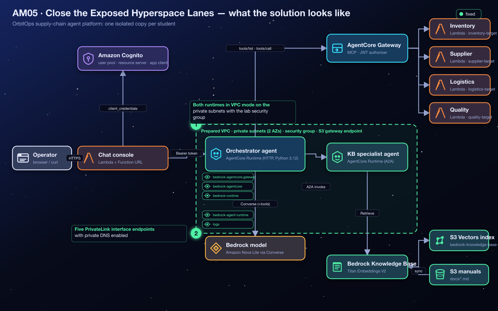
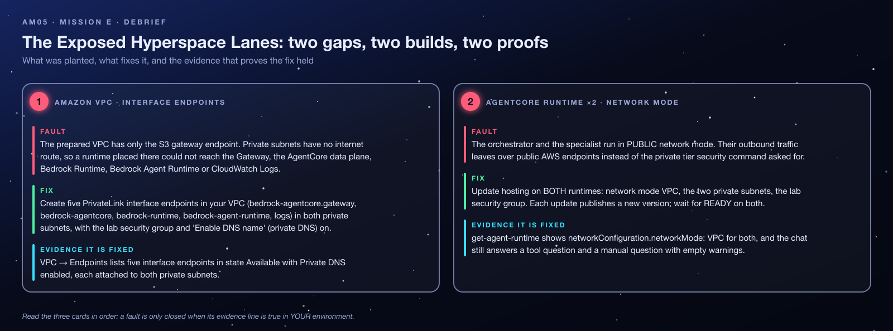
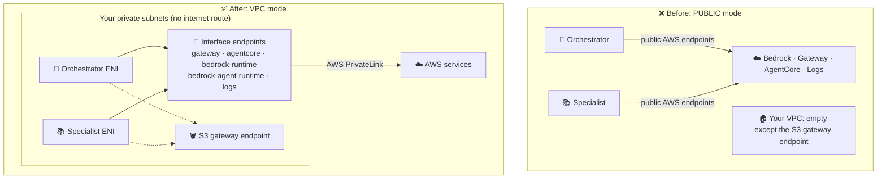
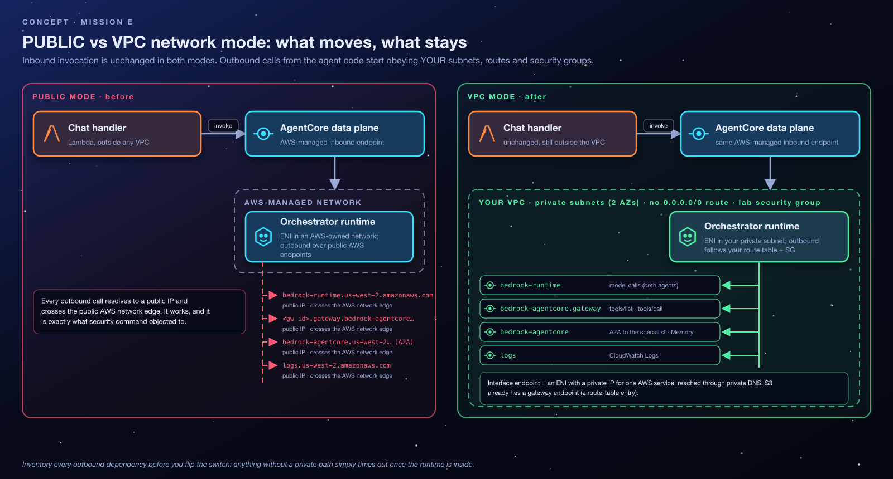
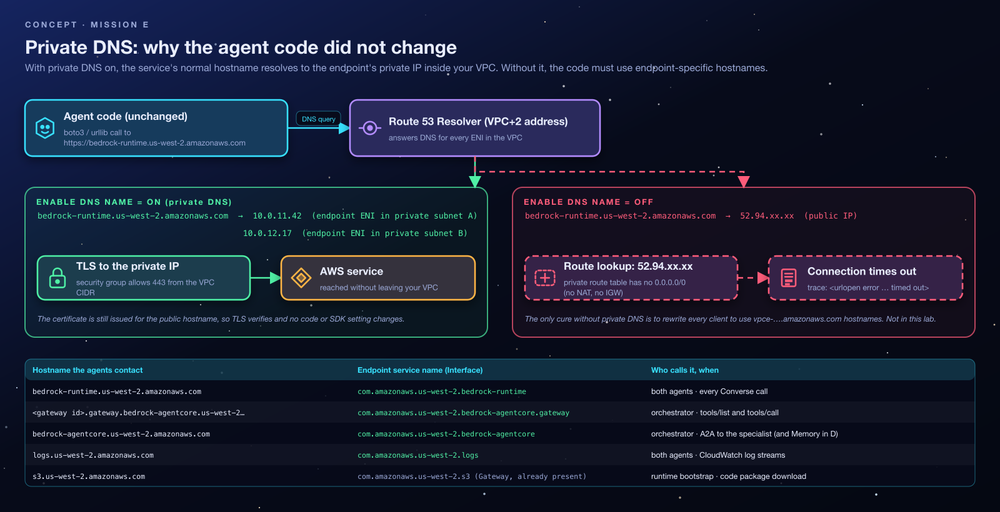
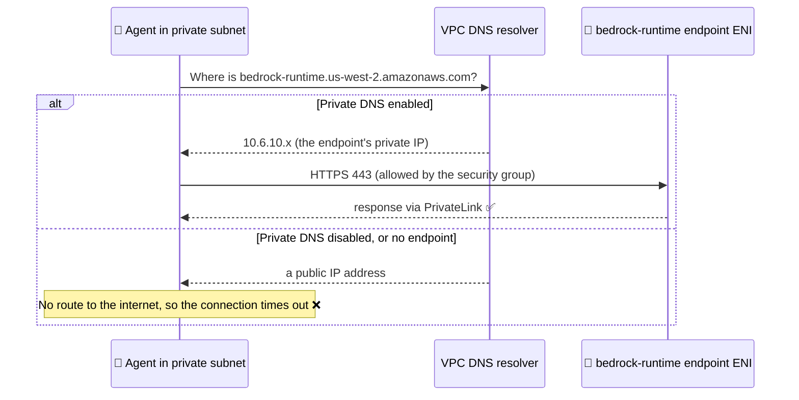
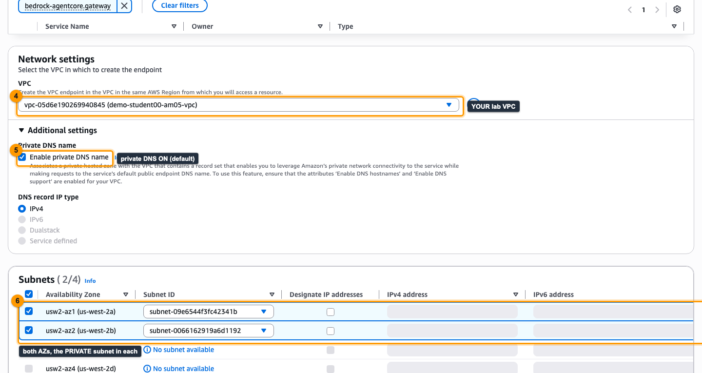
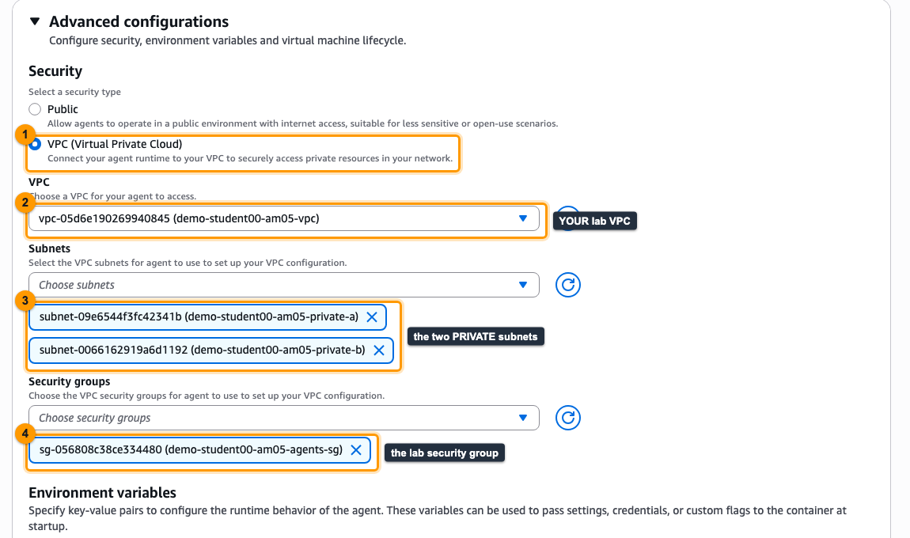
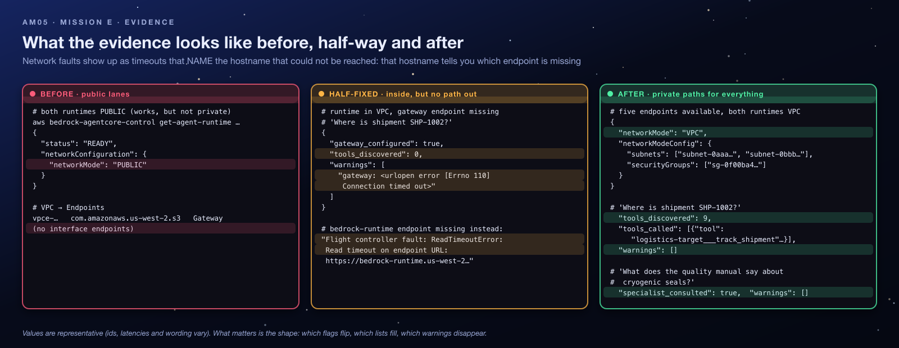
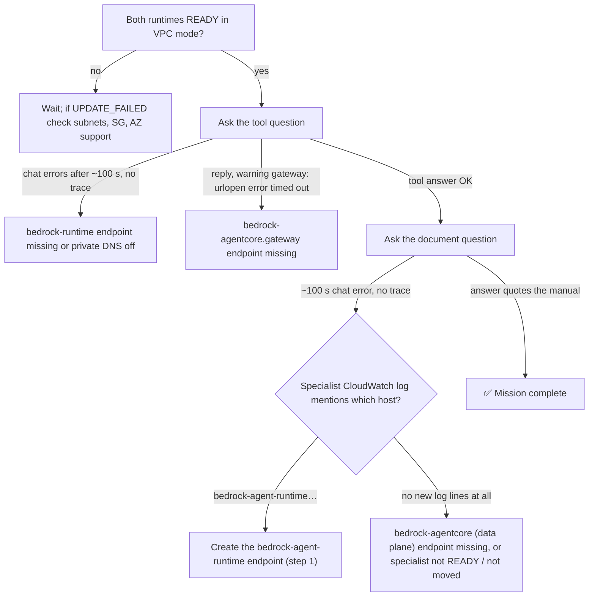

<sub>[⬅ All missions](../README.md) · [⬅ AM04 The Forgetful Flight Computer](../AM04-agentcore-memory/README.md) · [AM06 The Leaky Captain's Log ➡](../AM06-bedrock-guardrails/README.md)</sub>

<p align="center"></p>

# AM05 — Mission E: Close the Exposed Hyperspace Lanes — Solution Handout

> [!NOTE]
> **Answer key and debrief.** Open this after your Flight Test, or when your instructor calls time. It explains *what* to build and *why* the system behaves the way it does. No prior networking knowledge is assumed: terms are explained before they are used. Console images in this guide are **real screenshots** from an instructor run on 2026-10-25, taken on a demo copy, so resource names read `demo-student00-…` where yours read `orbit-<your id>-…`. The console changes over time; if a label differs slightly, look for the same idea nearby.

**Contents:** [1 Mission recap](#1-mission-recap) · [2 Where you start](#2-where-you-start) · [3 Architecture explained](#3-architecture-explained) · [4 Concepts you need](#4-concepts-you-need-to-understand) · [5 Understanding the gap](#5-understanding-the-gap) · [6 Step-by-step solution](#6-step-by-step-solution) · [7 Verification](#7-verification) · [8 Troubleshooting](#8-troubleshooting) · [9 Key takeaways](#9-key-takeaways) · [10 Knowledge check](#10-knowledge-check) · [11 Exam angle](#11-exam-angle) · [12 Reflection answers](#12-reflection-questions-model-answers) · [13 Going further](#13-going-further-optional)

> [!TIP]
> **New to AWS?** Skim the vocabulary table below first. Every other term is explained where it first matters.

| Words you'll meet | In plain English |
|---|---|
| **AWS console** | The website where you view and change AWS resources by clicking. |
| **Terraform** | A tool that builds cloud resources from code files. Your instructor used it to create your environment; `terraform output` prints the values you were given. |
| **AWS Lambda** | A service that runs a small piece of code on demand, only when something calls it. |
| **IAM role** | An AWS identity that a service or program temporarily "wears" to get a specific, limited set of permissions (IAM = Identity and Access Management). |
| **ARN** | Amazon Resource Name: the full, unique address of an AWS resource, e.g. `arn:aws:lambda:us-west-2:123456789012:function:…`. |
| **AgentCore Runtime** | AWS's managed hosting service for AI agents; OrbitOps's agents run there. |
| **Trace** | The panel under each chat reply that shows what the agent did (tools, memory, guardrail, warnings). It is your main evidence. |
| **VPC, subnet, Availability Zone** | Your private network, a slice of it, and an independent data-centre group (§4.1). |
| **ENI** | Elastic network interface: a virtual network card with a private IP address (§4.3). |
| **PrivateLink, interface endpoint, private DNS** | Private doorways into AWS services, and the setting that makes normal hostnames use them (§4.4–4.5). |
| **NAT gateway** | A paid device that lets private machines reach the internet; deliberately *not* used here (§4.6). |
| **MCP / gateway** | How the orchestrator lists and calls tools through the AgentCore Gateway (Mission B). |
| **Data plane** | The AWS APIs that do the everyday work, such as invoking an agent, as opposed to the control plane that configures resources. |
| **JWT authorizer** | AgentCore's built-in check of the caller's Cognito access token (Mission A). |
| **boto3, TLS** | The AWS library for Python the agents use, and the encryption behind every `https://` connection. |

---

## 1. Mission Recap

**The app in one sentence:** OrbitOps is a chat website where cargo operators ask an AI agent (the *flight controller*) about cargo; it calls tools through a gateway and delegates manual questions to a second agent, the knowledge-base specialist.

**What is wrong:** nothing is *broken* yet; it is *exposed*. Both agents run in AWS's shared public network mode, so their calls to AWS services leave over public endpoints. Security command wants both agents inside a private network, with private connections to every AWS service they use. This mission is different from the others: you start with a working system and must keep it working while you **lock it down**.

| | |
|---|---|
| **Scenario** | Both agent runtimes reach AWS APIs over public endpoints. They must move into private subnets with private connectivity to every API they use. |
| **Gaps planted** | 2: no PrivateLink interface endpoints for the APIs the agents call, and both runtimes in `PUBLIC` network mode. |
| **Services** | Amazon VPC (subnets, route tables, security groups), AWS PrivateLink interface endpoints with private DNS, AgentCore Runtime VPC network mode. |
| **The big idea** | VPC mode changes *outbound* traffic only: the runtime becomes a host inside your network, and every dependency must be reachable through *your* routing. |
| **Time budget** | 45 minutes; runtime network updates take several minutes each. The usual loss is creating one `bedrock-agentcore` endpoint instead of two. |

<p align="center"></p>

---

## 2. Where You Start

Your instructor deployed `AM05-vpc-private-networking/terraform/broken` and gave you the outputs for **your** student id (the repository does not say how they are delivered; ask your instructor if you do not have them). Region: **`us-west-2`**. Everything from Missions A to C already **works** here: Cognito authentication, a gateway with four targets, the orchestrator, and a specialist with a synced knowledge base.

### 2.1 Your prepared network: `solution_resources_vpc[<you>]`

| Key | Example | Meaning |
|---|---|---|
| `VpcId`, `VpcCidr` | `vpc-0ab…`, `10.6.0.0/16` (student07 in a default class; every student has a different range) | Your own VPC. Each student gets one, with a different address range. DNS support and DNS hostnames are on. |
| `PrivateSubnetIds` (2) | `10.6.10.0/24` in `us-west-2a`, `10.6.11.0/24` in `us-west-2b` | Where the agents and endpoints go. Their route table has **no** route to the internet. |
| `PublicSubnetIds` (2) | `10.6.0.0/24`, `10.6.1.0/24` | Have an internet-gateway route. **Not** for the agents. |
| `PrivateRouteTableId` | `rtb-…` | The private subnets' routes: local VPC traffic plus the free **S3 gateway endpoint**. |
| `SecurityGroupId` | `sg-…` | Allows inbound **TCP 443 from the VPC's own range** and all outbound. Used by the agents *and* the endpoints. |

Also: `orchestrator_runtime_ids[<you>]`, `kb_specialist_runtime_arns[<you>]` (the specialist's runtime ID is the last part of that ARN), `gateway_ids[<you>]`, `chat_urls[<you>]`.

### 2.2 Shared vs yours, cost, cleanup

- **Every network resource here is yours alone** (one VPC per student, because private DNS works per VPC). The Cognito pool and the code bucket are shared, as always. Check the VPC ID before creating anything: creating endpoints in a classmate's VPC wastes money and fixes nothing.
- **Cost:** interface endpoints are the only thing in the labs that bills **by the hour**: about $0.01 per endpoint per Availability Zone per hour, plus a small per-GB charge. Five endpoints × two AZs ≈ $0.10 per hour for you, about $2.20 per hour for a class of 22. Never create duplicates.
- **Cleanup:** endpoints you create are **not** tracked by Terraform and block deletion of the VPC. The instructor sweeps them; tell them if you created extras. Network interfaces that AgentCore created for a runtime can linger for hours after an agent is deleted, which is normal.
- **Permissions:** you need VPC endpoint create rights and AgentCore Runtime update rights. AgentCore creates its network interfaces through a service-linked role (`AWSServiceRoleForBedrockAgentCoreNetwork`), created automatically the first time anyone in the account uses VPC mode.

---

## 3. Architecture Explained

### 3.1 Who calls what

The question that drives this whole mission: **what does each agent's code call?** Reading the two agents' source code answers it:

| Caller | Calls | Hostname it resolves | Why |
|---|---|---|---|
| Orchestrator | Amazon Bedrock Runtime | `bedrock-runtime.us-west-2.amazonaws.com` | Nova 2 Lite reasoning (Converse) |
| Orchestrator | AgentCore Gateway | `<gateway id>.gateway.bedrock-agentcore.us-west-2.amazonaws.com` | MCP tool discovery and calls |
| Orchestrator | AgentCore data plane | `bedrock-agentcore.us-west-2.amazonaws.com` | Invoking the specialist (agent-to-agent) |
| Specialist | Amazon Bedrock Runtime | `bedrock-runtime.us-west-2.amazonaws.com` | Writing the answer |
| Specialist | **Bedrock Agent Runtime** | `bedrock-agent-runtime.us-west-2.amazonaws.com` | `Retrieve` on the knowledge base |
| The runtime itself (both) | CloudWatch Logs | `logs.us-west-2.amazonaws.com` | AWS lists this endpoint as required for VPC-mode runtimes |
| The runtime itself (both) | Amazon S3 | (gateway endpoint, already present) | AWS fetches the agent's code package from S3 |

**Not** in the list, and why:

- **Cognito:** the orchestrator forwards the caller's bearer token; it never asks Cognito for one. The JWT authorizers run in AWS's managed layer, not in your VPC.
- **The tool Lambdas:** the *gateway* (an AWS-managed service) invokes them, not your agents.
- **Inbound calls:** the chat handler calls the AgentCore data plane's public endpoint, and AWS delivers the request to the runtime whatever its network mode. Inbound never crosses your subnets.

### 3.2 Before and after



The chat handler and the tool Lambdas do not appear because nothing about them changes.

---

## 4. Concepts You Need to Understand

### 4.1 VPC, subnets and route tables

- A **VPC** (Virtual Private Cloud) is your own private network inside AWS, with its own address range (here `10.<n>.0.0/16`). Nothing reaches in or out unless you allow it. *Analogy:* a gated campus.
- A **subnet** is a slice of that range in one **Availability Zone** (an independent data centre group). Two subnets in two AZs means one data-centre failure does not take you down.
- A **route table** says where traffic for each destination goes. *Public* subnets have a route `0.0.0.0/0 → internet gateway`; *private* subnets do not, so traffic for public addresses has nowhere to go and simply **times out**. *Analogy:* a building with no doors to the street.

### 4.2 Security groups

A **security group** is a firewall attached to a network interface. This lab's group allows inbound HTTPS (TCP 443) from anything inside the VPC and all outbound traffic. The same group is placed on the agents (which only send) and the endpoints (which must accept 443 from the agents).

### 4.3 PUBLIC vs VPC network mode

<p align="center"></p>

In **PUBLIC** mode the runtime lives in an AWS-managed network and reaches public AWS endpoints directly. In **VPC** mode AgentCore attaches an **ENI** (elastic network interface, a virtual network card with a private IP) in *your* subnets, and the agent's outbound calls obey *your* route tables and security groups. Inbound invocation is unchanged in both modes. Two facts from AWS's documentation shape this lab:

- The ENI gets a **private IP only**. Putting it in a *public* subnet does **not** give it internet access: an internet gateway needs a public IP to work with. Only a NAT gateway or endpoints give a VPC-mode runtime a way out.
- In VPC mode the runtime has **no internet access by default**, so every AWS API it needs must have a private path.

### 4.4 Interface endpoints (AWS PrivateLink)

An **interface endpoint** is an ENI in your subnet that acts as a private doorway to *one* AWS service. Traffic to it stays on the AWS network. You create one per service, per VPC, placed in both private subnets (one ENI per AZ). *Analogy:* a private tunnel from your campus straight into one specific AWS building.

| | Gateway endpoint | Interface endpoint |
|---|---|---|
| Services | S3, DynamoDB only | Most AWS services |
| How it works | An entry in the route table | An ENI with a private IP in your subnet |
| Cost | Free | Hourly per AZ, plus per GB |
| In this lab | S3 (pre-provisioned) | The ones you create |

### 4.5 Private DNS: why the code does not change

<p align="center"></p>

The agents' code (boto3 and `urllib`) uses the services' normal public hostnames. **Private DNS** makes those same hostnames resolve, *inside your VPC*, to the endpoint's private IPs. TLS still verifies, because the certificate is for the public name.



### 4.6 Why there is no Cognito endpoint (and no NAT)

The runtimes never call Cognito: the orchestrator forwards the caller's bearer token, and the JWT authorizers run in the AWS-managed layer. The micro-credential's environment has the orchestrator mint its own token and therefore keeps a **NAT gateway** (a paid device in a public subnet that lets private hosts reach the internet) for Cognito. Here that lane is closed too. A NAT would "make it work" while defeating the goal of private-only connectivity.

### 4.7 Misconceptions to unlearn

- ❌ *"VPC mode changes how the chat handler reaches the agent."* ✅ Inbound is unchanged; only the agent's outbound calls move.
- ❌ *"Put the runtime in a public subnet and it can reach the internet."* ✅ AgentCore ENIs have private IPs only; a public subnet gives no internet access.
- ❌ *"One `bedrock-agentcore` endpoint covers the gateway too."* ✅ The gateway has its own service name, `…bedrock-agentcore.gateway`.
- ❌ *"An endpoint is enough."* ✅ Without **private DNS** the code still resolves public IPs and times out.

---

## 5. Understanding the Gap

| # | Gap | Where | Effect |
|---|---|---|---|
| 1 | No interface endpoints for the APIs the agents call | Your VPC | Once in VPC mode, the agents could not reach any AWS API, because the private subnets have no internet route. |
| 2 | Both runtimes in `PUBLIC` mode | AgentCore Runtime ×2 | Today's traffic travels over public AWS endpoints, outside your network controls. |

**How it happened (the story).** The network team delivered the VPC (subnets in two AZs, an internet gateway for the public tier, a free S3 gateway endpoint, a security group) and stopped. Nobody listed what the agents actually *call*, so no interface endpoints were ordered, and the runtimes were never moved. The mission is the inventory the team skipped.

### 5.1 Symptoms you may have met, decoded

| Symptom | Generated by | Plain-English meaning |
|---|---|---|
| Both runtimes show **Network mode: Public**; the VPC has exactly one endpoint (S3, gateway type) | Console | The starting state: working, but exposed. |
| After a move: the chat waits about 100 s, then shows an error such as `TimeoutError: … timed out` (no trace) | The chat handler gives up waiting | An agent could not reach the model (`bedrock-runtime`) or the specialist, so the turn never finished. |
| After a move: a reply arrives, but `warnings` has `gateway: <urlopen error timed out>` and `tools_discovered: 0` | Orchestrator | No private path to the gateway: the `.gateway` endpoint is missing or lacks private DNS. |
| Tools work, but a manual question ends in the same ~100 s chat error with no trace | The chat handler gives up while the orchestrator still waits (up to 120 s) for the specialist | Missing `bedrock-agentcore` (data plane) endpoint, the specialist still updating, or the specialist cannot reach `bedrock-agent-runtime` (§6, step 1). |
| A runtime sits in `UPDATING` for a long time, or `UPDATE_FAILED` | AgentCore | Subnet or security group from another VPC, a single AZ, or a subnet in an AZ AgentCore does not support. |

> [!TIP]
> **Read the timeout's shape.** A network fault in VPC mode never says "network". Calls made with Python's `urllib` (gateway, specialist) time out as a bare `<urlopen error timed out>`, so infer the endpoint from *which feature* failed (tools → `.gateway`; manuals → data plane or `bedrock-agent-runtime`). Calls made with boto3 (`bedrock-runtime`, `bedrock-agent-runtime`) name the URL in the runtime's CloudWatch log. Map feature or hostname to §3.1 and you have the missing endpoint.

---

## 6. Step-by-Step Solution

Create the private paths **first**, then move the runtimes. In the other order, the agents go dark until the endpoints exist.

### Gap 1: Interface endpoints with private DNS

<p align="center"></p>

VPC → **Endpoints** → **Create endpoint**, once per service:

1. Type **AWS services**; service name:
   - `com.amazonaws.us-west-2.bedrock-agentcore.gateway` (tools)
   - `com.amazonaws.us-west-2.bedrock-agentcore` (agent-to-agent)
   - `com.amazonaws.us-west-2.bedrock-runtime` (model calls)
   - `com.amazonaws.us-west-2.bedrock-agent-runtime` (the specialist's knowledge-base `Retrieve`)
   - `com.amazonaws.us-west-2.logs` (runtime logging)

   *Why read the search results carefully:* filtering for `bedrock-agentcore` shows **three** services (`bedrock-agentcore`, `bedrock-agentcore-control`, `bedrock-agentcore.gateway`) and the table truncates their names. Search each **full** service name so exactly one row appears. You need `bedrock-agentcore` and `bedrock-agentcore.gateway`; `-control` is the management API, which the agents never call.
2. VPC = your `VpcId`. Additional settings: **Enable DNS name** (private DNS) **on**. *Why:* it keeps the code's hostnames working unchanged (§4.5).
3. Subnets = **both** `PrivateSubnetIds` (one per AZ). Security group = `SecurityGroupId`. *Why:* an ENI in each AZ the agents use, and a firewall that accepts 443 from inside the VPC.
4. Create. Wait until all are **Available**, then about **two more minutes** before testing: private DNS takes a moment to propagate, and a test made the instant an endpoint turns *Available* can still time out.

> [!NOTE]
> **Why five, when the micro-credential lists four?** The assessment's checklist names the first four services. The code inventory in §3.1 shows one more private dependency: the specialist's `Retrieve` call goes to `bedrock-agent-runtime.us-west-2.amazonaws.com`, which none of the four covers, so without it the *document* question times out once the specialist is in VPC mode. This is the mission's core skill applied: *inventory what the code calls, and give each call a private path*. The fifth endpoint does not conflict with the four the assessment checks. (Derived from the code and AWS's VPC documentation; the lab's Terraform solution creates all five.)

### Gap 2: Move both runtimes into the private subnets

<p align="center"></p>

5. Bedrock AgentCore → Runtime → **orchestrator** → **Update runtime** → Network: **VPC**, subnets = the two **private** subnets, security group = the lab group → save.
6. Repeat for the **specialist**. *Why both:* each runtime makes its own outbound calls, so moving only one leaves the other on public endpoints.
7. Wait for both to be **READY** (several minutes each). Each update is a new runtime version; the old, public version answers until the new one is ready.

### CLI equivalent (AWS CLI v2.30+)

```bash
ME=<student id>; VPC=<VpcId>; SUB_A=<PrivateSubnetIds[0]>; SUB_B=<PrivateSubnetIds[1]>; SG=<SecurityGroupId>
for svc in bedrock-agentcore.gateway bedrock-agentcore bedrock-runtime bedrock-agent-runtime logs; do
  aws ec2 create-vpc-endpoint --vpc-id "$VPC" --vpc-endpoint-type Interface --service-name "com.amazonaws.us-west-2.$svc" \
    --subnet-ids "$SUB_A" "$SUB_B" --security-group-ids "$SG" --private-dns-enabled \
    --tag-specifications "ResourceType=vpc-endpoint,Tags=[{Key=Name,Value=$ME-$svc}]" --query 'VpcEndpoint.[VpcEndpointId,State]' --output text
done
aws ec2 describe-vpc-endpoints --filters Name=vpc-id,Values="$VPC" --query 'VpcEndpoints[].[ServiceName,State,PrivateDnsEnabled]' --output table

for RT_ID in <orchestrator_runtime_ids[ME]> <specialist runtime id>; do
  aws bedrock-agentcore-control get-agent-runtime --agent-runtime-id "$RT_ID" \
    | jq --arg a "$SUB_A" --arg b "$SUB_B" --arg sg "$SG" '{agentRuntimeId, description, agentRuntimeArtifact, roleArn, protocolConfiguration,
        authorizerConfiguration, requestHeaderConfiguration, environmentVariables, lifecycleConfiguration,
        networkConfiguration: {networkMode: "VPC", networkModeConfig: {subnets: [$a, $b], securityGroups: [$sg]}}} | del(..|nulls)' > rt.json
  aws bedrock-agentcore-control update-agent-runtime --cli-input-json file://rt.json
done
aws bedrock-agentcore-control get-agent-runtime --agent-runtime-id <id> --query '[status, networkConfiguration]'   # READY, VPC
```

### The permanent fix (what `terraform/solution` does)

One `aws_vpc_endpoint.interface` resource with `for_each` over the five services (`Interface`, `private_dns_enabled = true`, both private subnets, the lab security group) and `network_configuration { network_mode = "VPC" … }` on both runtimes. The optional `enable_nat_gateway` variable restores the micro-credential's topology for when an agent must mint its own Cognito token.

---

## 7. Verification

<p align="center"></p>

- [ ] Endpoints in your VPC, all **Available**, `PrivateDnsEnabled = True`, each in both private subnets with the lab group, and **no duplicates**.
- [ ] Both runtimes: network mode **VPC**, the two private subnets, the lab group, status **READY**.
- [ ] The private route table still has **no** `0.0.0.0/0` route (no NAT added).
- [ ] **Tool request** *"Where is shipment SHP-1002?"* → `logistics-target___track_shipment` called, answer mentions the delay, `warnings: []`.
- [ ] **Document request** *"What does the quality manual say about cryogenic seals?"* → `consult_manuals` called, `result_preview` quotes the manual (not an error), `warnings: []`.

```bash
CHAT=<chat_urls[ME]>
curl -s -X POST "$CHAT/chat" -H 'content-type: application/json' -d '{"prompt":"Where is shipment SHP-1002?"}' | jq '.trace.tools_called[].tool, .response'
# "logistics-target___track_shipment"  "… DELAYED … holding at the Jovian transfer point …"
curl -s -X POST "$CHAT/chat" -H 'content-type: application/json' -d '{"prompt":"What does the quality manual say about cryogenic seals?"}' | jq '.trace.specialist_consulted, .trace.tools_called[0].result_preview'
# true   "… a single fracture fails the batch …"
aws bedrock-agentcore-control get-agent-runtime --agent-runtime-id <orchestrator id> --query 'networkConfiguration.networkMode'   # "VPC"
```

Optional proof that the private path is really used: enable VPC Flow Logs on the endpoint ENIs and watch traffic arrive when you chat, or look at the endpoint's private IPs and note that they are the `10.x` addresses the agents now connect to.

---

## 8. Troubleshooting

### 8.1 Decision tree



### 8.2 Lessons learned from common mistakes

| Mistake | What you see | The lesson |
|---|---|---|
| Only one `bedrock-agentcore` endpoint | Either tools fail (`gateway: <urlopen error timed out>`) or manual questions end in the ~100 s chat error | The gateway has its own service name. Filter the service list and read both results. |
| Private DNS left off | Everything times out although the endpoints are `Available` | Without private DNS the code still resolves public IPs. "Enable DNS name" is the switch that keeps code unchanged. |
| Choosing the public subnets for the runtimes | No better than private ones: AgentCore ENIs have private IPs only, so the internet gateway does nothing for them. It also breaks the brief. | Agents go in the private subnets; endpoints give them their paths out. |
| Moving the runtimes **before** creating endpoints | The agents go dark until the endpoints exist | Build the paths first, then move the traffic. |
| Forgetting the specialist | Tools work, manual questions fail, or still go over public endpoints | Each runtime has its own network setting. |
| Testing before `READY` | Mixed results | Network updates take minutes; the old version serves until the new one is ready. |
| Creating duplicate endpoints | A second endpoint for the same service fails (private DNS conflict), or costs money | One interface endpoint per service per VPC with private DNS. Check the list before creating. |

### 8.3 Distinguish from similar failures

| Symptom | This lab? | Actually is |
|---|---|---|
| All chat times out after the move | ✅ | `bedrock-runtime` endpoint missing (both agents need the model) |
| Tools fail, manuals work | ✅ | Gateway endpoint missing |
| Manuals fail, tools work | ✅ | Data-plane or `bedrock-agent-runtime` endpoint missing, or the specialist still updating |
| Runtime `UPDATE_FAILED` | ❌ | Subnet or SG from another VPC, a single AZ, or an unsupported AZ (AgentCore supports `usw2-az1`, `usw2-az2`, `usw2-az3` in this region; check a subnet's `AvailabilityZoneId`) |
| `ENI limit` errors | ❌ | Account network-interface quota; unlikely at class scale |
| 403 from the gateway after the move | ❌ | Authorizer / client id (Mission A), unrelated to networking |

---

## 9. Key Takeaways

- **VPC mode changes outbound, not inbound.** Inventory every outbound dependency *from the code* before you move a runtime.
- **Private DNS is what keeps application code unchanged.**
- **Two `bedrock-agentcore` endpoints exist** (data plane and gateway); agents that use both need both.
- **Public subnets do not give AgentCore runtimes internet access**: only NAT or endpoints provide a way out.
- **No NAT is required** when every dependency has an endpoint and nothing needs the public internet.
- **Interface endpoints cost per hour per AZ:** create exactly what the dependency inventory says, no duplicates.

**Real-world connection:** banks, hospitals and governments commonly forbid workloads from touching the public internet. "It worked until we moved it into the VPC" is a classic cloud incident, and the fix is always the same: a written list of every hostname the code calls.

---

## 10. Knowledge Check

<details><summary><b>1. After the move, the chat handler (outside the VPC) still reaches the orchestrator without any endpoint. Why?</b></summary>

Inbound invocation goes to the AWS-managed AgentCore data-plane endpoint, which delivers the request to the runtime regardless of its network mode. VPC mode only changes where the agent's *outbound* calls originate.
</details>

<details><summary><b>2. All five endpoints are <i>Available</i>, yet every call times out. What setting do you check first?</b></summary>

Private DNS ("Enable DNS name") on each endpoint. Without it, the normal hostnames resolve to public IPs that the private subnets cannot reach.
</details>

<details><summary><b>3. Why does the lab need no Cognito endpoint?</b></summary>

No code inside the VPC calls Cognito: the orchestrator forwards the caller's token, and token validation happens in AgentCore's managed authorizer layer.
</details>

<details><summary><b>4. Would placing the runtimes in the public subnets "fix" a missing endpoint?</b></summary>

No. AgentCore's network interfaces get private IPs only, so a public subnet's internet-gateway route gives them no internet access. Only a NAT gateway (which defeats the mission) or the right endpoint would.
</details>

<details><summary><b>5. Which hostname does the specialist's <code>Retrieve</code> call use, and which endpoint serves it?</b></summary>

`bedrock-agent-runtime.us-west-2.amazonaws.com`, served by an interface endpoint for `com.amazonaws.us-west-2.bedrock-agent-runtime` with private DNS.
</details>

---

## 11. Exam Angle

Challenge E checks: four interface endpoints (`bedrock-agentcore.gateway`, `bedrock-agentcore`, `bedrock-runtime`, `logs`) with private DNS enabled in both private subnets; the provided security group on the endpoints and the runtimes; VPC network mode on **both** runtimes with the private subnets; and runtimes back to `READY` with chat still answering tool and knowledge-base questions. Expect questions on the difference between gateway and interface endpoints, what private DNS does, and which services need an endpoint for a given set of calls. That last skill is exactly why this lab needs a fifth endpoint (`bedrock-agent-runtime`) on top of the assessment's four.

---

## 12. Reflection Questions: Model Answers

1. **Which of these endpoints would you still need if the agents used only the knowledge base and no Gateway?** `bedrock-runtime` (both agents call the model), `bedrock-agentcore` (the orchestrator's agent-to-agent call to the specialist) and `logs` (required for VPC-mode runtimes). The `bedrock-agentcore.gateway` endpoint would be unnecessary. The specialist's `Retrieve` call goes to `bedrock-agent-runtime`, which needs its own interface endpoint (`com.amazonaws.us-west-2.bedrock-agent-runtime`) to stay private, so you would keep that one too.
2. **The chat handler Lambda is not in the VPC. Why does it not need an endpoint to reach the runtime?** It calls the AWS-managed AgentCore data-plane endpoint over AWS's public network, as any Lambda outside a VPC does, and that endpoint delivers the request to the runtime regardless of the runtime's network mode. Inbound invocation never crosses your subnets.
3. **If the orchestrator fetched its own Cognito token, what would you add to the private tier, and what would it cost?** The token request goes to the user pool's hosted domain (`<prefix>.auth.us-west-2.amazoncognito.com`), so the usual answer is a NAT gateway in a public subnet plus a `0.0.0.0/0` route from the private route table to it: roughly $0.045 per hour plus per-GB processing, per AZ if you want resilience. That is why the micro-credential's environment keeps a NAT gateway, and why this track forwards the caller's token instead.

---

## 13. Going Further (optional)

- Attach an endpoint policy to the `bedrock-runtime` endpoint that allows only `InvokeModel` on Nova 2 Lite, and watch the error change from "timeout" to "AccessDenied".
- Turn on VPC Flow Logs for one endpoint ENI and match a chat message to the flow records.
- In a sandbox account of your own, set `enable_nat_gateway = true` in the solution stack, give the orchestrator its own Cognito credentials, and compare the traffic paths.

---

> [!TIP]
> Back to this mission's [after-class runbook](README.md).

<sub>[⬅ All missions](../README.md) · [⬅ AM04 The Forgetful Flight Computer](../AM04-agentcore-memory/README.md) · [AM06 The Leaky Captain's Log ➡](../AM06-bedrock-guardrails/README.md)</sub>
