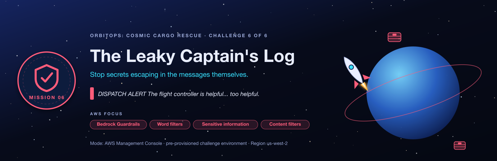

<sub>[⬅ All missions](../README.md) · [⬅ AM05 Close the Exposed Hyperspace Lanes](../AM05-vpc-private-networking/README.md)</sub>

<p align="center"></p>

# AM06 · Mission F: The Leaky Captain's Log — After-Class Runbook

> 🚨 The flight controller will happily repeat classified mission names, discount codes and personal data.

| | |
|---|---|
| **You'll practise** | Bedrock Guardrails: denied words, sensitive-information (PII) filters, regex, content filters, input vs output actions |
| **Fix time** | about 40 minutes |
| **Deploy time** | about 2½ min for either stack |
| **Cost** | Cents (guardrail text units). |
| **Files here** | [`HANDOUT.md`](HANDOUT.md) (the brief, no answers) · [`SOLUTION.md`](SOLUTION.md) (the answer key) · `student-terraform/` (broken) · `student-terraform-solution/` (fixed) |

New to the loop? [02-RUN-A-MISSION.md](../02-RUN-A-MISSION.md) explains every step in detail. Below are the exact commands for this mission. Replace `jsmith42` with your id everywhere.

## ① Deploy the broken environment

```bash
cd AM06-bedrock-guardrails/student-terraform
terraform init
terraform apply -var 'student_id=jsmith42'
```

## ② Load your values

Run this from `student-terraform/` (needs `jq`). It fills every variable that [SOLUTION.md](SOLUTION.md)'s CLI uses, so its commands work as written:

```bash
ME=jsmith42                                                   # your student_id
RT_ID=$(terraform output -raw orchestrator_runtime_ids)
CHAT=$(terraform output -raw chat_urls)
echo "chat console: $CHAT"
```

<details><summary><b>Every output of this stack</b> (the handout's <code>name[&lt;you&gt;]</code> is just <code>terraform output</code> here)</summary>

| Output | What it is | Print it |
|---|---|---|
| `chat_urls` | OrbitOps chat console URL (open in a browser; GET /health shows the config state). | `terraform output -raw chat_urls` |
| `chat_function_names` | Chat handler Lambda name. | `terraform output -raw chat_function_names` |
| `orchestrator_runtime_arns` | Orchestrator AgentCore Runtime ARN. | `terraform output -raw orchestrator_runtime_arns` |
| `orchestrator_runtime_ids` | Orchestrator AgentCore Runtime id. | `terraform output -raw orchestrator_runtime_ids` |
| `cognito_user_pool_id` | Shared Cognito user pool id. | `terraform output -raw cognito_user_pool_id` |
| `cognito_domain` | Cognito hosted domain (token endpoint is https://<domain>/oauth2/token). | `terraform output -raw cognito_domain` |
| `cognito_discovery_url` | OIDC discovery URL used by every JWT authorizer. | `terraform output -raw cognito_discovery_url` |
| `m2m_client_ids` | Machine-to-machine app client id. | `terraform output -raw m2m_client_ids` |
| `m2m_client_secrets` | Machine-to-machine app client secret (sensitive). | `terraform output -raw m2m_client_secrets` |
| `tool_function_arns` | Tool Lambda ARN and domain. | `terraform output -json tool_function_arns` |
| `code_bucket` | Shared S3 bucket holding agent zips, tool schemas and manuals. | `terraform output -raw code_bucket` |
| `quality_schema_s3_uri` | S3 URI of the quality tool schema (used when creating quality-target). | `terraform output -raw quality_schema_s3_uri` |

</details>

## ③ Confirm it's broken

```bash
python3 ../../tools/flight_test.py .
```

**Expect:** 0 of 4 checks pass: `guardrail_configured=False`, so the classified name, the discount code and the password all go straight through. Open the chat URL in a browser too, and read the trace yourself.

## ④ Fix it

- **Practise for real:** open [HANDOUT.md](HANDOUT.md), work the objectives with the hint ladder, and keep SOLUTION.md closed.
- **Follow along:** open [SOLUTION.md](SOLUTION.md) **§6 Step-by-step solution**. Console steps work as written; for the CLI, run the block in ② first.

## ⑤ Prove it's fixed

```bash
python3 ../../tools/flight_test.py .
```

The Flight Test checks that:

- a guardrail is attached
- `Project Meridian` is blocked
- a discount code is masked
- a password is blocked

It exits `0` with **Mission accomplished** when everything passes.

## ⑥ Compare with the solution

```bash
cd ../student-terraform-solution
terraform init
terraform apply -var 'student_id=jsmith42' -var 'course_prefix=orbitsol'
python3 ../../tools/flight_test.py .                  # passes out of the box
diff ../student-terraform/main.tf main.tf             # every fix, as code
```

<details><summary><b>Spoiler:</b> every fault and its fix, in one list</summary>

1. **Fault 1, no guardrail:** create one with the denied word `Project Meridian` (+ the profanity list), PII `USERNAME` → anonymize and `PASSWORD` → block, a regex `DISC-[A-Z]{3}-\d{4}` → anonymize (input **and** output actions), and HATE / INSULTS / MISCONDUCT / VIOLENCE filters at HIGH. Publish a version.
2. **Fault 2, not attached:** set `GUARDRAIL_ID` (and `GUARDRAIL_VERSION`) on the orchestrator runtime.

</details>

## ⑦ Clean up

**Things you created by hand:**

Delete the guardrail you created. It doesn't block `terraform destroy`, but it stays in your account:

- **Bedrock → Guardrails →** `orbit-<you>-am06-guardrail` → **Delete**, or:

```bash
GR=$(aws bedrock list-guardrails --query "guardrails[?contains(name, '$ME')].id" --output text)
for id in $GR; do aws bedrock delete-guardrail --guardrail-identifier "$id"; done
```

**Then destroy both stacks**, with the same flags you applied with:

```bash
# from the repo root
cd AM06-bedrock-guardrails/student-terraform-solution && terraform destroy -var 'student_id=jsmith42' -var 'course_prefix=orbitsol'
cd ../student-terraform              && terraform destroy -var 'student_id=jsmith42'
python3 ../../tools/find_leftovers.py jsmith42        # should find nothing
```

<sub>[⬅ All missions](../README.md) · [⬅ AM05 Close the Exposed Hyperspace Lanes](../AM05-vpc-private-networking/README.md)</sub>
