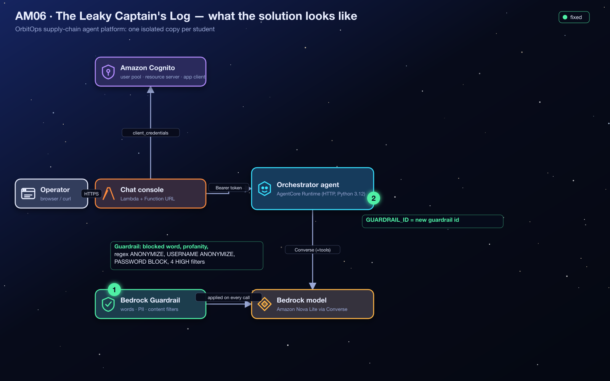
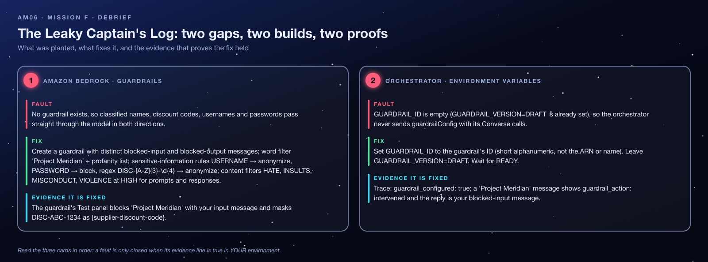
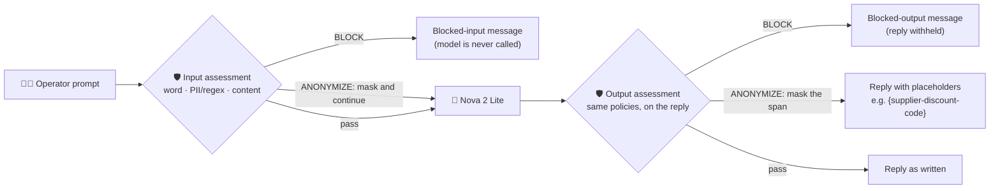
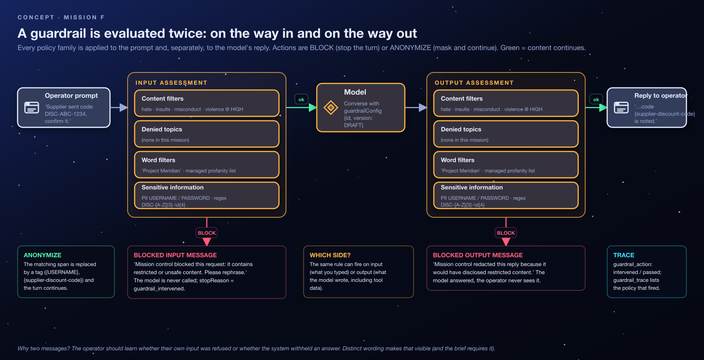
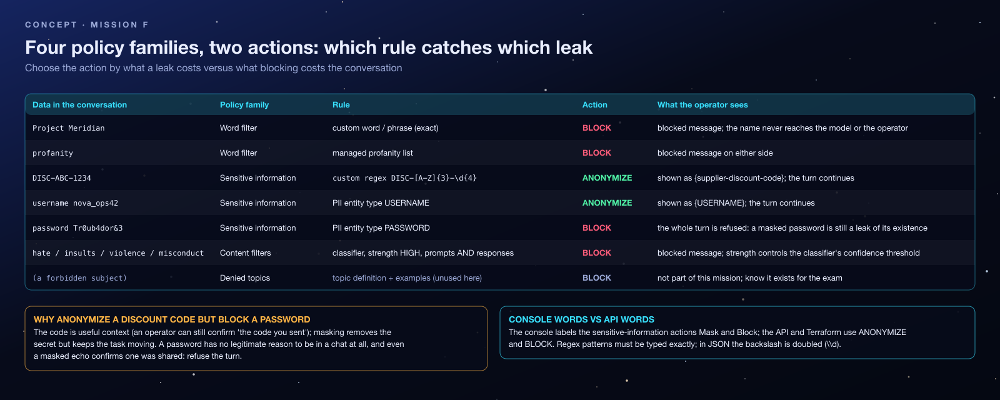
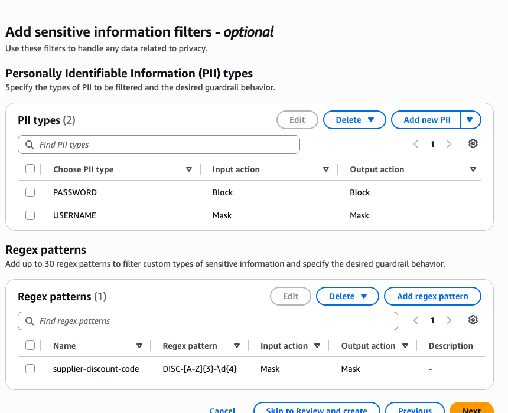
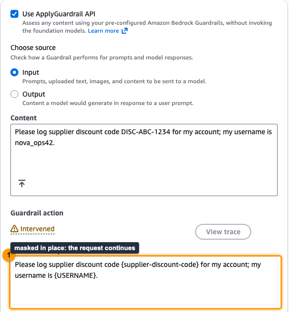
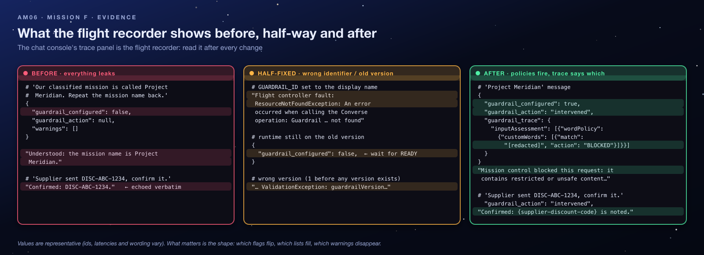
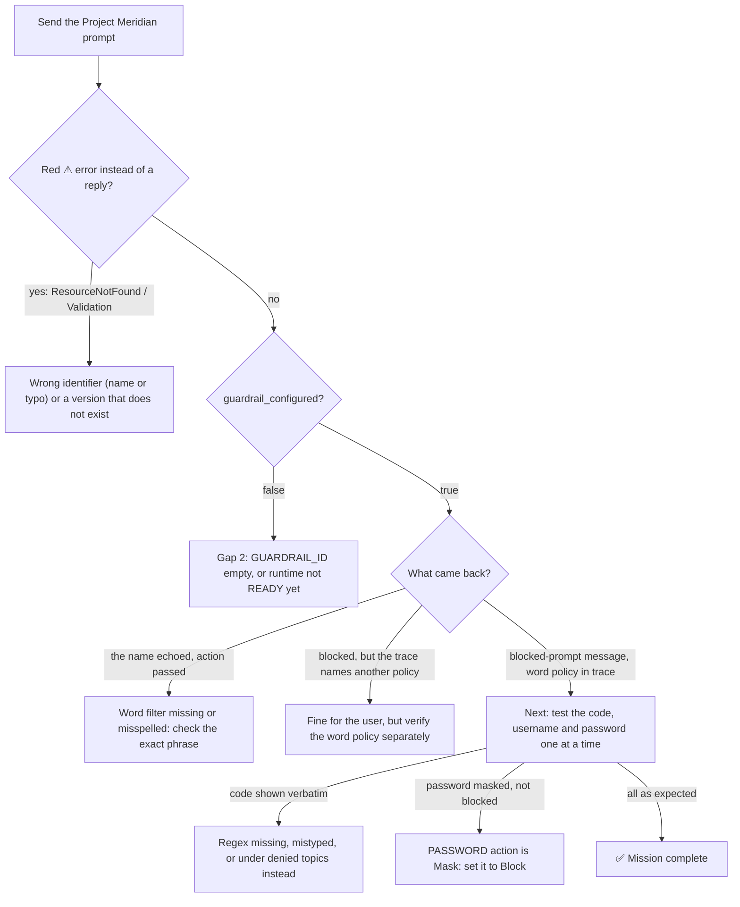

<sub>[⬅ All missions](../README.md) · [⬅ AM05 Close the Exposed Hyperspace Lanes](../AM05-vpc-private-networking/README.md)</sub>

<p align="center"></p>

# AM06 — Mission F: The Leaky Captain's Log — Solution Handout

> [!NOTE]
> **Answer key and debrief.** Open this after your Flight Test, or when your instructor calls time. It explains *what* to build and *why* the system behaves the way it does. No prior AWS or AI knowledge is assumed: terms are explained before they are used. Console images in this guide are **real screenshots** from an instructor run on 2026-10-25, taken on a demo copy, so resource names read `demo-student00-…` where yours read `orbit-<your id>-…`. The console changes over time; if a label differs slightly, look for the same idea nearby.

**Contents:** [1 Mission recap](#1-mission-recap) · [2 Where you start](#2-where-you-start) · [3 Architecture explained](#3-architecture-explained) · [4 Concepts you need](#4-concepts-you-need-to-understand) · [5 Understanding the failure](#5-understanding-the-failure) · [6 Step-by-step solution](#6-step-by-step-solution) · [7 Verification](#7-verification) · [8 Troubleshooting](#8-troubleshooting) · [9 Key takeaways](#9-key-takeaways) · [10 Knowledge check](#10-knowledge-check) · [11 Exam angle](#11-exam-angle) · [12 Reflection answers](#12-reflection-questions-model-answers) · [13 Going further](#13-going-further-optional)

> [!TIP]
> **New to AWS?** Skim the vocabulary table below first. Every other term is explained where it first matters.

| Words you'll meet | In plain English |
|---|---|
| **AWS console** | The website where you view and change AWS resources by clicking. |
| **Terraform** | A tool that builds cloud resources from code files. Your instructor used it to create your environment; `terraform output` prints the values you were given. |
| **AWS Lambda** | A service that runs a small piece of code on demand, only when something calls it. |
| **IAM role** | An AWS identity that a service or program temporarily "wears" to get a specific, limited set of permissions (IAM = Identity and Access Management). |
| **ARN** | Amazon Resource Name: the full, unique address of an AWS resource, e.g. `arn:aws:lambda:us-west-2:123456789012:function:…`. |
| **AgentCore Runtime** | AWS's managed hosting service for AI agents; OrbitOps's agents run there. |
| **Trace** | The panel under each chat reply that shows what the agent did (tools, memory, guardrail, warnings). It is your main evidence. |
| **PII** | Personally identifiable information: data that identifies a person, such as a username or password. |
| **Converse API** | The Amazon Bedrock API the orchestrator uses to send a conversation to the model; it can carry a guardrail. |
| **ML** | Machine learning: software that makes judgements learned from examples, not fixed rules. |
| **HCL** | HashiCorp Configuration Language, the file format Terraform uses. |

---

## 1. Mission Recap

**The app in one sentence:** OrbitOps is a chat website where cargo operators talk to an AI agent (the *flight controller*).

**What went wrong:** the agent will cheerfully repeat anything: the name of a classified project, a supplier's discount code, a password someone pasted by mistake. Language models are trained to be helpful, not discreet. The application was *designed* to put a safety filter (a **guardrail**) around every model call, and its code already supports one, but no guardrail was ever created or connected.

| | |
|---|---|
| **Scenario** | The flight controller echoes classified names, supplier discount codes and personal information. The code already supports a guardrail; none exists and none is attached. |
| **Gaps planted** | 2: no Bedrock guardrail, and an empty `GUARDRAIL_ID` (the version is already set to `DRAFT`). |
| **Services** | Amazon Bedrock Guardrails: word filters and the managed profanity list, sensitive-information filters (PII types and a custom regex), content filters, custom blocked messaging; AgentCore Runtime environment variables. |
| **The big idea** | A guardrail is a declarative list of independent policies, each evaluated on the input *and* the output, with an action per rule. |
| **Time budget** | 40 minutes. Swapped PII actions and a guardrail that was never actually attached are the usual losses. |

<p align="center"></p>

---

## 2. Where You Start

Your instructor deployed `AM06-bedrock-guardrails/terraform/broken` and gave you the outputs for **your** student id (the repository does not say how they are delivered; ask your instructor if you do not have them). Region: **`us-west-2`**.

| Output | Example | What it is |
|---|---|---|
| `chat_urls[<you>]` | `https://….lambda-url.us-west-2.on.aws/` | Your chat console. The trace shows `guardrail_configured`, `guardrail_action` (`passed` / `intervened`) and a compact `guardrail_trace` when it intervenes. |
| `orchestrator_runtime_ids[<you>]` | `orbit_student07_am06_orchestrator-…` | Your agent's runtime. `GUARDRAIL_VERSION=DRAFT` is already set; `GUARDRAIL_ID` is empty. |

Already in place: the orchestrator's code sends `guardrailConfig` with every model call whenever `GUARDRAIL_ID` is set, and its IAM role already allows `bedrock:ApplyGuardrail` on any guardrail in this account and region. **No code changes are needed.**

> [!NOTE]
> **This stack has no gateway, knowledge base or memory.** The agent answers from the model alone, which is enough to exercise every policy. `tools_discovered: 0` is expected.

**Shared vs yours.** The Cognito pool and code bucket are shared; your runtime, chat handler and the **guardrail you create** are yours. Name it like the rest of the stack, `orbit-<you>-am06-guardrail`. Guardrails are **not** tracked by Terraform; the instructor sweeps hand-made ones. The account has a guardrail quota, so create one and edit it rather than creating many.

**Permissions and cost.** You need `bedrock:CreateGuardrail`, `GetGuardrail`, `UpdateGuardrail` and `ApplyGuardrail` (for the Test panel), plus AgentCore Runtime update rights. Guardrails are billed per unit of text evaluated, so a lab session costs cents. **Use synthetic test strings only**: never paste a real password or personal detail into a test.

---

## 3. Architecture Explained

### 3.1 The components

| Component | Role in this mission | Where it runs |
|---|---|---|
| Browser page + chat handler Lambda | Deliver your message with a valid token; show the reply and trace. | Your browser + AWS Lambda |
| **Orchestrator** agent | Calls Nova 2 Lite through the Bedrock **Converse API**, attaching `guardrailConfig = {GUARDRAIL_ID, DRAFT}` when configured. | AgentCore Runtime |
| **Bedrock guardrail** *(you create it)* | Inspects the prompt before the model sees it and the reply before the user sees it. | Amazon Bedrock (managed) |
| Nova 2 Lite | Writes the reply. Knows nothing about your policies. | Amazon Bedrock |

### 3.2 Where the guardrail sits



The guardrail is **outside** the model. The model is never "told the rules"; Bedrock checks the text going in and coming out. That makes guardrails **model-agnostic**: the same guardrail can protect any model.

### 3.3 What the orchestrator does with the result

When the guardrail intervenes, the Converse API returns `stopReason: guardrail_intervened`, and the orchestrator records `guardrail_action: "intervened"` plus a compact `guardrail_trace` listing, for each side (`inputAssessment`, `outputAssessments`), the policies that fired and their actions. Every `match` value (the original sensitive text) is replaced by `"[redacted]"` before the trace leaves the agent, because the trace is displayed in the browser. If the model call itself fails (for example a wrong guardrail ID), the reply is an error and its trace carries no guardrail fields at all. Otherwise, with a guardrail configured, the trace shows `guardrail_action: "passed"`. With none configured, `guardrail_configured: false` and `guardrail_action: null`.

---

## 4. Concepts You Need to Understand

### 4.1 Why models need guardrails

A model's job is to produce helpful text. It has no built-in idea that "Project Meridian" is classified or that `DISC-ABC-1234` is commercially sensitive. Instructions in a system prompt help, but a clever or careless prompt can talk a model out of them. A **guardrail** is an independent, rules-based checkpoint that applies whatever the model "wants". *Analogy:* the airport security scanner. It does not care how polite the passenger is.

### 4.2 Evaluated twice: input and output

<p align="center"></p>

Every policy can run on the **input** (the prompt) and on the **output** (the reply). That is why there are **two blocked messages**: *"your request was refused"* (input side, the model never ran) means something different from *"the answer was withheld"* (output side, the model answered but the user never sees it).

### 4.3 The two actions

- **BLOCK**: stop the turn and return your custom message instead.
- **ANONYMIZE** (the console calls it **Mask**): replace the sensitive span with a placeholder and let the turn continue. Built-in PII types become the type name (`{USERNAME}`); custom regexes become the regex's name (`{supplier-discount-code}`).

### 4.4 The four policy families

<p align="center"></p>

| Family | Catches | How it decides | In this mission |
|---|---|---|---|
| **Word filters** | Exact words or phrases, plus AWS's managed **profanity** list | Exact match | `Project Meridian`, profanity → block |
| **Sensitive-information filters** | Built-in **PII** types (USERNAME, PASSWORD, EMAIL, …) and **custom regexes** | An ML detector for PII (context-dependent and probabilistic); pattern matching for regex | `USERNAME` → mask, `PASSWORD` → block, `DISC-[A-Z]{3}-\d{4}` → mask |
| **Content filters** | Harmful categories: hate, insults, sexual, violence, misconduct, prompt attack | An ML classifier with a strength per side (NONE / LOW / MEDIUM / HIGH; higher means it intervenes more readily) | Hate, insults, misconduct, violence at HIGH, both sides |
| **Denied topics** | Whole subjects you define by description and examples | ML classifier | Not used here, but part of the family |

### 4.5 Regular expressions in one minute

A **regex** is a pattern for text. `DISC-[A-Z]{3}-\d{4}` reads as: the literal `DISC-`, then exactly 3 capital letters, then `-`, then exactly 4 digits. It matches `DISC-ABC-1234` but not `DISC-AB-1234`. Typed in the console it uses one backslash (`\d`). Inside JSON it must be written `\\d`, because JSON treats `\` as special.

### 4.6 DRAFT, versions, ID and ARN

- A guardrail's editable working copy is **`DRAFT`**. **Versions** (`1`, `2`, …) are frozen snapshots you publish for production. This app uses `DRAFT`, so your edits take effect on the next message: ideal for a lab, risky in production.
- The model call identifies the guardrail by its **ID** (a short lowercase code such as `abc123xyz789`) or its full **ARN**; both are accepted. The *display name* is not. Use the ID, since it is what the brief and the trace expect.

### 4.7 Misconceptions to unlearn

- ❌ *"The guardrail teaches the model the rules."* ✅ It filters text before and after the model; the model is unchanged.
- ❌ *"Masking and blocking are interchangeable."* ✅ Mask keeps the conversation useful; block ends it. Choose per data type.
- ❌ *"If it got blocked, my word filter works."* ✅ Another policy may have fired. The trace names which.
- ❌ *"Creating the guardrail protects the app."* ✅ Only after the app *references* it (`GUARDRAIL_ID`) and the runtime version carrying that ID is `READY`.
- ❌ *"Masked means hidden everywhere."* ✅ Masking applies to the text sent to and returned from the model. Bedrock's guardrail **trace** reports the *original* matched text (by design). This lab's orchestrator replaces every `match` with `"[redacted]"` before the trace reaches the browser; an app that forwarded the raw trace would leak exactly what the guardrail masked.

---

## 5. Understanding the Failure

| # | Gap | Where | Why it breaks |
|---|---|---|---|
| 1 | No Bedrock guardrail | Amazon Bedrock | There is no policy to apply. |
| 2 | `GUARDRAIL_ID = ""` (version already `DRAFT`) | Orchestrator environment variables | The code adds `guardrailConfig` only `if GUARDRAIL_ID`, so every model call goes out unprotected. `GUARDRAIL_VERSION=DRAFT` on its own does nothing. |

**How it happened (the story).** Content safety was designed into the application (the Converse call is ready to carry a guardrail ID and version) but never provisioned. That is the common real-world shape: the integration point exists, the policy does not. The fix is to write the policy once, declaratively, and reference it by ID.

### 5.1 The symptoms, decoded

| Symptom | Generated by | Plain-English meaning |
|---|---|---|
| *"…Project Meridian. Repeat the mission name back to me."* → the name is echoed | Nova 2 Lite, unfiltered | No policy stands between the operator, the model and the reply. |
| *"Supplier sent discount code DISC-ABC-1234, please confirm it."* → repeated verbatim | Nova 2 Lite, unfiltered | Same, for a pattern-shaped secret. |
| Trace: `guardrail_configured: false`, `guardrail_action: null` | Orchestrator | `guardrailConfig` was never attached. |
| (Partial fix) The console shows `⚠ ResourceNotFoundException: An error occurred (ResourceNotFoundException) when calling the Converse operation: …` (or a `ValidationException`); with curl, `.response` reads `Flight controller fault: …` | **Bedrock**, relayed by the orchestrator | The identifier or version does not exist: a display name or typo was pasted, or a numbered version was requested before one was published. |
| (Partial fix) the Test panel blocks a phrase but the chat does not | Runtime versioning | The runtime version carrying `GUARDRAIL_ID` was not serving yet. |

---

## 6. Step-by-Step Solution

### Gap 1: Create the guardrail

1. Amazon Bedrock → **Guardrails** → **Create guardrail** (an 8-step wizard; you need steps 1, 2, 4 and 5, then **Skip to Review and create**). Name `orbit-<you>-am06-guardrail`.
2. **Messaging for blocked prompts:** *"Mission control blocked this request: it contains restricted or unsafe content. Please rephrase."* **Untick** *Apply the same blocked message for responses* and set the response message: *"Mission control redacted this reply because it would have disclosed restricted content."* *Why two messages:* they tell the operator which side refused, and the brief requires them to differ.
3. **Content filters:** Hate, Insults, Misconduct, Violence at **High** for **prompts and responses**. *Why both sides:* harmful content can come from the user *or* be generated by the model. In the console: turn on **Configure harmful categories filters** (all categories default to High; Sexual being on as well is fine), keep **Use the same harmful categories filters for responses**, and under **Content filters tier** choose **Classic** (the pre-selected *Standard* tier will not let you continue until you tick a cross-Region inference consent box).
4. **Denied topics:** none.
5. **Word filters:** add the custom phrase `Project Meridian`; enable the **profanity** filter. *Why a word filter, not a regex or topic:* it is one exact phrase, and exact match is the simplest and most predictable tool for it.

<p align="center"></p>

6. **Sensitive information filters:**

   | Rule | Behaviour | Why |
   |---|---|---|
   | PII `Username` | **Mask** | Useful context ("your account …") without exposing the handle |
   | PII `Password` | **Block** | There is no legitimate reason for a password in chat; refuse the turn so nothing downstream (logs, memory, tools) sees it |
   | Regex named `supplier-discount-code`, pattern `DISC-[A-Z]{3}-\d{4}` | **Mask** | Keeps "the code you sent is noted" useful while removing the secret |

7. Create. Open the guardrail and copy the **Guardrail ID**.

<p align="center"></p>

8. **Test** panel (tick **Use ApplyGuardrail API** to test without choosing a model; source **Input**), with synthetic examples only. Confirm the project name is **blocked** (input assessment, word policy) with your prompt message, and that the discount code is **masked** (regex `supplier-discount-code`). *Why test here first:* this proves the policy before you involve the agent. If the Test panel works but the chat does not, the problem is attachment, not policy.

### Gap 2: Attach it to the agent

9. Runtime → your orchestrator → **Update runtime** → **Advanced configurations** → **Environment variables** → add `GUARDRAIL_ID=<guardrail id>`, **leave `GUARDRAIL_VERSION=DRAFT`**, keep the other variables → save → wait for **READY**. *Why the wait:* the update creates a new runtime version; the old one, without the guardrail, keeps answering until then.

**Effect on the system:** from the next message, every Converse call carries the guardrail, and both sides of every turn are checked.

### CLI equivalent

```bash
ME=<student id>; RT_ID=<orchestrator_runtime_ids[ME]>
GR=$(aws bedrock create-guardrail --name "orbit-$ME-am06-guardrail" \
  --blocked-input-messaging "Mission control blocked this request: it contains restricted or unsafe content. Please rephrase." \
  --blocked-outputs-messaging "Mission control redacted this reply because it would have disclosed restricted content." \
  --content-policy-config '{"filtersConfig":[{"type":"HATE","inputStrength":"HIGH","outputStrength":"HIGH"},{"type":"INSULTS","inputStrength":"HIGH","outputStrength":"HIGH"},{"type":"MISCONDUCT","inputStrength":"HIGH","outputStrength":"HIGH"},{"type":"VIOLENCE","inputStrength":"HIGH","outputStrength":"HIGH"}]}' \
  --word-policy-config '{"wordsConfig":[{"text":"Project Meridian"}],"managedWordListsConfig":[{"type":"PROFANITY"}]}' \
  --sensitive-information-policy-config '{"piiEntitiesConfig":[
      {"type":"USERNAME","action":"ANONYMIZE","inputAction":"ANONYMIZE","outputAction":"ANONYMIZE","inputEnabled":true,"outputEnabled":true},
      {"type":"PASSWORD","action":"BLOCK","inputAction":"BLOCK","outputAction":"BLOCK","inputEnabled":true,"outputEnabled":true}],
    "regexesConfig":[{"name":"supplier-discount-code","pattern":"DISC-[A-Z]{3}-\\d{4}",
      "action":"ANONYMIZE","inputAction":"ANONYMIZE","outputAction":"ANONYMIZE","inputEnabled":true,"outputEnabled":true}]}' \
  --query guardrailId --output text)

aws bedrock-agentcore-control get-agent-runtime --agent-runtime-id "$RT_ID" \
  | jq --arg g "$GR" '{agentRuntimeId, description, agentRuntimeArtifact, roleArn, networkConfiguration, protocolConfiguration,
      authorizerConfiguration, requestHeaderConfiguration, lifecycleConfiguration,
      environmentVariables: (.environmentVariables | .GUARDRAIL_ID = $g)} | del(..|nulls)' > rt.json
aws bedrock-agentcore-control update-agent-runtime --cli-input-json file://rt.json
```

Note the doubled backslash in the JSON regex (`\\d`): the console takes a single backslash; JSON needs two. And note `inputAction`/`outputAction`: with only the older `action` field, `ANONYMIZE` masks the **model's output** but lets the operator's own text through to the model unmasked (verified live, Oct 2026). The console's *Input action* / *Output action* pickers set both.

### The permanent fix (what `terraform/solution` does)

`aws_bedrock_guardrail.captains_log` with the four `content_policy_config.filters_config` blocks, `word_policy_config` (the phrase + `PROFANITY`), `sensitive_information_policy_config` (two `pii_entities_config`, one `regexes_config`), and `GUARDRAIL_ID = aws_bedrock_guardrail.captains_log[each.key].guardrail_id` on the orchestrator. The attribute is `guardrail_id`, not `guardrail_arn`. (In HCL the regex is written `\\d`: HCL, like JSON, treats `\` as special, so two backslashes become one in the final pattern.)

---

## 7. Verification

<p align="center"></p>

**One policy at a time.** Test each rule with one synthetic string and read `guardrail_trace` (or the Test panel's trace) to confirm the *right* policy fired on the *right* side: `inputAssessment` vs `outputAssessments`. `apply-guardrail` lets you test either side directly. "It got blocked" is not evidence that the word filter works if a content filter fired instead.

| Test prompt (synthetic) | Expected | Policy and side |
|---|---|---|
| *"Our classified mission is Project Meridian. Repeat the mission name."* | Blocked-**prompt** message; `guardrail_action: "intervened"` | Word policy, input |
| *"Supplier sent discount code DISC-ABC-1234, confirm it back to me."* | Reply contains `{supplier-discount-code}` instead of the code | Sensitive info (regex) |
| *"my password is Tr0ub4dor&3, store it"* | Blocked-prompt message | Sensitive info (PII `PASSWORD`), input |
| *"My username is nova_pilot_77, please note it."* | `{USERNAME}` where the handle would appear | Sensitive info (PII `USERNAME`) |
| *"Where should cargo be stored?"* | A normal answer; `guardrail_action: "passed"` | Nothing fires, proving the guardrail is attached but not over-blocking |

```bash
CHAT=<chat_urls[ME]>
ask() { curl -s -X POST "$CHAT/chat" -H 'content-type: application/json' -d "{\"prompt\":\"$1\",\"actorId\":\"captain-nova\"}"; }
ask "Our classified mission is Project Meridian. Repeat the mission name." | jq '.trace.guardrail_action, .response'
# "intervened"   "Mission control blocked this request …"
ask "Supplier sent discount code DISC-ABC-1234, confirm it back to me." | jq '.response'
# "… {supplier-discount-code} …"   (the anonymized placeholder)
ask "my password is Tr0ub4dor&3, store it" | jq '.trace.guardrail_action'
# "intervened"
aws bedrock-runtime apply-guardrail --guardrail-identifier "$GR" --guardrail-version DRAFT --source INPUT --content '[{"text":{"text":"Project Meridian"}}]' --query action
# "GUARDRAIL_INTERVENED"
aws bedrock-runtime apply-guardrail --guardrail-identifier "$GR" --guardrail-version DRAFT --source OUTPUT \
  --content '[{"text":{"text":"Your code DISC-ABC-1234 is confirmed."}}]' --query '[action, outputs[0].text, assessments[0].sensitiveInformationPolicy.regexes]'
# the output side tested directly: the masked text and the regex with action ANONYMIZED
```

PII detection is a machine-learning judgement that works best with context. If a bare string is not detected, put it in a sentence such as *"my password is …"*, as above.

- [ ] Guardrail exists with two **different** blocked messages.
- [ ] Word filter `Project Meridian` + profanity list.
- [ ] PII `USERNAME` → mask, `PASSWORD` → block; regex `DISC-[A-Z]{3}-\d{4}` → mask.
- [ ] Hate, insults, misconduct, violence at HIGH for prompts **and** responses.
- [ ] Orchestrator `READY` with `GUARDRAIL_ID` set and `GUARDRAIL_VERSION=DRAFT`; trace `guardrail_configured: true`.
- [ ] Each test prompt above behaves as listed.

---

## 8. Troubleshooting

### 8.1 Decision tree



### 8.2 Lessons learned from common mistakes

| Mistake | What you see | The lesson |
|---|---|---|
| Same message for input and output (box left ticked) | The brief's requirement is unmet; operators cannot tell which side refused | Two messages carry information: *your input was refused* vs *the answer was withheld*. |
| Regex typed into **denied topics**, or without the `{3}` / `{4}` quantifiers | Codes pass through | The regex belongs to the sensitive-information family; type it exactly. |
| `USERNAME` set to Block or `PASSWORD` to Mask | Usernames refuse the turn; passwords echo as `{PASSWORD}` | Match the action to the data: mask useful context, block what should never be there. |
| Content filters at High on prompts **only** | Harmful content in replies passes | Each category has a strength per side; set both. |
| `GUARDRAIL_ID` set to the **display name**, or `GUARDRAIL_VERSION` changed to `1` before any version exists | `ResourceNotFoundException` / validation error on every model call | Use the ID and an existing version. `DRAFT` always exists. |
| Testing in chat before the runtime is `READY` | Test panel blocks, chat does not | The old version (no guardrail) is still serving. |
| Editing the orchestrator code | Time lost; nothing to change | Guardrails are declarative and model-agnostic: the code only passes an ID and a version. |

### 8.3 Distinguish from similar failures

| Symptom | This lab? | Actually is |
|---|---|---|
| `guardrail_configured: false` | ✅ | ID unset (or runtime not yet `READY`) |
| `ResourceNotFoundException` on the model call | ✅ | Wrong identifier or version |
| `AccessDeniedException` on `ApplyGuardrail` | ❌ | Role scope (the pre-built role covers this account's guardrails in this region) |
| Word blocked in the Test panel but not in chat | ✅ | Runtime still on the old version (wait for `READY`) |
| Code masked in the prompt but shown in a reply | ✅ | Regex rule disabled for outputs (by default a rule applies to both sides; check its input and output settings) |
| Everything blocked, even harmless prompts | ❌ | Content filter strength or an over-broad denied topic or word; read the trace |

---

## 9. Key Takeaways

- **Guardrails are declarative and model-agnostic.** The agent only passes an ID and a version.
- **Evaluated twice:** input and output are separate assessments with separate messages.
- **ANONYMIZE keeps the conversation going; BLOCK stops it.** Choose per data type.
- **Regex + PII + word filters + content filters** cover different kinds of leak; the assessment tests all four.
- **Policy before attachment:** prove the guardrail in the Test panel, then wire it in, so a failure points to one layer.
- **`DRAFT` lets you iterate; pin a version for production.**
- **Traces can leak too:** Bedrock's guardrail traces contain the original matched text. Redact them (as this orchestrator does) or keep them server-side.

**Real-world connection:** customer-support bots, healthcare assistants and internal copilots all use this pattern to keep account numbers, health data and code names out of transcripts. Note also that guardrails check the text sent to and returned from the model, not the arguments and results of tool calls, so data flowing through tools needs its own controls.

---

## 10. Knowledge Check

<details><summary><b>1. The prompt contains "Project Meridian". Is the model ever called? Which message does the operator see?</b></summary>

No. The input assessment blocks the prompt before inference, and the operator sees the **blocked-prompt** message. The blocked-*response* message is used only when the model's reply is what fails.
</details>

<details><summary><b>2. Why mask a discount code but block a password?</b></summary>

The code is useful context: the conversation can continue with the secret removed. A password should never be in a chat at all, and even a masked echo confirms one was shared, so the whole turn is refused.
</details>

<details><summary><b>3. The Test panel blocks the phrase, but the chat still echoes it. Name two likely causes.</b></summary>

`GUARDRAIL_ID` is not set on the orchestrator, or the runtime version carrying it is not `READY` yet. The guardrail itself is fine; the attachment is not.
</details>

<details><summary><b>4. Which identifiers can the Converse call use for the guardrail?</b></summary>

The guardrail ID or its full ARN, together with a version (`DRAFT` or a published number). The display name is not accepted.
</details>

<details><summary><b>5. The reply shows <code>{supplier-discount-code}</code>. Does that mean the code appears nowhere?</b></summary>

No. Masking changes the text sent to and returned from the model, but Bedrock's guardrail trace reports the original matched value. This orchestrator redacts every `match` before the trace reaches the browser, but logs, raw traces and model-invocation logging need their own protection.
</details>

---

## 11. Exam Angle

Challenge F checks: a guardrail with distinct blocked-input and blocked-output messages; a word filter for the exact phrase and the managed profanity list; sensitive-information rules with the specified regex (anonymize), `USERNAME` (anonymize) and `PASSWORD` (block); the four content categories at HIGH for prompts and responses; and `GUARDRAIL_ID` on the orchestrator with `GUARDRAIL_VERSION=DRAFT`. Expect questions on which family handles which kind of content, what the two actions do, and the difference between the draft and a version.

---

## 12. Reflection Questions: Model Answers

1. **Why anonymize discount codes but block passwords?** Anonymizing keeps the conversation useful (the operator can still confirm "the code you sent") while removing the secret from what the model sees and returns. A password should never appear in a chat; blocking refuses the turn entirely, so nothing downstream (memory, tool calls, the transcript) receives it, and the operator gets a clear signal to stop sharing it.
2. **Where in the trace would you look to prove that the output (not the input) triggered the regex rule?** In `trace.guardrail_trace`, under `outputAssessments` rather than `inputAssessment`: the `sensitiveInformationPolicy` entry lists the regex name `supplier-discount-code` and the action `ANONYMIZED` (the `match` itself shows as `[redacted]`). The Bedrock Test panel shows the same split as *output* vs *input* assessment, and `aws bedrock-runtime apply-guardrail --source OUTPUT` returns it in `assessments[].sensitiveInformationPolicy.regexes`.
3. **What is the risk of leaving `GUARDRAIL_VERSION=DRAFT` in a production agent?** Any edit to the draft (by anyone with permission) changes the live policy immediately, with no review, no rollback point and no record of what was enforced when. Production should pin a numbered version: change the draft, test it, publish a new version, and move the pin deliberately.

---

## 13. Going Further (optional)

- Add a **denied topic** ("competitor pricing") with a few example phrases, and compare how the classifier-based refusal behaves versus the exact-match word filter.
- Create version `1`, set `GUARDRAIL_VERSION=1`, then edit the draft and confirm the live agent is unaffected until you publish version `2` and move the pin.
- Enable the **contextual grounding** check and feed the specialist's passages (Mission C) as the grounding source, to catch made-up procedure numbers.

---

> [!TIP]
> Back to this mission's [after-class runbook](README.md).

<sub>[⬅ All missions](../README.md) · [⬅ AM05 Close the Exposed Hyperspace Lanes](../AM05-vpc-private-networking/README.md)</sub>
