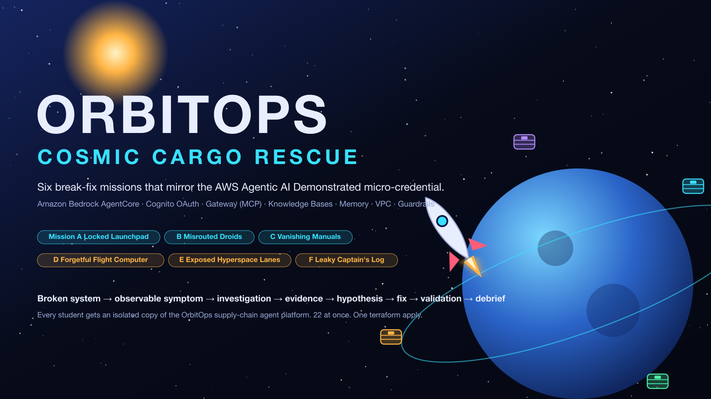

<p align="center"></p>

# Agentic AI on AWS: After-Class Terraform Kit

**Run every OrbitOps break-fix mission again, on your own, in your own AWS account.**

In class, your instructor deployed the broken environments and you fixed them in the console. This kit gives you everything you need to do the whole thing by yourself:

| | What you get |
|:-:|---|
| 🧨 | **The broken environment** for each mission (`student-terraform/`): one `terraform apply` and you're back at the start of the mission. |
| 📋 | **The mission handout** (`HANDOUT.md`): the same brief, concept briefing, investigation map and hint ladder you had in class. |
| 🤖 | **An automated Flight Test** (`tools/flight_test.py`): it tells you exactly which checks still fail, and confirms when you've fixed everything. |
| 📖 | **The full solution guide** (`SOLUTION.md`): root causes, concept deep dives, every console step with screenshots, the CLI equivalent, the exam angle and model answers. |
| ✅ | **The fixed environment** (`student-terraform-solution/`): deploy it to see the correct end state running, or `diff` it against the broken one to read every fix as code. |
| 🧹 | **Cleanup tools**: a preflight check before you start, and a leftover finder so nothing keeps billing after you finish. |

> **Verified, not just written:** on 2026-10-26 all 12 stacks were deployed into a real AWS account. Each broken stack failed its Flight Test exactly as its runbook says, each solution stack passed, and then all of them were destroyed. Measured deploy times are in each runbook.

---

## Quick start (about 20 minutes to your first mission)

```bash
git clone https://github.com/varoonsahgal/agentic-aws-after-class-terraform.git
cd agentic-aws-after-class-terraform

python3 tools/preflight.py                         # 1. is your machine + account ready?

cd AM01-cognito-oauth-launchpad/student-terraform  # 2. deploy a broken mission
terraform init
terraform apply -var 'student_id=jsmith42'         #    use your own 3–12 letter/digit id

python3 ../../tools/flight_test.py .               # 3. see what's broken (expect FAILs)
#   … fix it, using HANDOUT.md (no answers) …
python3 ../../tools/flight_test.py .               # 4. prove it's fixed (expect all PASS)

terraform destroy -var 'student_id=jsmith42'       # 5. tear it down
```

New to Terraform or AWS accounts? Start with **[01-SETUP.md](01-SETUP.md)**. It takes you from zero to a passing preflight.

## The guides

| Guide | Read it when |
|---|---|
| [**01-SETUP.md**](01-SETUP.md) | Before your first mission: AWS account, budget alarm, permissions, tools, preflight. |
| [**02-RUN-A-MISSION.md**](02-RUN-A-MISSION.md) | The step-by-step loop for any mission: deploy → investigate → fix → verify → compare with the solution → destroy. |
| [**03-COSTS-AND-CLEANUP.md**](03-COSTS-AND-CLEANUP.md) | Before you walk away from a running mission. |
| [**04-TROUBLESHOOTING.md**](04-TROUBLESHOOTING.md) | When `terraform`, the console or a Flight Test surprises you. |
| **Each mission's `README.md`** | The mission-specific runbook: time and cost, how to load your values into the shell, what to clean up by hand. |

## The missions

| | Mission | You'll practise | Fix time | Runbook |
|:-:|---|---|:-:|---|
| **A** | **The Locked Launchpad** | Cognito OAuth 2.0 M2M, AgentCore JWT authorizers, Lambda | 40 min | [AM01](AM01-cognito-oauth-launchpad/README.md) |
| **B** | **The Case of the Misrouted Cargo Droids** | AgentCore Gateway, MCP, Lambda targets, tool schemas | 40 min | [AM02](AM02-gateway-tool-routing/README.md) |
| **C** | **The Vanishing Starport Manuals** | Bedrock Knowledge Bases, S3 Vectors, AgentCore Runtime, agent-to-agent | 60 min | [AM03](AM03-knowledge-base-specialist/README.md) |
| **D** | **The Forgetful Flight Computer** | AgentCore Memory, strategies, namespaces | 35 min | [AM04](AM04-agentcore-memory/README.md) |
| **E** | **Close the Exposed Hyperspace Lanes** | VPC, PrivateLink interface endpoints, Runtime VPC mode | 45 min | [AM05](AM05-vpc-private-networking/README.md) |
| **F** | **The Leaky Captain's Log** | Bedrock Guardrails: words, PII, regex, content filters | 40 min | [AM06](AM06-bedrock-guardrails/README.md) |

Every mission is independent of the others, so you can do them in any order. If you're preparing for the assessment, **A → B → C → D → E → F** builds each idea on the last, and the whole set takes about two evenings.

## Every mission folder

```
AM02-gateway-tool-routing/
├── README.md                      ← start here: the runbook for this mission
├── HANDOUT.md                     ← the brief + hint ladder (no answers)
├── SOLUTION.md                    ← the answer key and debrief (spoilers!)
├── assets/                        ← diagrams and console screenshots used by both
├── student-terraform/             ← the BROKEN environment
└── student-terraform-solution/    ← the FIXED environment
```

## Three ways to use this kit

1. **Re-run the mission honestly.** Deploy the broken stack, keep `SOLUTION.md` closed, use the hint ladder, and let the Flight Test tell you when you're done. This is the best exam practice.
2. **Follow the solution step by step.** Deploy the broken stack and work through `SOLUTION.md` §6 in the console, or in the CLI with the values your mission README loads for you. Good for a mission you didn't finish in class.
3. **Study the end state.** Deploy `student-terraform-solution/`, explore what a correct setup looks like in the console, and `diff` the two `main.tf` files. Good for revision the night before.

## Also useful

- 📘 **[Agentic AI Field Guide](https://varoonsahgal.github.io/aws-agentic-ai-field-guide/)**: the course study guide, with every concept, a crib sheet and a glossary.
- 🧭 **[AWS Agentic AI Demonstrated micro-credential](https://skillbuilder.aws/learn/GTGKXBWUGU/aws-agentic-ai-demonstrated/SJK9ZKVCYU)**: the assessment these labs mirror.
- 📚 AWS docs: [AgentCore developer guide](https://docs.aws.amazon.com/bedrock-agentcore/latest/devguide/what-is-bedrock-agentcore.html) · [Knowledge Bases](https://docs.aws.amazon.com/bedrock/latest/userguide/knowledge-base.html) · [Guardrails](https://docs.aws.amazon.com/bedrock/latest/userguide/guardrails.html) · [Cognito app clients](https://docs.aws.amazon.com/cognito/latest/developerguide/user-pool-settings-client-apps.html)

## How these labs differ from the assessment

| The assessment | These labs | Why |
|---|---|---|
| OpenSearch Serverless vector store | **Amazon S3 Vectors** (same index name) | Costs cents instead of ~$350+/month. The console concepts are the same. |
| The orchestrator fetches its own Cognito token, so Mission E keeps a NAT gateway | The orchestrator **forwards your bearer token**; NAT is optional (`-var enable_nat_gateway=true`) | No NAT cost, with the same authorizer lessons. |
| Strands agents in containers | Plain Python agents via **direct code deployment** | No Docker needed, with the same runtime contract (`/invocations`, `/ping`). |

---

<sub>Please keep this repository private: the solution guides are the answer key for future classes. OrbitOps is a fictional company. AWS service names are trademarks of Amazon.com, Inc. or its affiliates.</sub>
